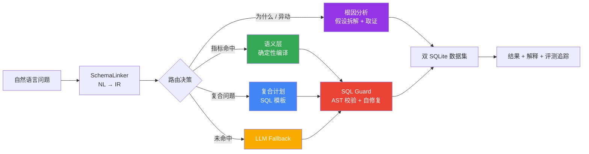

# NexusMind

<div align="center">

### 语义驱动的多智能体 ChatBI 与数据洞察系统

**把自然语言问题转化为可信 SQL、可解释归因和可验证的数据结论。**

[](https://www.python.org/)
[](https://fastapi.tiangolo.com/)
[](https://langchain-ai.github.io/langgraph/)
[](https://react.dev/)
[](https://sqlite.org/)
[](https://github.com/tobymao/sqlglot)

</div>

---

## 为什么是 NexusMind

大多数 NL2SQL 项目把自然语言直接交给 LLM 生成 SQL，但这会带来指标口径漂移、JOIN 路径失控、结果可执行却不可信等问题。

NexusMind 的核心原则是：**能确定的，不交给概率。** 系统将问题先解析为结构化中间表示（IR），对已定义业务指标走语义层确定性编译；对复杂复合分析走计划模板；对陌生问题才降级到 LLM 生成，并通过 SQL 守卫、字段级评测与全链路观测构成闭环。



## 项目亮点

| 高频方向 | 核心实现 | 可讲的价值 |
|---|---|---|
| 记忆系统 | 语义 / 情节 / 程序性三级长期记忆 + Redis 会话快照 + PostgreSQL 持久化 | 既保留稳定用户偏好，又不把一次性上下文无限塞进 Prompt |
| 上下文工程 | 工具结果两级截断、近轮保留、压缩前 Transcript 归档到 `ContextStore`、`recall_context` 按关键词延迟加载 | 将上下文截断从“直接丢信息”改为“可检索的按需回忆” |
| RAG + Rerank | 父子块切分、Milvus 稠密向量 + BM25 稀疏检索 + RRF 融合 + rerank | 兼顾召回率、关键词精确性与最终上下文完整度，并具备降级路径 |
| Agent 编排 | LangGraph Supervisor / ReAct / Coordinator / Reflection | 简单问题走快速路径，工具复合问题走循环，跨域任务拆解后并行执行 |
| MCP 与 Skills | 工具按 MCP 概念模型做发现、LLM 重排、参数推断与调用路由；Skills 动态注入流程知识 | 把模型能力与外部能力解耦，新增工具或流程不必改 Agent 主链路 |
| Schema 索引 | Domain → Table → Column 三级收敛，融合 DDL、业务定义和 SQL 示例的混合检索 | 降低大 Schema 噪声，减少选错表列，并为动态 Few-shot 提供样例 |
| NL2SQL 优化 | `MetricPlanCompiler`：14 指标、18 维度、NL → IR → 确定性 SQL；6 类复合计划 | 已定义口径不交给 LLM 概率生成，保证 JOIN、聚合和业务指标可审计 |
| SQL Guard | sqlglot AST 校验 → 执行反馈自修复 → 空结果 / LIMIT / NULL / 比率合理性检查 | 防止“可执行但不可用”的静默错误，并阻断非只读 SQL |
| 评测体系 | 域内、复合、泛化、Spider 四套评测；EX + 表命中率 + 行召回率 + 字段准确率 | 区分域内系统收益和开放域模型能力，失败可定位到表、行或单元格 |
| 可观测与审计 | JSONL Trace、错误 / 慢查询采样、IR / SQL / 路由链路记录 | 让每一次结论可复核，线上问题可定位 |

## 面试常考设计点

### 记忆系统：如何兼顾多轮连贯性和上下文成本？

NexusMind 将短期与长期记忆拆开。短期对话由 Redis 检查点与最近轮次上下文保证连贯；长期信息则按语义记忆、情节记忆和程序性记忆分类沉淀到持久层，并按照语义相似度、时近性和重要性进行融合排序。这样“用户偏好的指标口径”可以跨会话复用，而一次性的 SQL 结果不会无边界占用上下文窗口。

### 上下文工程：超长工具结果如何避免丢失？

工具输出先经过两级截断，避免单次查询挤占模型上下文；被截断的超长结果和压缩前会话会带 `ref_id` 归档到 `ContextStore`。后续 Agent 可通过 `recall_context` 按关键词、尾部或完整内容召回。这个设计的关键不是“压缩得更短”，而是把信息损失改造成可控的延迟加载。

### RAG + Rerank：为什么不是只做向量检索？

文档采用父子块策略：子块用于精细召回，父块用于恢复完整上下文；检索同时使用 Milvus 稠密向量、BM25 稀疏关键词和 RRF 融合，然后交给 rerank 重排。向量检索处理语义改写，BM25 保住表名、字段名等精确术语，rerank 在候选集合中筛选最相关证据。系统还保留混合检索失败降级为稠密检索、rerank 失败回退 RRF 的路径，优先保证可用性。

### Agent 编排：为什么不只用一个 ReAct Agent？

单 Agent 适合轻量工具调用，但复杂任务会出现无谓循环、上下文膨胀和工具选择混乱。系统用 Supervisor 做首层路由：直接查询走快速链路；“顺便 / 同时 / 还有”等复合工具需求进入 ReAct 循环；业务、知识、历史等多个模块同时涉及时，Coordinator 用更强模型拆解子任务并行派发；最终 Reflection 对低质量答案请求 Advisor 给出定向改进建议，而不是盲目重试。

### MCP 与 Skills：如何支持外部能力扩展？

MCP（Model Context Protocol）是 Anthropic 开源的工具接入开放标准：Host 内嵌 Client 与提供能力的 Server 之间基于 JSON-RPC 2.0 通信，传输分 stdio 与 Streamable HTTP，能力分 Tools / Resources / Prompts 三类原语，会话经历 initialize → operation → shutdown 的生命周期。本项目的工具发现、LLM 重排与调用路由沿用这一概念模型，内部工具统一注册、无差别路由。Skills 则承载可复用的业务 SOP 与约束，通过检索动态注入 Prompt。前者解决“怎么接工具”，后者解决“调用工具时遵循什么流程”。

### Schema 索引：如何在大库里减少表列幻觉？

Schema 检索不把全量 DDL 直接塞给模型，而是先按领域、表、列三级收敛候选范围；语料同时包含 DDL、业务定义和历史 SQL 示例，并可动态挑选 Few-shot。对于开放域 Spider，脚本从 SQLite 的 DDL、外键和每表采样行构造 Schema Prompt，因此表命中率达到 97.0%。

### 自然语言转 SQL：具体做了哪些优化？

系统不是单一 Prompt。第一步是 SchemaLinker 抽取指标、维度、过滤、排序和 LIMIT，形成可检查的 IR；第二步按置信度路由到语义编译、复合模板、根因规划或 LLM fallback。语义层将 14 个指标与 18 个维度的口径、JOIN 路径和聚合逻辑固化为代码，复合计划覆盖多指标与派生比率；最后 SQL Guard 负责只读 AST 校验、方言问题修复和执行结果合理性检查。优化目标不是让模型“写得更像 SQL”，而是让查询结果更稳定、更可审计。

### 评测：为什么保留四项核心指标？

EX 只回答“最终结果是否正确”，无法说明错误发生在哪里。因此保留表命中率、行召回率和字段准确率，形成“选对表 → 查全行 → 值准确 → 整体对”的诊断链。组件级 EM、平均 Jaccard 等指标要么会受等价 SQL 写法干扰，要么只是 EX 的派生统计，所以不作为主叙事指标。四套评测分开报告，也避免把定制语义层的域内能力与开放域 LLM 裸能力混为一谈。

## 可量化结果

### 四套独立评测

| 评测集 | 题数 | EX | 覆盖目标 |
|---|---:|---:|---|
| 域内端到端集 | 15 | **100%（15/15）** | 语义层、复合计划、LLM fallback 混合链路 |
| 复合专项集 | 12 | **100%（12/12）** | 6 类复合计划及每类两种自然语言改写 |
| 域内泛化集 | 10 | **80%（8/10）** | 未见过的业务表述泛化能力 |
| Spider dev 全 20 库 | 99 | **78.8%（78/99，严格判等）** | 真实开放域 SQLite 数据、无语义层的 LLM 裸能力 |

### Spider 开放域四项核心指标

| 指标 | 结果 | 衡量的问题 |
|---|---:|---|
| EX（执行准确率，严格判等） | **78.8%（78/99）** | 结果集与 Gold SQL 完全一致 |
| 部分正确（Jaccard ≥ 0.8，不计入 EX） | 3 题 | 结果集高度重叠但不完全相等 |
| 表命中率（Schema Linking） | **97.0%（96/99）** | 是否选择了正确的表 |
| 行召回率（Field Recall） | **0.851** | Gold 中应返回的行是否被查全 |
| 字段准确率（Cell Accuracy） | **0.898** | 已匹配行中的单元格值是否正确 |

这四项指标对应一条完整验证链路：**选对表 → 查全行 → 值准确 → 整体对**。Spider 评测覆盖 20 个异构数据库、99 个问题，其中 10 个数据库达到 EX 满分；在无 few-shot、无自我一致性的 zero-shot 设定下，严格判等口径 EX 为 78.8%（另有 3 题 Jaccard ≥ 0.8 的部分正确，宽松口径合计 81.8%）。完整数据见 [`docs/eval_spider.json`](docs/eval_spider.json)，评测报告见 [`docs/evaluation_report.md`](docs/evaluation_report.md)。

## 核心能力

### 1. 可信 Text2SQL：从自然语言到确定性 SQL

```text
问题：最近三个月各品类销售额排名

SchemaLinker
  └─> IR: {
        metrics: [revenue],
        dimensions: [product_category],
        filters: [last_3_months],
        sort: revenue_desc
      }

MetricPlanCompiler
  └─> 选择指标定义、正确 JOIN 路径、GROUP BY 与排序规则
  └─> 输出可审计 SQL
```

语义层命中时，SQL 由编译器生成而非 LLM 即兴生成；未命中的开放问题才使用 LLM fallback。这使业务口径、关联路径和降级原因都可追溯。

### 2. SQL Guard：让“能执行”不等于“可信”

SQL Guard 分为三层：静态阶段用 `sqlglot` 解析 AST，拒绝写操作、无效表列与不兼容函数；执行阶段将数据库错误连同 Schema 反馈给模型，最多进行两轮自修复；结果阶段检查空结果、Top-N 与 LIMIT 一致性、NULL 占比和异常比率，识别“SQL 成功但结论不可用”的静默错误。

### 3. 评测与可观测：让每一次结论可复核

系统通过域内、复合、泛化和 Spider 四套独立评测区分工程体系收益与开放域泛化能力；线上 Trace 记录问题、Schema Linking IR、最终 SQL、执行耗时和错误上下文。EX 用于最终结果判定，表命中率、行召回率和字段准确率用于定位失败发生在选表、结果行还是单元格值。

## 数据与技术架构

| 类别 | 选型与规模 |
|---|---|
| 域内数据 | Olist 巴西电商：14,747 笔订单、9 张表、8.9MB；Chinook 数字媒体：11 张表、984KB |
| 开放域数据 | Spider dev：20 个异构 SQLite 数据库、99 题评测样本 |
| 多智能体编排 | LangGraph StateGraph：Supervisor、ReAct、Coordinator、Reflection |
| 后端 | Python + FastAPI + LangChain / LangGraph |
| 前端 | Vite + React 19 + TypeScript + ECharts |
| SQL 基础设施 | SQLite ATTACH 跨库查询 + sqlglot 26.33.0 |
| 检索与记忆 | Milvus、BM25 稀疏检索、RRF 融合、rerank、Redis、PostgreSQL |
| 工程规模 | 12 个 ChatBI 核心模块、4 组评测脚本、34 项回归测试 |

## 项目结构

```text
NexusMind/
├── backend/
│   ├── chatbi/                 # ChatBI 核心：语义层、路由、SQL Guard、根因、字段评测
│   ├── core/                   # LangGraph 编排、多 Agent 协作、上下文管理
│   ├── evaluation/             # 评测、自进化、在线监控
│   ├── rag/                    # 文档处理、混合检索、Embedding Provider
│   ├── memory/                 # 会话恢复与长期记忆
│   └── tools/                  # SQL 执行与工具注册
├── frontend/                   # React ChatBI 控制台（对话、评测、监控、审计等页面）
├── data/
│   ├── olist.sqlite            # 电商数据集
│   ├── chinook.sqlite          # 数字媒体数据集
│   └── spider/                 # Spider 原始 SQLite 数据库
├── scripts/
│   ├── eval_chatbi.py          # 域内端到端评测
│   ├── eval_compound.py        # 复合指标专项评测
│   ├── eval_generalization.py  # 域内泛化评测
│   └── eval_spider.py          # Spider 开放域评测
├── tests/                      # 34 项回归测试
└── docs/                       # 架构、评测、项目亮点与面试材料
```

## 快速开始

### 1. 准备环境

要求 Python 3.12+、Node.js 20+；如需运行完整 RAG、记忆和多智能体服务，还需 Docker Compose。

```bash
git clone https://github.com/Dreamt0511/NexusMind.git
cd NexusMind

python3 -m venv .venv
source .venv/bin/activate
pip install -r requirements.txt
```

复制并填写本地环境变量文件。至少配置一个 OpenAI 兼容 LLM 服务；Embedding/Rerank 可以按需启用。

```bash
cp .env.example .env
```

```env
# Text2SQL / Agent 模型
DASHSCOPE_API_KEY=your_api_key
BASE_URL=https://api.deepseek.com/v1
AGENT_BASE_MODEL=deepseek-chat

# 可选：Embedding 与 rerank
EMBEDDING_PROVIDER=siliconflow
EMBEDDING_MODEL=BAAI/bge-m3
EMBEDDING_API_KEY=your_embedding_api_key
```

### 2. 启动后端与前端

```bash
# Terminal 1：FastAPI 后端
cd backend
PYTHONPATH=. uvicorn main:app --reload --port 8000
```

```bash
# Terminal 2：React 前端
cd frontend
npm install
npm run dev
```

后端 API 文档默认位于 `http://localhost:8000/docs`；前端开发服务器地址以 Vite 输出为准。

### 3. 使用 Docker 启动完整基础设施（可选）

Docker Compose 会启动 Milvus、etcd、MinIO、PostgreSQL、Redis 与 FastAPI 后端。

```bash
docker compose up -d
docker compose ps
```

## 运行评测

所有评测脚本输出原始 JSON 到 `docs/`，便于复核每一个问题的 Gold SQL、Agent SQL、执行结果与字段级指标。

```bash
# 进入项目根目录，确保 .env 中已配置 LLM
PYTHONUNBUFFERED=1 .venv/bin/python scripts/eval_chatbi.py
PYTHONUNBUFFERED=1 .venv/bin/python scripts/eval_compound.py
PYTHONUNBUFFERED=1 .venv/bin/python scripts/eval_generalization.py
PYTHONUNBUFFERED=1 .venv/bin/python scripts/eval_spider.py
```

> Spider 评测默认会调用 LLM，并使用本地 `data/spider/spider_data/` 的真实数据库；首次运行前请确认数据文件已经准备完成。

## 关键文档

| 文档 | 内容 |
|---|---|
| [`docs/PROJECT_HIGHLIGHTS.md`](docs/PROJECT_HIGHLIGHTS.md) | 项目亮点总览与架构、评测图表 |
| [`docs/CHATBI_UPGRADE.md`](docs/CHATBI_UPGRADE.md) | ChatBI 演进过程、设计细节与失败案例归因 |
| [`docs/evaluation_report.md`](docs/evaluation_report.md) | 四套评测报告与 Spider 全库结果 |
| [`docs/eval_spider.json`](docs/eval_spider.json) | 99 个 Spider 样本的可复核原始评测数据 |
| [`docs/INTERVIEW_GUIDE.md`](docs/INTERVIEW_GUIDE.md) | 项目介绍、面试话术与 20 个深度 Q&A |

## 设计取舍

NexusMind 不宣称在任何陌生数据库上都能达到域内确定性编译的效果。域内 100% EX 来自“语义层 + SQL Guard + 评测驱动迭代”的系统设计；Spider 严格口径 78.8% 则刻画了脱离定制语义层后的开放域零样本能力。将两者分开报告，是为了区分工程体系收益与底座模型能力，也让后续优化有明确方向。

---

<div align="center">

**NexusMind — 连接业务语义与数据决策的智能分析中枢。**

</div>
