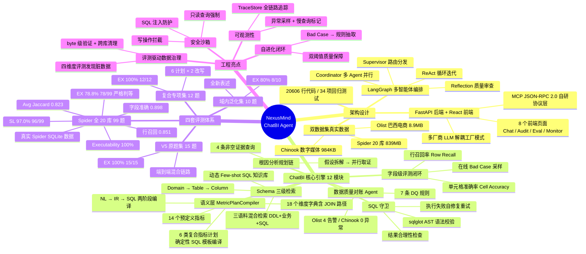
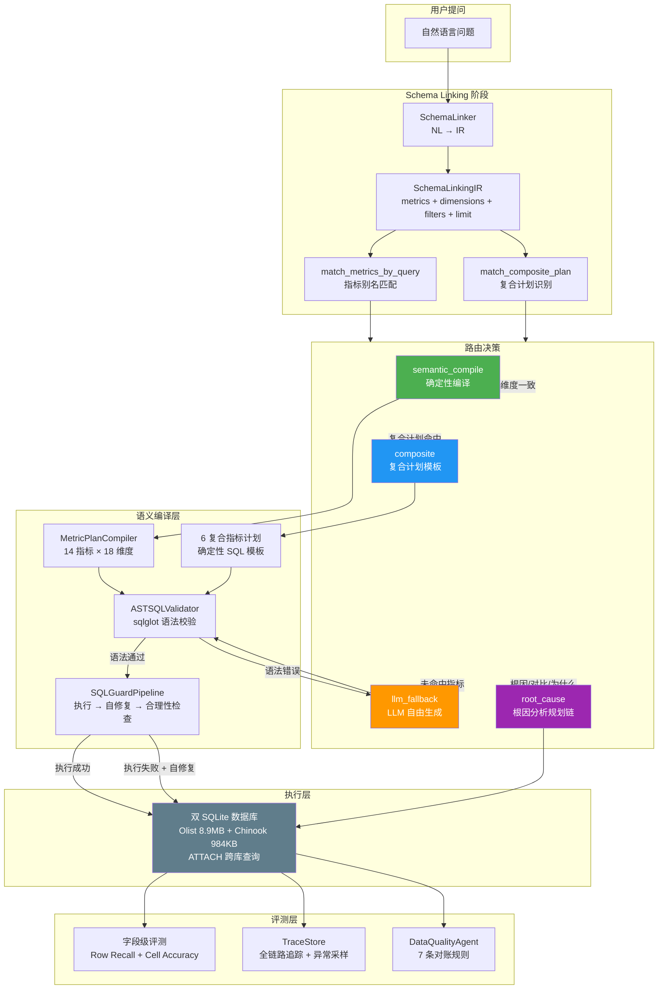
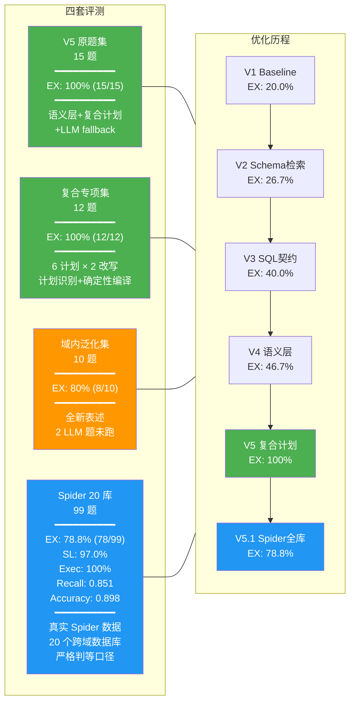
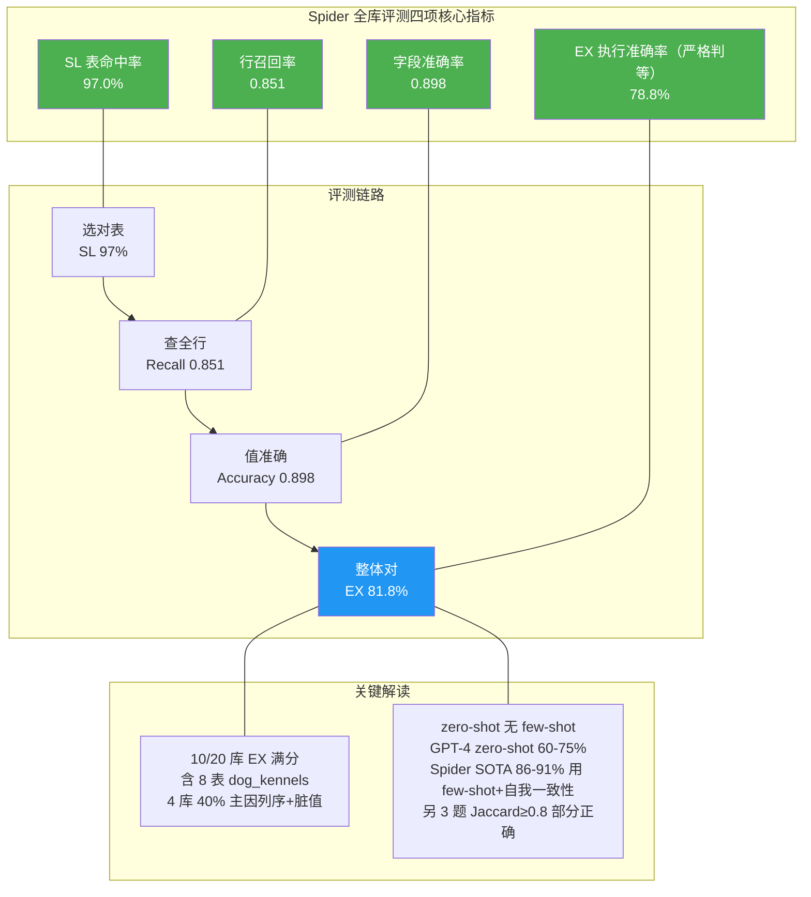

# NexusMind 项目亮点总览

## 架构流程图

## 评测结果对比

## Spider 四项核心指标

## 数据规模与技术栈

| 维度 | 数据 |
|------|------|
| 总代码行数 | 20,606 行（Python 6,830 + TypeScript/React + 配置） |
| ChatBI 核心模块 | 12 个 Python 模块，2,405 行 |
| 评测脚本 | 4 个，1,348 行 |
| 回归测试 | 34 项，352 行 |
| 文档 | 7 份，1,834 行 |
| 域内数据 | Olist 8.9MB（14,747 订单）+ Chinook 984KB |
| Spider 数据 | 20 个 dev 数据库，839MB 真实数据 |
| 后端 | FastAPI + LangGraph + Milvus + Redis + PostgreSQL |
| 前端 | Vite + React + TypeScript，8 个页面 |
| LLM | DeepSeek v4-flash（text2sql）+ SiliconFlow bge-m3（embedding） |
| 评测指标 | 4 项（EX / SL / 行召回率 / 字段准确率） |
| 评测套件 | 4 套（V5 原题 / 复合专项 / 域内泛化 / Spider 全库） |
