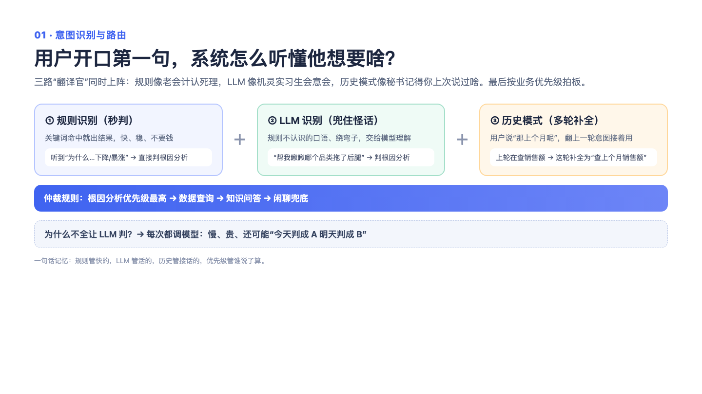

# 01｜意图识别与 ChatBI 路由：先听懂你想要啥，再决定派谁干活

> 一句话记住它：餐厅迎宾员——先弄清你是堂食、外带还是等位，再把你领到对的窗口。

## 这到底是个啥？

想象你走进一家大餐厅，门口站着一位迎宾员。你说"来碗面"，他把你领到堂食区；你说"打包带走"，他指给你外带窗口；你说"我就问下今天有啥活动"，他直接把海报给你看——不浪费后厨一颗盐。

我们的系统也有一位这样的迎宾员。用户问"为什么这个月销量下降了？"和"什么是 RFM 分析？"，字面都跟数据沾边，但一个要真去查库算账，一个只需要翻翻知识库。意图识别干的就是这个分诊的活儿。而且这位迎宾员不是一个人在战斗：他心里住着三个帮手——一个是背熟了店规的老员工（关键词规则，看到"为什么……下降"就秒懂）、一个是脑子活络但偶尔走神的聪明经理（大模型，什么话都能听个八九不离十）、还有一份常客档案（这个用户前面几轮在聊啥）。三个人各给一个判断，最后加权合计出一个结论。要是三个人吵得不可开交、谁也没把握，迎宾员会老实反问一句："您是想查数据，还是想了解概念？"——宁可多问一句，绝不瞎猜一路。

## 面试官会问啥？

### Q1: 为什么不干脆全靠大模型分类？它不是最聪明吗？
**答：**
聪明人也有打盹的时候。大模型偶尔会输出格式不对、调用失败，这种时候要是没有备用方案，整个系统就瘫在门口了。所以我们的设计是"老员工兜底 + 经理主判 + 常客档案辅助"：关键词规则又快又稳，大模型负责理解千奇百怪的说法，历史记录提供一点倾向性参考。三者权重不一样，大模型拿大头（一半），规则三成，历史两成。这就像重要决定不能只听一个人的——万一那个人今天没睡醒呢。

### Q2: 规则和模型结论打架了，听谁的？
**答：**
分情况。如果老员工拍着胸脯说"这是问到具体业务了"（比如问到根因分析、数据对比这种明确的活儿），而经理却说"这就是个闲聊"，我们信老员工——因为业务关键词的误判代价太高，把一个真实的数据需求当闲聊打发走，用户会当场翻脸。但如果是两个都言之凿凿的业务判断在打架，就还是回到加权投票，让模型的大权重说话。一句话：明确的业务信号优先，模糊的分歧靠投票。

### Q3: 拿不准的时候怎么办？硬猜一个吗？
**答：**
不猜，反问。置信度低于一个门槛时，系统会直接返回一个澄清问题，比如"您是想看具体数据，还是想了解这个概念？"。这听起来像认怂，其实是聪明的保守主义：猜错了路由，后面整条链路（查库、跑分析）全是白干，成本和体验双输；多问一句的成本几乎为零。就像点单员听到"来个那个"时，问一句"您是说这个吗"永远不丢人。

### Q4: 历史记录那个帮手靠谱吗？会不会把人带沟里？
**答：**
会，所以只给它两成的最小话语权。它的逻辑是"这个用户前面五轮都在做数据分析，那这句话大概率也是"，适合补个倾向，不适合拍板。而且新对话开始时它一片空白，直接闭嘴。真正处理"它指的是啥"这类指代问题的是另一个环节（改写器），历史模式只是个弱提示。用人的话讲：常客档案帮你记住熟客爱吃什么，但今天他想换口味，你还得听他本人说。

### Q5: "为什么销量下降"为什么要单独当成一类意图？
**答：**
因为它压根不是"查个数"能回答的问题。它是个侦探活：要提假设（是不是大促？是不是某个品类拖后腿？）、一条条查证据、最后综合写结论——流程和普通查询完全不同。如果把它当普通查询路由过去，就等于让收银员去破案，顶多给你一个数字，给不了你"为什么"。所以根因分析是独立的一类意图，走专属的取证链路。

### Q6: 这套东西上线后效果怎么证明？提升了多少准确率？
**答：**
机制层面可以说得很清楚：有降级（模型挂了规则顶上）、有容错（解析失败不崩）、有澄清（低置信反问）、有记录（每轮意图存档）。但量化的准确率数据目前没有，我不编。要说的是设计逻辑：错误路由的代价是后面整条链路白跑，所以宁可在这第一步多花点心思。这跟体检一个道理——第一道分诊错了，后面的检查全白做。

## 记忆口诀

迎宾员带三个帮手：老员工兜底、聪明经理主判、常客档案打辅助；吵不清楚就反问，绝不瞎猜带你走错门。
