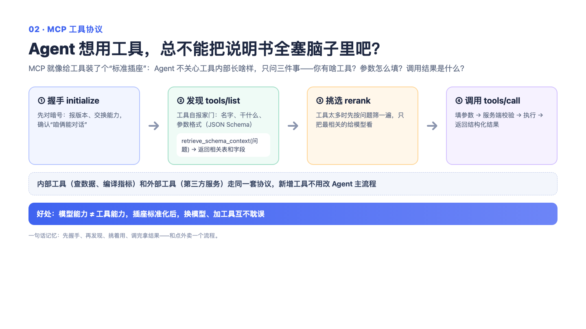

# 02｜MCP 工具协议与发现：给 AI 世界的所有能力装上统一插座

> 一句话记住它：USB-C 接口——充电宝、键盘、硬盘长得五花八门，但插上电脑就能用。

## 这到底是个啥？

想象一个办公室，桌上摆着几十台设备：打印机、扫描仪、咖啡机……如果每台设备都有自己的插头标准，电工得疯。于是有了统一插座：只要符合标准，谁来都能插上就用。

AI Agent 的世界有一样的问题：查数据、查文档、查记忆、跑分析……这些能力五花八门，如果每个都自己发明一套接入方式，主程序很快就成了一锅意大利面。MCP（模型上下文协议）就是那个统一插座。每个能力按标准格式登记一份"说明书"——我叫什么、我干什么、你需要给我什么参数——然后统一挂到一个服务台上。Agent 要干活时，先问服务台要一份完整的能力清单（就像翻菜单），让模型挑出最对口的几道菜，再按说明书点单、拿结果。外部的服务也一样：接进来的时候先握个手对个暗号，然后把它的工具也挂到这块插座上，Agent 根本分不清也不需要分清哪个能力是自家的、哪个是外面的。

## 面试官会问啥？

### Q1: MCP 到底解决了什么问题？不用它行不行？
**答：**
不用也行，就像没有 USB-C 之前大家也活了几十年——只不过每接一个新设备就要重新拧一次螺丝。直接把工具函数写进 Agent 的问题是：工具的定义、调用、报错、记录全搅在一起，工具一多就乱。MCP 给的是一套最简契约：怎么列清单、怎么调用、错了怎么报，全有标准格式。最大的实际收益是加新能力不用动主流程——新工具登记上来，Agent 自动就能看到它。就像商场招商，柜台按标准入驻，导购图自动更新。

### Q2: 工具一大堆，模型怎么知道该用哪个？
**答：**
两步走。先看菜单——所有已注册的工具连同说明书都在清单里；然后让模型自己当美食评委，给每道菜和当前问题的相关度打零到十分，取分数最高的几个来用。这比关键词匹配聪明，因为"销售额走势"和"趋势查询"这种换个说法的匹配，关键词根本对不上。当然评委偶尔也会失灵，失灵的时候就退化成"按默认顺序取前几个"——排序质量降了，但单还是能点出去，不会卡死在门口。

### Q3: 为什么要自己实现这套协议，不用官方现成的 SDK？
**答：**
一个很朴素的理由：怕依赖打架。官方 SDK 背后牵着一串依赖库，跟项目里已有的东西版本冲突时，排错能排到怀疑人生。而协议本身其实很薄——就是一套固定格式的请求和响应，外加错误码。自己实现确实要处理一些脏活，比如子进程的输出可能夹杂着日志、多个请求的回信可能交错到达，得靠编号把每一问一答对上号。但换来的自主权值这个价。这就像自带餐具去食堂：麻烦一点，但永远不用担心食堂换供应商。

### Q4: 外部工具和自家工具撞名了怎么办？
**答：**
给外部工具冠上姓——哪个服务器的，就姓哪个服务器名，像"某某家的查询工具"一样。一来天然隔离，两家服务器都有个叫"查询"的工具也不打架；二来看日志一眼就知道这个工具是哪来的。对 Agent 来说内外无感，统一的菜单统一的点法。

### Q5: 如果工具涨到几百上千个，这套还撑得住吗？
**答：**
说实话，直接把几百份说明书塞给评委打分，又贵又乱——评委光读完菜单就饱了。合理的演进是两级漏斗：先粗筛（按类别或语义相似度捞出一小撮），再让模型对这一小撮精排。这是个清晰的设计方向，但要说实话：当前实现还没做这一层，属于"知道路在哪，还没铺"。面试里把边界说清楚，比吹牛加分。

### Q6: 结果的格式上有什么特别的讲究吗？
**答：**
有一个小巧思：每个工具的结果都带上工具名做前缀。格式上讲这不算"纯洁"，但下游要展示来源、要评测哪个工具干得好，靠这个前缀一眼就能识别。算是为了实用性牺牲了一点格式洁癖——就像快递盒上贴的面单，不好看，但没它分拣中心就得瘫痪。

## 记忆口诀

统一插座加一份菜单：能力按标准入驻，Agent 翻菜单、打分点菜、按格式收货；评委失灵就按默认顺序上菜，绝不让客人饿着。
