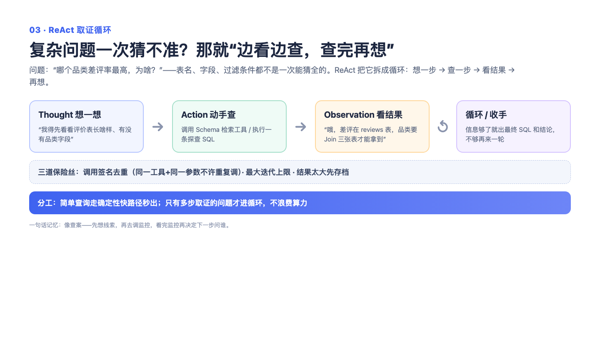

# 03｜ReAct 循环：像医生看病一样，看到检查结果再决定下一步

> 一句话记住它：看病式工作流——先验血，看报告，再决定要不要拍 CT，而不是一口气开十八项检查。

## 这到底是个啥？

你去医院说"我最近不舒服"。糟糕的医生会一次给你开十八项检查，好的医生是先验个血，看着化验单想一想，"嗯，再拍个片子"，看完片子再决定要不要做别的。每一步都由上一步的发现驱动。

Agent 处理复杂的数据问题也是这样。用户问："先看看各品类销售额，再查查卖得最差的那个品类最近三个月的走势。"注意，后半句的查询条件——查哪个品类——得等前半句的结果出来才知道。这就没法"一次规划到位"，只能让模型循环干活：想一想 → 调个工具 → 看看结果 → 再想一想，直到它觉得证据够了，才输出答案。这个"边看边决定"的循环就叫 ReAct。当然，循环这东西失控起来也很吓人——想象一个疑心病患者无限复查。所以我们给它配了两道保险：最多五轮，到点强制让医生"基于已有化验单直接下诊断"；还有个病历本，做过的检查记着呢，同样的检查不会做第二遍。

## 面试官会问啥？

### Q1: 不是已经有入口路由了吗，为什么还要这个循环？两者什么关系？
**答：**
一个是分诊台，一个是诊室，不打架。路由负责判断"这个问题是简单还是复杂"：像"按州统计订单数"这种一句话说得清的，直接走快速通道，一次编译一次执行，三秒出结果，何必绕循环。而"先查A，再根据结果查B"这种环环相扣的，才送进 ReAct 诊室慢慢看。判断标准一句话：下一步要不要看上一步的结果？要，就进循环；不要，就别花这个冤枉钱。

### Q2: 为什么不干脆让模型一次把所有查询都规划好，然后执行？
**答：**
因为那是闭卷考试。没看数据之前，模型根本不知道哪个品类异常、异常到什么程度，硬要提前规划就等于在没证据的时候猜取证路径，大概率猜错方向白跑几趟。分析型问题的中间结果本身就是决策的输入——化验单决定下一步拍什么片子。当然这个逻辑要反过来用也对：无依赖的简单任务就该一次规划执行，让它们也进循环纯属烧钱拖时间。所以两条路都要有。

### Q3: 循环失控怎么办？模型会不会无限查下去？
**答：**
两道保险。第一道是次数上限：默认最多五轮，到点就强制模型"别再查了，基于手上已有的证据直接给答案"——给个七成的答案，总比让用户干等到天荒地老强。而且结果会被打上"这是强制收尾"的标记，下游知道这是降级产物。第二道是防重复：每次调用都记个签名，同样的工具加同样的参数，第二次想调就直接拦下，并提醒模型"这个你查过了，别再来"。就像病历本上写着"已验血"，护士不会再给你抽一管。

### Q4: 防重复能被绕过去吗？比如模型每次改一个参数反复调？
**答：**
能，这是个已知边界，面试里我愿意主动摊开讲。签名是精确匹配——工具名加一模一样的参数才算重复。模型要是每次把时间范围改一天，每次都是"新"调用，拦不住。这种漏网的最终靠五轮上限兜底强制收尾。要说改进方向，可以做成模糊判重（相似度超过阈值就提醒），但当前没实现，我不吹。

### Q5: 每轮循环都把所有历史结果塞给模型，上下文会不会越滚越大？
**答：**
会，所以截断发生在结果一进来的时候，而不是堆成山了再补救。工具返回一个八百行的大表，进入循环前就被压缩成摘要加一个"存档号"——需要细节的时候，模型可以调回忆工具凭号去取，甚至只取跟某个关键词相关的几行。另外强制收尾时也只取前六千字符。一句话：记账要轻，查账按需。

### Q6: 模型每轮都输出规规矩矩的结构化指令吗？
**答：**
不保证，模型偶尔会自由发挥。所以协议上要求它输出固定格式的行动指令（用哪个工具、传什么参数、这一步在想什么），解析时还要容错——先剥掉模型顺手包上的代码块外壳再解析。解析失败就分情况：已经查到些东西的，直接进入强制收尾；啥都没有的，老老实实报错。定协议加容错，这两样得配着用，缺一个都活不过第一周。

## 记忆口诀

看病循环：看一步走一步，化验单决定下一步；五轮封顶强制下诊断，病历本拦住重复检查——简单的病别挂专家号。
