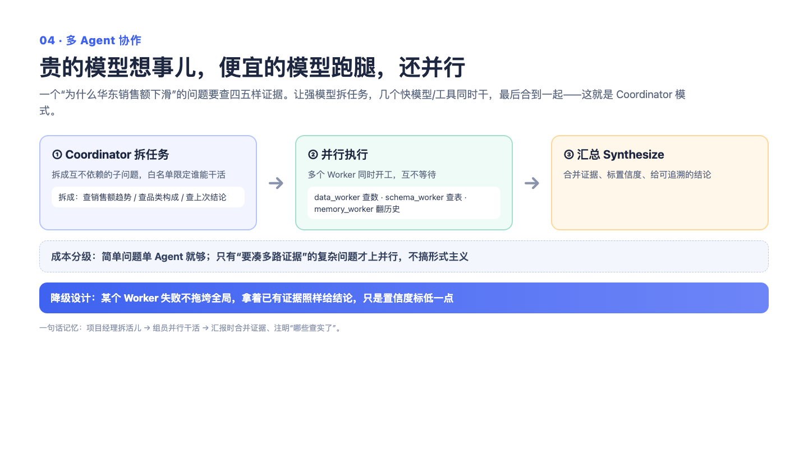

# 04｜多 Agent 协作：强模型当项目经理，实习生并行跑腿

> 一句话记住它：老板动脑，实习生跑腿，三件事同时干——总耗时看最慢的那个，不是三个加起来。

## 这到底是个啥？

想象一家小公司只有一个超级全能员工，什么活都自己干：写方案自己写、跑银行自己跑、寄快递自己寄。能力是没问题，问题是又贵又慢——他一个小时的工资顶实习生一天，而且所有事只能一件件排队干。

我们的做法是拆角色。用户问："销量为什么异动？顺便看下相关字段的口径，再结合我之前关注的品类。"这就是个三头并进的活：查数据、查文档、查用户记忆，三件事互相不依赖。让最强的模型当项目经理，把活拆成三个明确的小任务，然后三个"实习生"（便宜的执行路径或确定性工具）同时开跑。原来串行要等三倍时间，现在总耗时约等于最慢的那一路。项目经理的工资贵，但只请他动这一次脑子；跑腿的活便宜，还并行。这背后还有一条更深的链路——根因分析：像破案一样，先列嫌疑人（可能是大促？品类结构？数据口径？），每个嫌疑人派一组证据调查（并行跑查询），最后写报告，结论必须挂着证据数字，查不实的嫌疑人明确标注"证据不足"。

## 面试官会问啥？

### Q1: "强模型规划、便宜模型执行"，凭什么这么分？
**答：**
因为这两件事贵得不一样。规划是真正需要脑子的活——理解问题、拆任务、标风险，一步拆错后面全歪，这钱该花，而且只需要花一次。而执行——跑个查询、取个字段——是体力活，用不着天才出手，让便宜的路径干绰绰有余。这就像盖房子：图纸必须总工来画，但搬砖不必。反过来全用强模型，等于让总工亲自搬每一块砖——账单感人，墙也没砌快多少。

### Q2: 并行执行，结果怎么合回来才不出错？
**答：**
有个前提先说清楚：能并行的前提是子任务彼此独立，拆任务的时候项目经理就保证了这一点。合并的时候有个讨巧的设计——三个实习生的产出分别填回系统里本来就有的三个格子（数据结果、检索结果、记忆结果），下游负责汇总的环节完全不知道中间发生了并行，照常干活零适配。而且汇总那份根因报告不走二次改写：证据撑出来的结论，让模型再润色一遍反而可能把数字润没了，直接输出最保真。

### Q3: 某个实习生掉链子了，整个事就黄了吗？
**答：**
不会。每个子任务单独包了安全气囊，谁失败谁自己标记"这一路没跑成"，另外两路照常交活，用户至少拿到部分结果。更极端的情况——项目经理自己拆任务拆砸了、格式解析失败——也有兜底：退化为单个数据查询，保底交差。原则就是：局部失败局部隔离，永远给用户一个"差但能用"的答案，而不是一个优雅的报错页面。

### Q4: 模型拆任务会不会拆出幻觉？比如派给一个根本不存在的人？
**答：**
会，所以发派单之前有个白名单检查：子任务只认三种角色之一——查数据的、查文档的、查记忆的，而且每个都得带着明确的查询内容。名字对不上号的派单直接作废，全都不合法就退化为保底任务。就像公司通讯录里没有的人，你派单他也收不到——不如发之前先核一遍名单。

### Q5: 根因分析的结论凭什么让人信？
**答：**
三道锁。第一道，证据查询本身要过安检（校验、出错了先自动修复再跑）；第二道，写报告的时候明确立规矩——结论必须引用证据里查回来的数字，撑不住的假设就得老实写"证据不足"，禁止编数据；第三道，报告直接作为最终输出，不再让模型二次改写，避免润色过程把证据润丢。一句话：结论不是模型想出来的，是从证据里长出来的。模型只负责把证据串成人话。

### Q6: 几种协作模式是自动选择的吗？
**答：**
老实说：能力都在，选择主要靠上游路由决定，还没有做到"系统自己发现质量不行、主动去请教高人"的全自动闭环。三种模式各有分工：顾问模式只出主意不动手，适合卡壳时问路；规划模式出一份带步骤的施工图，适合有依赖的多步任务；协调模式拆并行子任务，适合三头并进。把这条边界讲清楚，比把设计意图吹成既成事实要加分。

## 记忆口诀

贵脑袋只出一次图纸，便宜手脚并行干活；谁掉链子谁自己认栽，结论必须挂着证据数字——没证据的嫌疑人，就老实写"证据不足"。
