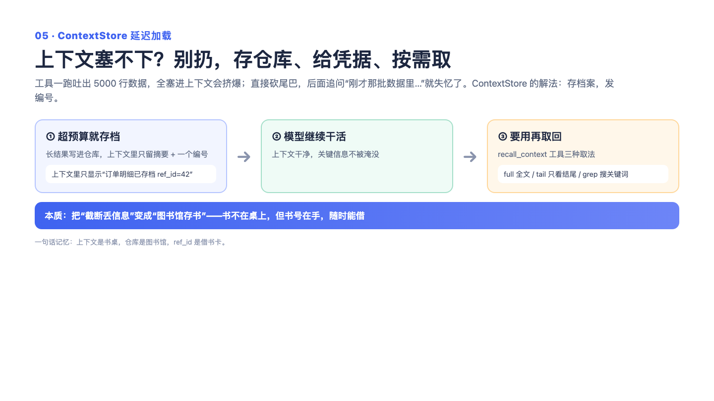

# 05｜动态上下文与 ContextStore：截断不等于扔掉，存起来给你一张取件条

> 一句话记住它：行李寄存——箱子太大不能全带上，寄存了给你号牌，要的时候凭号取，还能只取口袋里那件。

## 这到底是个啥？

想象你拖着三个大行李箱去图书馆，门口保安说：一次只能带一个小包进去。朴素的办法是——把两个箱子当场扔了。但万一你最需要的那份文件恰好在被扔的箱子里呢？

AI 处理上下文就天天遇到这个问题：模型一次能"记住"的东西有限，工具动不动甩回来几百行数据，塞不进去只能截断。但截掉的那部分，说不定恰好藏着异常的那一行。我们的做法是行李寄存：超长的结果在截断的同时，完整原件被存进寄存处，上下文里只留一张"取件条"——写着原件有多大、被压缩了多少、寄存号是多少。模型后面要是分析到一半发现"等等，我需要看看家具品类那几行的具体数值"，就凭号去取，而且取的时候还能挑着取：只搜带某个关键词的行、只看结尾的几十行、或者整箱全搬（有大小保护，防止取个新的超大件又把包撑爆）。关键区别在于：朴素截断是"不可逆的删除"，我们做的是"可控的延迟加载"——信息一直躺在寄存处，只是取它要花点功夫。

## 面试官会问啥？

### Q1: 截断掉的信息丢了怎么办？这是不是有损方案？
**答：**
恰恰是这个问题催生了这个设计。纯截断是真丢——丢了就永远找不回来，而且没人敢保证关键行不在被切掉的那段里。我们的顺序是先存档再截断：原件完整落盘，上下文里放摘要加取件条。信息损失从"不可逆的删除"变成了"可控的检索成本"——模型平时不背整个箱子，需要哪件取哪件。也有人会说"让模型先总结一遍不就行了"，但摘要同样是不可逆的：总结一出手，细节就永久没了，模型连反悔的机会都没有。

### Q2: 都存下来了，模型去取的时候，读取本身不会又把上下文撑爆吗？
**答：**
这是个好问题，说明你想到第二层了。答案是取件也有规矩：按关键词搜，最多给一百行匹配；只看结尾，默认五十行还附赠总行数；整箱取的话，超过五万字符就只给前两千字符，外加一句"建议您换个方式取"。而且取件条上和工具说明书里都明晃晃地写着"推荐先按关键词搜"——主动引导模型用最便宜的粒度。一句话：寄存处不怕你存，怕你贪。

### Q3: 模型怎么知道有个寄存号可以用？
**答：**
不用猜，取件条上白纸黑字写着："完整内容已存档，号是某某，可调用回忆工具取回，推荐先搜关键词。"工具说明书里也教了它看到取件条该怎么办。这套引导全靠上下文内的提示，不需要额外的魔法机制——就像快递短信自带取件码和驿站地址，你不用自己推理去哪拿。

### Q4: 那模型要是偷懒不去取，答案缺细节怎么办？
**答：**
会，这是诚实的边界：延迟加载救得了"模型意识到自己需要细节"的场景，救不了它压根没意识到的场景。所以我们留了后手——取件条上保留了原始规模信息（原来有多少行、多少内容被压掉了），至少模型和用户都知道"这里被压缩过"。就像行李寄存单上写着"三个箱子"，你至少知道自己还有两箱没翻。想要更聪明的主动召回，那是未来方向，当前不吹。

### Q5: 会不会有人拿假的寄存号乱翻别人的东西？或者存件把磁盘塞满？
**答：**
安全上，寄存号有严格格式校验——只能是"固定前缀加十六进制"这一种长相，多一个斜杠都不行，路径拼接这种小动作根本钻不进来。容量上有三重限制：单件有大小上限，超了就拒存；每存一件顺手清理七天前的过期件——寄存处不是永久仓库，是短期周转站；再加上游本来就限制了什么才值得存。清理失败也只是记个日志，绝不耽误正事——寄存是增值服务，不是命根子。

### Q6: 为什么不干脆换个上下文窗口更大的模型，一了百了？
**答：**
窗口大不等于白用：账单随长度线性涨，而且窗口越长、注意力越稀——五十页的材料里找一个数字，人也会看漏。这跟换大模型还是正交的两件事：就算换成巨型窗口，常用路径保持轻装上阵、确有需要才为局部细节付费，依然是省钱的。就像公司给你配了个超大后备箱的车，你也不会每次通勤都拉满一车货——油钱和找东西的功夫都是成本。

## 记忆口诀

截断不扔箱，寄存拿号牌；平时背摘要，要时凭号取——先搜关键词，再看结尾行，整箱有保护。信息没丢，只是换了个便宜的方式等你来取。
