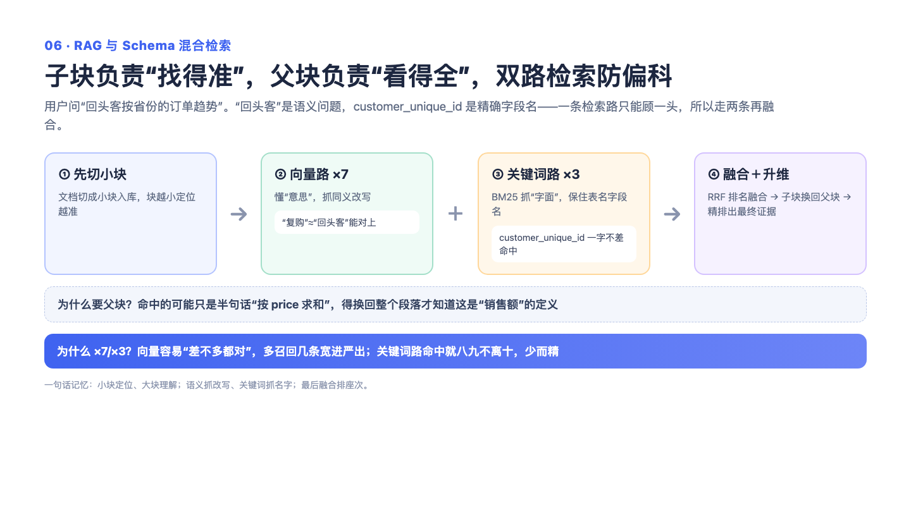

# 06 — RAG 混合检索：撒大网 + 抛精准网，两路一起捞

> 一句话记住它：小卡片负责精准定位，翻回整页书负责看全上下文；一路靠"懂意思"，一路靠"认字面"，两份榜单投票定名次。

## 这到底是个啥？

想象你在一个大图书馆找资料，问图书管理员："回头客的复购周期怎么算？"馆里有两个管理员：一个特别"懂意思"，你说复购，他能联想到"二次下单间隔"、"重复购买"，哪怕书上没写"复购"俩字也能帮你找到；另一个特别"认字面"，你问某个具体字段名，他能精确翻到写这个词的那一页。前者叫语义检索（Dense 向量），后者叫关键词检索（BM25）。只用一个都有短板——懂意思的认不出精确字段名，认字面的听不懂换个说法的问题。所以干脆两个一起上，把两份推荐榜单投票合在一起，这就是"混合检索"。

还有一个巧妙设计：找的时候用小卡片（小段文字，定位精准），但最后交给 AI 看的是整页书（大段落，上下文完整）。就像你用便利贴标记了某一句话，但读的时候会翻开那一整页——只看便利贴上撕下来的半句话，很容易断章取义。最后还有个"终审评委"（rerank）把捞回来的段落再精挑细排一遍。整套流程层层兜底：评委不在，就用投票名次；一路检索挂了，另一路顶上。

## 面试官会问啥？

### Q1: 为什么要分小块检索、大块返回？直接切一样大不行吗？

**答：** 这是把两个矛盾拆开解决。切小了，检索很准，但 AI 拿到的是断章——比如"复购周期是两次下单的时间差"这句话找到了，但前面定义"什么叫回头客"的句子被切走了，AI 还是答不对。切大了，上下文是全了，但一段一千字里只有一句话相关，检索反而被稀释，找不准。所以小卡片管"找得准"，整页书管"看得全"，各干各的活。就像用便利贴定位，但阅读要翻开整页。

### Q2: 语义检索和关键词检索，到底各自管什么？为什么必须两路都要？

**答：** 语义检索管"换了个说法也能找到"——用户问"复购用户"，能找到只写了"回头客"的文档；关键词检索管"精确到字"——用户问某个数据库字段名，这种信息几乎全在字面上，靠"懂意思"反而会跑偏。我们在早期真实踩过坑：两个长得几乎一样的字段，一个每单唯一、一个回头客共享，语义检索分不清，答错了。从此词法信号就是刚需。两路不是冗余，是互补。

### Q3: 两路的召回宽度为什么不一样？一路放 7 倍、一路只放 3 倍？

**答：** 因为两路的"脾气"不一样。语义检索像撒大网——近邻的内容天然扎堆，同一段落的好几个小卡片会一起被捞上来，随后按来源段落去重，候选会大幅缩水，所以必须放宽到 7 倍，去重之后才还剩得下足够多的不同段落。关键词检索像抛精准的鱼叉——一个词精确命中就能定位，收缩很小，3 倍就够。一句话总结：撒网的那路要宽，叉鱼的那路要准。这两个倍数是工程上够用的起点，不是理论最优，这点我如实承认。

### Q4: 两份榜单怎么合成一份？为什么不直接把分数加起来？

**答：** 因为两边的分数根本不是一个量纲——一个是相似度、一个是关键词得分，就像一个用厘米一个用斤，直接加权没法调。所以我们用"投票"：只看排名不看分数，一个结果在这边排第 3、在那边排第 1，就各拿一份"名次分"加起来。这样天然免疫量纲问题，换模型也不用重新调权重。代价是丢了"分差"信息——排第 1 和第 2 差很多也被等权对待，所以后面还有终审评委（rerank）再精排一遍补偿。

### Q5: 这套链路挂了怎么办？

**答：** 层层兜底，设计原则是"增强项可以丢，主链路不能断"。语义向量的生成失败就重试几次；混合检索整体出问题就退回纯语义检索，慢一点但能跑；终审评委挂了就直接用投票名次出结果，只是排序质量降一档。任何单点故障最多让质量退到下一档，不会让用户拿到报错。

### Q6: rerank 这步具体是干嘛的？放在哪个位置有讲究吗？

**答：** rerank 是个比检索更聪明的终审评委——检索是"快速海选"，rerank 是"逐个细看"。位置放在翻回整页之后，因为评委审的应该是最终真正要交给 AI 的东西，直接对着最终交付物排序最贴目标，也省成本（候选段落变少了再细看）。它失败时不报错、直接回退用投票名次——它是锦上添花，不是必需品。

## 记忆口诀

小卡片定位，整页书看全；撒大网的放宽，抛精准网的对准；两份榜单投票，评委缺席也不慌。
