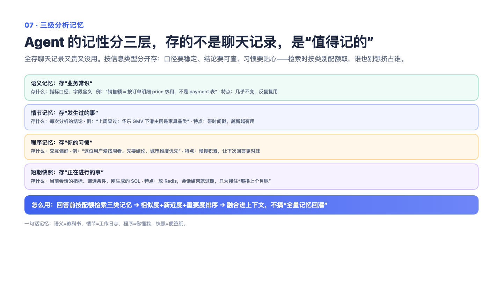

# 07 — 三级长期记忆：让 AI 记住你的规矩、你的往事、你的口味

> 一句话记住它：规矩（口径）、往事（分析历史）、口味（交互偏好）分开记账；聊完下班才做笔记，而且是挑重点记。

## 这到底是个啥？

你有没有遇到过这种同事：上个月刚跟他说过"咱们 GMV 一律按支付口径算"，这个月他又问你一遍；你上周刚做过一版异常分析，今天他完全失忆。跟这种人共事很累，跟"失忆的 AI"共事也一样。长期记忆系统就是让 AI 变成那种靠谱的老同事——你说过一次的规矩，他一直记得；你上次分析的结论，他随口能接上；你喜欢看图不喜欢看大表，他记在心里。

关键在于"分开记账"。想象一个秘书有三个抽屉：第一个抽屉放"规矩"——比如指标口径这类稳定不变的事实，几乎每次干活都要翻；第二个抽屉放"往事"——上次分析了什么、结论是什么，只在回忆的时候才翻；第三个抽屉放"口味"——你喜欢什么呈现方式，影响的是端菜的样子而不是菜本身。为什么非要分三个抽屉？因为不分的话，海量的"往事"会把少量但关键的"规矩"从台面上挤走——就像流水账报销单混进了公司章程。还有个反直觉的设计：AI 不是边聊边记，而是聊天结束后由后台"下班整理笔记"，挑值得记的才记。这样一次没答好的查询不会被急吼吼地固化成"事实"。

## 面试官会问啥？

### Q1: 记忆为什么非要分三类？全存一个库里检索不也一样吗？

**答：** 分类的依据是这三样东西的"寿命"和"使用时机"完全不同。规矩类更新慢、几乎每次相关查询都该带上；往事类只在回忆性提问时有用；口味类影响的只是呈现方式。混在一起会有个具体故障：往事类数量大、更新快，会把少量关键的规矩从检索前几名里挤出去。分成三个抽屉后，可以按问题类型分配翻哪个抽屉、翻多少条——问事实多翻规矩抽屉，问历史多翻往事抽屉。

### Q2: 用户问"和上个月比呢"，系统里发生了什么？这跟长期记忆有什么关系？

**答：** 这种多轮追问根本轮不到长期记忆出场——它属于"短期记忆"的职责范围。会话的完整对话快照存在一个带过期时间的缓存里，"上个月"指什么指标、上一轮查的结果是什么，全在快照里。长期记忆只在真正需要历史的时候才被调用，比如"上次那个异常分析的结论是什么"。短期和长期各管各的，这是职责分离，不是重复建设。

### Q3: 记忆越存越多怎么办？去重和冲突怎么处理？

**答：** 三道防线。第一，入库前先查重：新记忆和库里的旧记忆如果内容几乎一样（相似度极高），新的那条直接丢弃——宁可留旧的不冒进。第二，用户画像（这位用户是谁、什么偏好）不采用覆盖也不采用无限追加，而是用小模型把新旧合并成一份——覆盖丢历史，追加会膨胀，合并是折中。第三，排序时给稳定规矩更高的权重，往事类权重最低，就算往事再多也很难把规矩挤出前几名。

### Q4: 为什么不边聊边记，非要等会话结束再整理？

**答：** 因为聊天中途的信息是"半成品"——查询可能失败，结论可能被后面推翻，边聊边记会把一次没答好的东西固化成长期事实，相当于把草稿纸上的涂鸦归档进了正式档案。所以设计成：聊完之后，后台任务统一整理笔记，超过一定信息量的会话才值得整理，整理时还会过滤掉语义不完整的消息。代价是记忆有几分钟延迟，但换来了"入库的都是想清楚了的"。

### Q5: 记忆多了之后，怎么决定给 AI 看哪几条？排序怎么排？

**答：** 不是只看"内容像不像"。综合分 = 内容相似度 + 时间新鲜度 + 重要程度三块加权，再乘一个类型权重。新鲜度是指数衰减——上周确认的偏好和今天确认的差别不大，三个月前的就淡了很多，但不会像滑动窗口那样被硬生生踢掉（三个月前定的规矩可能至今有效）。重要程度是入库时 AI 打的分。类型权重上规矩最高，因为稳定口径比一次性事件金贵。被用到的记忆还会刷新"最近使用时间"——就像图书馆里常被借的书，下次更容易被推荐。

### Q6: 跨两个存储系统写数据，怎么保证不写一半？

**答：** 没用重量级的分布式事务，用的是"补偿式回滚"加一个巧妙的锚点。写入分几步走：先给消息打上"已整理"的标记，再更新画像，最后写记忆库；任何一步失败，就把前面的步骤撤销回去。妙处在于：后台任务只扫描"还没打标记"的消息，所以回滚后的消息下个周期会被自动重新处理，整个流程天然可重试。就像快递签收单——签收单没写上，配送系统就会一直当作未送达，下次重新送。

## 记忆口诀

三个抽屉分规矩、往事、口味；聊完下班才做笔记；查重留旧、画像合并；排序看相似加新鲜加重要，规矩永远优先。
