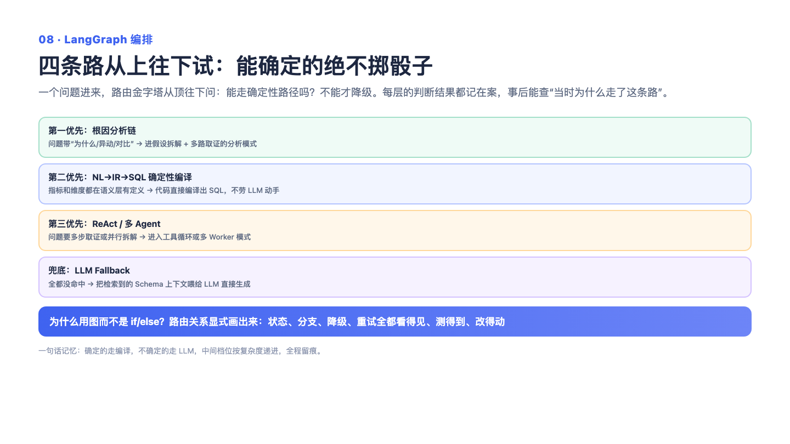

# 08 — LangGraph 编排：确定性优先，能算的绝不靠猜

> 一句话记住它：先分诊再干活——有标准答案的走流水线，没有的才交给 AI 发挥；"能确定的，不交给概率"。

## 这到底是个啥？

想象一家医院的分诊台。病人来了，护士先快速判断：感冒发烧的去普通门诊走标准流程，胸痛的直送急诊绿色通道，疑难杂症才请专家会诊。如果所有病人不分青红皂白都直接进专家会诊，又贵又慢还容易误诊。AI 系统的编排层就是这个分诊台——用户的问题进来，先判断这是什么类型的问题，再决定走哪条处理路径。

这个系统的核心原则是"确定性优先"：问"上个月 GMV 是多少"，这种有标准口径的问题，直接走一条"编译"流水线——把问题拆解成结构化的意思，按预先治理好的指标定义组装出查询语句。全程 AI 只参与开头的一句分诊，后面是流水线作业，同样的问法永远得到同样的答案，零发挥、零幻觉。而"为什么 GMV 跌了"这种开放问题，走专属的"取证"链路——每条结论必须挂着真实跑过的查询证据，不许 AI 自由发挥。"顺便对比下去年"这种复合任务，才轮到 AI 迭代式地边想边干。核心逻辑一句话：把宝贵的"概率"用在刀刃上，能用规则和流水线解决的，绝不让 AI 抽签。

## 面试官会问啥？

### Q1: 为什么坚持确定性优先？让大模型自己生成查询语句不好吗？

**答：** 分场景。没见过的陌生领域，只能靠大模型，这条路系统也保留了。但已治理的口径是另一回事：GMV 怎么算、什么叫回头客，这些是业务资产，让模型每次重新"理解"一遍定义，等于把最不该出错的地方交给了运气——同一个人今天问明天问，答案可能不一样。编译路径三个好处：口径来自标准定义所以零幻觉，同问同答所以零方差，中间产物全程留痕所以可审计。代价是覆盖面有限，没治理过的问题只能降级到 AI 路径，所以两条路必须共存。

### Q2: 路由这一步是谁决定的？会不会让大模型来选路？

**答：** 判断问题类型用了一点 AI（拿不准时还会反问用户澄清），但从类型到路径的映射是纯代码写死的。原因很实际：路由错误是最难排查的错——用户看到的是"答非所问"，日志里却没有任何报错。把这一层做成可枚举、可测试的确定逻辑，是整个系统能运维的前提。就像医院的分诊规则是写在手册里的，而不是护士每天凭心情现场发明。

### Q3: 编译失败之后呢？降级是怎么设计的？

**答：** 降级不是抛异常，而是图上的一条正常道路。编译失败——比如问题里的指标没治理过——就标记一个"降级"状态，顺着边走到下一站：三路检索并行上场，把相关资料凑齐交给 AI 综合作答。这样设计的好处是降级可观察、可统计：多少查询走了编译、多少降了级，是能直接看数字的运营指标。就像高速路主路堵了走辅路，辅路也是修好的路，不是翻车。

### Q4: 我听说你们有个"反思"环节，为什么它默认只审不改？

**答：** 因为"自我批评"是个很危险的死循环：AI 自己说"我不满意"，重做一遍，还是不满意，再来一遍……每次重做都是真金白银的延迟和成本。所以策略是"审查免费、重试要预算"：反思环节一直在跑、结论都记在案，但只有存在明确的改进建议、且显式配置了重试额度时才真的重做。优雅退化不能变成优雅死循环——自我批评类行为必须有硬上限。

### Q5: 用图编排框架，你实际得到了什么？踩过什么坑？

**答：** 得到三样：所有路由画成一张拓扑图，一眼看全系统；每个节点是独立函数，可以单独测试；新增一条路径只改两个地方，是增量不是侵入。踩过一个很阴的坑：某个节点明明返回了数据，最后 API 响应里却没有，日志也不报错——后来发现是图的状态合并层把"没在契约里声明的字段"静默丢弃了。就像快递发了但地址栏没填，直接消失且无人知晓。教训是：状态契约要当成接口契约一样严肃对待，没写进契约的等于不存在。

### Q6: 根因分析这种问题，为什么不直接让大模型自由发挥？

**答：** 因为根因分析最大的失败模式恰恰是"自由发挥"——模型一本正经地编一个看起来合理的解释，却没有一条真实数据支撑。所以这条链路被设计成"先立假设、再并发取证、出报告"：每条结论都必须绑定真实执行过的查询，报告出来后原样透传，不允许后面的环节润色改写。就像法庭判决书，每个论断都得有卷宗编号，不许律师即兴抒情。

## 记忆口诀

分诊台先看病：标准病走流水线，疑难杂症才专家会诊；降级是修好的辅路不是翻车；自我批评要限量，否则优雅死循环。
