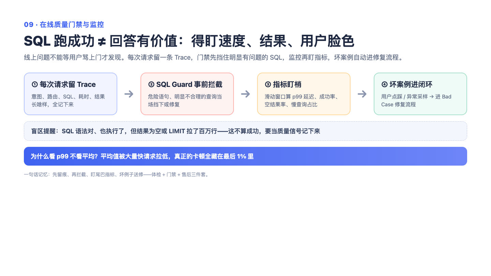

# 09 — 在线质量门禁与监控：最危险的故障是"跑成功了，但答案是废的"

> 一句话记住它：传统监控只看"快不快"，这套系统还盯"对不对"——外卖准时送到，但送错菜了，也得有人发现。

## 这到底是个啥？

传统监控的世界观是：调用没报错、响应够快，就没故障。但想象一个外卖场景：骑手 500 米冲刺、5 分钟送达、APP 显示"订单完成"——一切指标完美，唯独送错菜了。数据查询领域最阴险的故障正是这种：查询语句跑成功了、没报错、500 毫秒就返回，但结果表是空的，或者被截断了只剩一半。用户拿着一张空表格去做业务决策，比系统直接报错还危险——报错你会警惕，空表格你会以为"这个月真的没数据"。

所以这套系统的核心判断是：质量信号和性能信号必须平起平坐。性能侧盯每个环节的耗时和成功率——用滑动窗口只看"最近几分钟"的表现，老数据自动过期，这样反映的是当前状态而不是历史包袱；而且看慢不慢要看"最慢的那百分之一"而不是平均值，因为平均值会被大量快请求稀释，一条 20 秒的慢查询混在 99 条半秒的请求里，平均值几乎纹丝不动。质量侧则像个懂行的质检员：结果是不是空的？行数是不是恰好卡在数量上限（疑似被砍了一半）？空值是不是多得离谱？查出来的数值是不是大到不正常？发现问题不瞒着，在回答里向用户老实说明。所有请求还会留下完整"行车记录仪"（trace），出了事能回放整个决策过程。

## 面试官会问啥？

### Q1: 你说做了"质量门禁"——用户问各品类销量，SQL 跑成功了、很快返回、但结果是空的，你的监控怎么发现？

**答：** 这正是传统监控的盲区，也是这套系统存在的理由。答案在结果层检查：查询执行完之后，有一道"结果合理性检查"专门看四类可疑信号——空结果、疑似截断（返回行数恰好等于数量上限）、异常高的空值占比、离谱的超大超小值。空结果这种"成功执行的失败"会被标记成一条可解释的警告，跟着整个处理链路留档，最后在回答里向用户诚实说明"该条件下无数据，建议放宽条件"。发现它的是懂业务语义的质检层，不是通用监控。

### Q2: 空结果告警会不会误报？有些查询合法地就是没有数据。

**答：** 会误报，所以它被设计成"警告"而不是"拦截"。误报的代价是多说一句提示，漏报的代价是用户拿空表格做决策——两者严重不对称，所以宁可误报。而且警告不是干巴巴一句"结果为空"，而是带着解释的：哪条规则触发、结果长什么样。就像烟感器偶尔被水蒸气触发，响一声让你看一眼，总比失火不响强。

### Q3: 为什么监控"快不快"要看最慢的百分之一，而不是平均值？

**答：** 因为平均值是个和稀泥的老好人。99 条半秒的请求加 1 条 20 秒的慢查询，平均下来才 0.7 秒，看起来岁月静好，但那个 20 秒的用户早就骂街了。看最慢的百分之一，那条慢查询直接现形。小样本的时候这个指标确实会被单条离群值带得上下乱跳，所以要连同样本量一起看，样本不够时看趋势不看绝对值。

### Q4: 监控系统自己挂了怎么办？会不会反过来拖垮业务？

**答：** 铁律是：观测的命不能比业务金贵。落盘是后台旁路任务干的，主请求不等它；旁路任务全程包了异常兜底，失败只记日志不上抛；就算日志写不进去，质检环节在请求内部已经产出的警告也不受影响。宁可丢一条行车记录，不能让装记录仪把车搞熄火。

### Q5: 线上出了坏例子，怎么决定哪些值得留下来复盘？

**答：** 不是全量留——复盘要用 AI 重跑修复，按条计费，全量进来既烧钱又大多没信息量。采样按优先级分四类：报了错的、太慢的、重试过的，外加一成随机抽样。前三类是"已知有问题"的重点关注对象，随机那一成看着没用，其实很关键——只盯着坏样本复盘，经验会被难题带偏，随机样本提供了"普通用户日常体验"的基线，还能抓到"看起来没事但用户其实不爽"的静默缺陷。另外用户点踩走单独通道直通复盘队列——用户亲自说的不满意，是价值最高的信号。

### Q6: 查询语句写错了怎么办？直接报错给用户吗？

**答：** 不会让用户看到赤裸裸的报错。查询出来先过三道静态安检：不许有写操作（只读是底线）、不许用不支持的函数、表和列必须真实存在。安检没过不是一票否决，而是给 AI 一个"改错的机会"——把报错原因告诉它，让它修，最多修三轮，修复历史也记下来。就像作文交上去先过一遍错别字检查，检查器说"这里用词不当"，改完再交，而不是直接判零分。

## 记忆口诀

监控不能只看快不快，还要看对不对；平均值是和稀泥的老好人，盯最慢的百分之一；质检宁可误报不可漏报；记录仪挂了车不能熄火。
