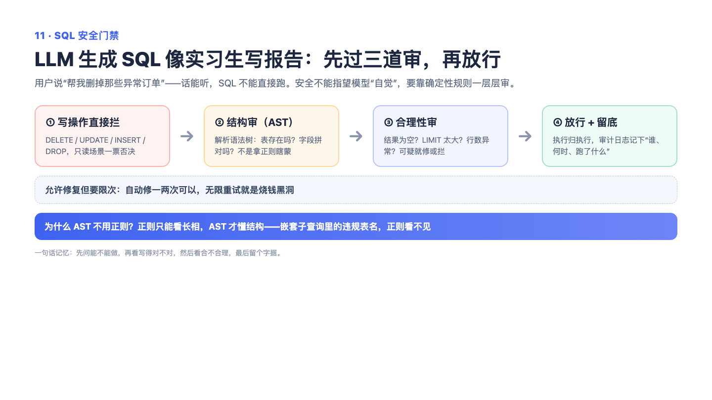

# 11 — SQL 安全门禁与审计：模型写的 SQL，不能直接放行

> 一句话记住它：模型是实习生，数据库是金库——SQL 要过安检门、带工牌、还被摄像头全程录像。

## 这到底是个啥？

AI 帮你写 SQL 查数据，听着很爽，但你敢让它直接碰数据库吗？万一它一抽风写了个"删表"呢？所以在模型和数据库之间，我们设了一道安检门：模型写好的 SQL 先过检查——是不是只读查询？表和字段是真的还是模型瞎编的？通过了才执行。执行完了还有第二道检查——比如你问"销量前五"，结果返回了五百行，那多半是漏了限制条数，再回去修一修。要是 SQL 写错了，系统不会直接甩给用户一句"失败"，而是把报错信息喂回给模型，让它自己改——但只给两次机会，改不好就明确报告失败。全程还留有录像，谁在什么时候执行了什么 SQL，都查得到。就像机场安检：先看证件（语法检查）、再过扫描仪（执行检查），行李异常还要复检（自动修复），而且每一道都有监控。

## 面试官会问啥？

### Q1: 模型的提示词里已经写了"只能查数据"，为什么还要再做一道校验？

**答：** 提示词只是"口头叮嘱"，不是"铁栏杆"。模型偶尔会听岔、被上下文带偏，甚至被用户的话术忽悠着写出危险语句。安全这种事不能靠模型的自觉，得在执行前用代码硬性检查一遍。一句话：提示词管"应该怎么做"，门禁管"实际能不能过"。

### Q2: SQL 写错了，系统怎么处理？直接报错让用户重试吗？

**答：** 不会那么粗暴。系统会把错误原因（比如"字段不存在"）和表结构一起喂回给模型，让它自己修——但最多修两轮。修好了用户无感知；修不好就把失败原因如实告诉用户，而不是无限重试烧钱。这就像修理师傅修不好会如实说"这个我修不了"，而不是无限拆下去。

### Q3: 为什么修复要限制次数，不能一直修到成功为止？

**答：** 一是烧钱——每次修复都是一次模型调用，拖下去用户等着干瞪眼；二是有的问题根本修不好，比如用户问法本身有歧义，模型只会在原地打转。限制两轮是个折中：常见的语法、字段错误两轮内基本能修好，修不好就说明需要人来介入了。

### Q4: 检查了语法和表结构之后，结果就一定可信吗？

**答：** 不一定。语法完全正确的 SQL 也可能查出错误结果——比如日期条件写错了，合法执行但查回来一个空集。所以还有第二道检查专门看"结果合不合理"：该有数据却是空的、明明问前五名却返回五百行、一堆空值——这些可疑信号会被标记出来，要么触发修复，要么附在结果里提醒用户。

### Q5: 这套机制能替代数据库自身的安全措施吗？

**答：** 不能，它只是应用层的第一道门。数据库该有的自我保护一样不能少：只读账号、超时限制、访问控制。我们的门禁是"防君子防糊涂"，数据库权限才是最后一道防线。面试时主动说清这个边界，比把它吹成万无一失更加分。

## 记忆口诀

安检门三件套：先查证件（语法）、再过扫描（执行）、最后看录像（审计）；修不好最多给两次机会——"两轮修不好，就得人工保"。
