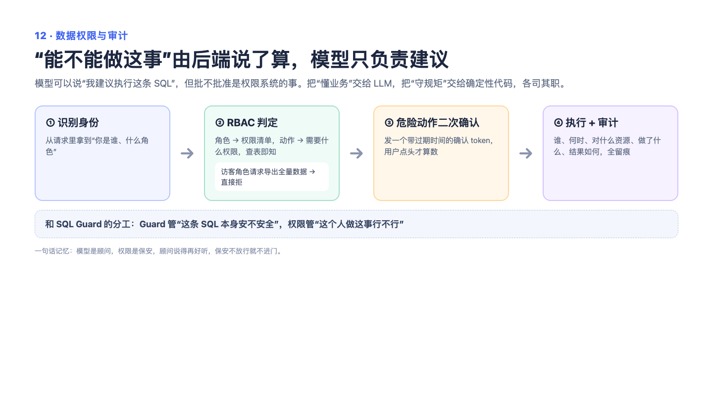

# 12 — 数据权限与审计：别把钥匙放在门口的脚垫下

> 一句话记住它：前台藏起按钮没用，金库大门得自己上锁——权限要在服务器端拦，还要有台账。

## 这到底是个啥？

一个 AI 系统里，有人是管理员、有人只是来看报表的访客。怎么保证访客动不了管理员的活儿？很多人的第一反应是"把按钮藏起来不就行了"——这就好比把钥匙藏在门口脚垫下，看着藏好了，其实谁都能掀开。正确的做法是把锁装在门上：每一个接口在服务器这边都先问一句"你是谁？你有资格进来吗？"，没资格直接拒绝，跟你走不走前端页面毫无关系。不同角色拿不同的钥匙串：管理员几乎全能，普通编辑能管内容，访客只能看。而那些特别危险的操作——删库、执行命令——光有钥匙还不够，还得再按一次"二次确认"，而且确认凭证几分钟就过期。最后所有敏感操作都记在台账上：谁、什么时候、干了什么、成没成功。就像医院：不是穿白大褂就能进手术室，刷卡、登记、留记录，一样不缺。

## 面试官会问啥？

### Q1: 前端已经按角色隐藏了按钮，为什么后端还要再检查一遍？

**答：** 前端隐藏只是"视觉上的锁"，用户完全可以绕过页面直接调接口——就像藏起按钮挡不住会用工具的人。安全必须放在服务器端：每个接口进门先验明正身，权限不够直接拒绝。原则就一句话：凡是只靠前端拦的，等于没拦。

### Q2: 权限是按每个用户单独设的吗？

**答：** 不是，是按角色分组的——管理员、编辑、访客这种。就像公司的门禁卡分"员工卡"和"访客卡"，不用给每个人单独配钥匙。每个角色绑定一组它能干的事，比如访客卡刷不开机房门。这样管理简单，新人入职发张对应卡就行。当然代价是做不到"这个人只能看某一个知识库"这种细粒度，需要时再往上加一层资源级校验。

### Q3: 危险操作为什么还要"二次确认"？有权限不就行了吗？

**答：** 权限回答的是"你能不能做"，二次确认防的是"你是不是真的想做"。比如删除整个知识库，一次误点就是灾难。系统会生成一张一次性的确认凭证，绑定这个人和这个操作，几分钟内有效。就像银行转账时的短信验证码：你知道密码不代表这钱就该转，再确认一步，误触和冒用都被拦下。

### Q4: 角色信息是从哪来的？直接信客户端传来的行吗？

**答：** 不行，客户端自报家门等于"我说是管理员你就是管理员"，这是演示环境级别的做法。生产环境必须用正规的登录凭证（比如签名过的令牌），服务器验过签才认身份。面试时主动交代这一点很关键：说明我知道现在的做法是开发期的简化，也知道正确姿势是什么。

### Q5: 审计日志都记些什么？为什么它重要？

**答：** 记录谁、什么时间、对什么资源、做了什么操作、成功与否，外加来源 IP。它就像商场的监控录像——平时没人看，但出了事（误删、越权、扯皮）它就是唯一的证据链。没有审计的系统，出了问题只能大眼瞪小眼。要点是敏感信息不能往里写，日志本身不能变成新的泄密源。

## 记忆口诀

"锁装门上，不藏脚垫"：前端隐藏是装饰，服务端拦截才是锁；权限分角色发钥匙串，删库级操作再来一次限时确认，最后所有动作都写台账。
