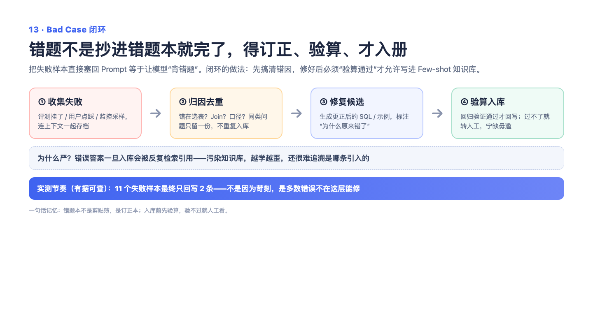

# 13 — BadCase 闭环与 Few-shot 进化：错题本不是收藏夹，是练习册

> 一句话记住它：用户的差评不是攒着吃灰，而是变成"验证过的标准答案"存进错题本——下次同类题直接抄作业。

## 这到底是个啥？

AI 答错题了（业内叫 Bad Case），很多系统的做法是把差评存个文件，然后……就没有然后了。我们的做法是给它一个完整的"错题闭环"：答错的题先记进错题本；然后系统用更强的链路重新做一遍这道题；新答案不是自己说了算，要和标准答案逐行逐格比对，几乎完全一致才算"改对了"；验证通过后，这道"问题 + 正确答案"对才会存进示例库，下次遇到类似的题，直接翻出来当参考答案用。没通过验证的也不会重复纠缠，标记为已处理留给人工。这里最关键的一点是：**答案必须验证过才能入库**。因为错误的答案一旦进库，就会变成后面无数道题的坏示范——一个学生把错误解法抄进笔记，越学越歪。就像健身教练不会因为会员抱怨就随便改训练计划，而是先看数据确认问题，再改，再测效果。

## 面试官会问啥？

### Q1: 系统是怎么"从错误中学习"的？具体改变了什么？

**答：** 不是玄学的"自我进化"，是很朴素的错题本机制：失败的查询被记录下来，后台定期用增强链路重试，重试结果和标准答案逐格比对，通过验证的才作为示例存进库里。下次用户问相似问题时，这条验证过的示例会被检索出来给模型参考。说白了，就是把"踩过的坑"变成"下次的参考答案"。

### Q2: 为什么验证不通过就不入库？看起来差不多的答案也不行吗？

**答：** 这是整个闭环的命门。示例库是模型的"学习材料"，一条错误的示例会污染后面所有相似问题的回答——错题进本子，越抄越错。所以标准定得非常严：结果要和标准答案几乎逐格一致才算通过。宁可少沉淀几条，也不往库里塞可疑答案。这叫"宁缺毋滥"，闭环的价值在质量不在数量。

### Q3: 同一道错题反复修不好怎么办？会不会一直重复处理？

**答：** 不会。每条错题都有状态标记，处理过就翻页，不会反复拿出来重试烧钱。修不好的题会明确标记为"已处理待人工"，保留在记录里供人分析——可能是表结构没覆盖到，也可能是问题本身就有歧义。关键是处理进度本身也持久化保存了，重启服务也不会从头再来一遍。

### Q4: 系统会不会"学坏"——把坏经验攒进知识库？

**答：** 有三重保险。第一，入库前有硬验证，答案不过关进不去；第二，新经验要和已有内容做相似度比对，重复的不收；第三，拿不准的走人工审核，高置信度才自动通过。就算有漏网的，单条经验也支持回滚删除。这就像公司收简历：先笔试（验证）、查重（去重）、再面签（人工确认），入职了不合适还能辞退。

### Q5: 用户点踩的反馈，和这个闭环是什么关系？

**答：** 用户反馈是原料之一，但要经过提炼才能用。系统会用模型从反馈里抽取可复用的经验规则——什么情况下该怎么处理——带一个置信度评分，高分的自动入库，低分的排队等人审。注意置信度是模型自己打的分，只能当参考，所以阈值卡得比较严，宁可多走人工。反馈是生肉，规则是熟饭，中间隔着一条验证流水线。

## 记忆口诀

错题本三步走：记下来（Bad Case）、重做并对照标准答案（验证）、验证过了才抄进本子（入库）；记不住就想想——"没对答案的错题，抄了也是白抄"。
