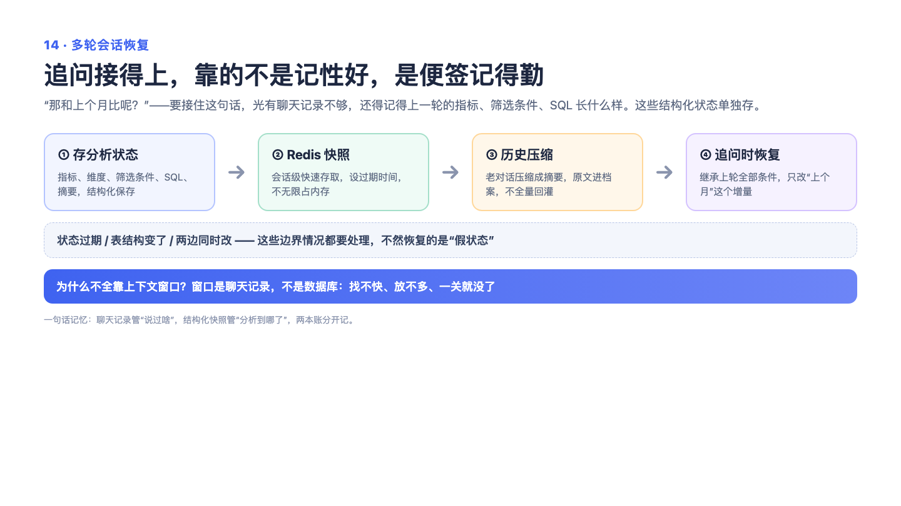

# 14 — 多轮分析会话恢复：聊天记录像行李，超重了不能直接扔箱子

> 一句话记住它：旧对话压缩成便签贴在箱子上，原箱完整存进仓库——丢了细节随时回去翻，第二天回来还能接着聊。

## 这到底是个啥？

你跟 AI 聊数据分析，第一句问"各品类销量"，十分钟后追问"那和上月比呢"——AI 得记得"那"是什么。这要求聊天记录一直留着。但对话越长，模型的"工作记忆"装不下，成本还蹭蹭涨。很多人的做法是简单粗暴：只留最近几条，更早的直接扔。这就好比搬家时行李超重，你把最老的箱子整个扔了——可偏偏最早那箱装的是整个分析的目标设定，扔了后面全乱套。我们的做法分三步：**第一，存档**——每轮对话结束都给整个会话拍个快照存起来，第二天回来能原样恢复；**第二，压缩**——记忆快满时，保留最近的完整对话，更早的部分压缩成一份摘要（关键需求、已确认的事实、用户的偏好）；**第三，留后路**——压缩之前，原始对话完整地存进档案室，摘要上留了个档案编号，模型发现摘要不够用时，可以随时去档案室把原文调出来看。就像领导给你交代一个长项目：你不会逐字记住每次会议，但会记笔记（摘要），同时会议纪要都归档（存档），忘了就翻纪要。

## 面试官会问啥？

### Q1: 对话太长超过模型限制了，你们是直接截断吗？

**答：** 不截断，压缩加存档。直接砍掉旧消息是"无差别丢失"——没有证据说明前面的内容不重要，恰恰相反，最早的消息往往定义了整个分析的方向。我们的做法是：最近几轮完整保留，更早的压成结构化摘要。而且压缩前原始对话全部落盘，摘要里附上档案编号，需要细节时随时取回。相当于"摘要 + 延迟加载"，而不是一刀两断。

### Q2: 摘要肯定会丢细节，你们怎么兜底？

**答：** 承认丢、但可找回。压缩前先把完整原文存进档案库，拿到一个编号；摘要尾部附上这个编号作提示。后续对话中如果模型发现摘要的信息不够回答，可以主动调用"回忆"工具，按需把原文调出来——既可以是全文，也可以只看尾部或搜索关键词。相当于把"扔掉还是留着"的二选一，变成了"收进仓库 + 用时再取"。

### Q3: 用户第二天回来，会话还能接着聊吗？

**答：** 能。每轮对话结束都会给会话拍快照存进缓存，带一个有效期（默认一天）。用户回来时按会话 ID 取快照，历史完整恢复，追问不用重新交代背景。过期了就当新会话开始，用户得重新说一遍需求。如果业务上需要更长的记忆，可以把有效期调大或者定期归档到数据库——但"跨会话的长期记忆"是另一套机制的事，这里只管"短期不失忆"。

### Q4: 压缩历史消息时，有没有什么容易踩的坑？

**答：** 有个很隐蔽的坑：切分点的位置。对话消息是成对出现的——用户提问、AI 作答（中间还夹着工具调用）。如果切分点正好落在中间，比如把提问和回答拆到两边，恢复后模型会看到"半截对话"，容易理解错乱。所以我们专门做了回溯：切分点必须落在一条完整轮次结束的位置，保证压缩出去的部分是整整齐齐的完整轮次。

### Q5: 会话存储要是挂了，主流程还能用吗？

**答：** 能，降级不宕机。恢复会话失败时，系统静默地开一个新会话，用户最多损失历史上下文，功能本身照常可用。这是"优雅降级"的典型场景：辅助能力故障不应该拖垮主链路。当然存档失败那一步的容错还有改进空间，面试时可以坦白说——这也是我知道的待优化点。

## 记忆口诀

"拍快照、写便签、留档案"：每轮拍快照（随时恢复），超重写便签（摘要压缩），原文进档案（编号可召回）——记不全就想搬家："扔箱子是截断，贴便签、存仓库才是压缩"。
