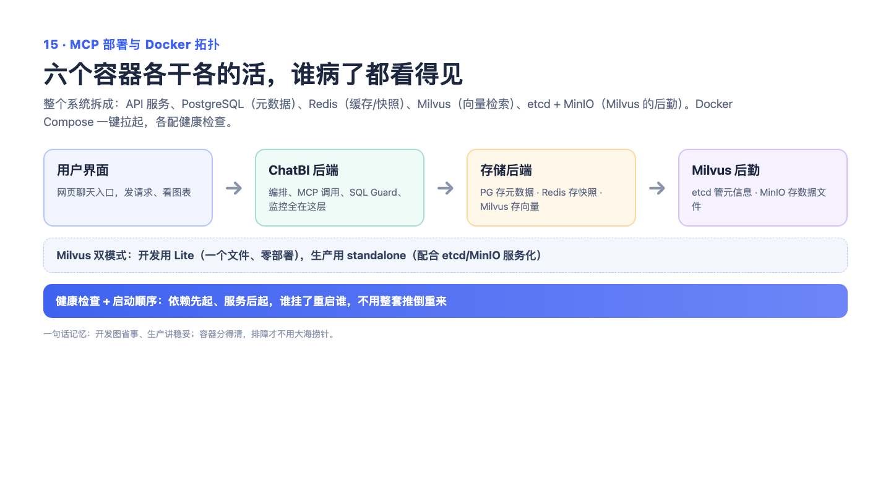

# 15 — MCP 部署与 Docker 六容器：给 AI 插外挂，一条命令开整机

> 一句话记住它：MCP 是万能插座，Docker 是一键开机的整机——六个部件排队就位，AI 的本领随插随用。

## 这到底是个啥？

两个问题。第一个：AI 想用工具（查数据、搜资料、抓网页），怎么接进来才不用每加一个工具就改一遍代码？答案是 MCP——一套工具的"通用插座标准"。家里的插座不会管你插台灯还是充电器，统一两孔三孔；MCP 也不管工具是自家的还是第三方的，统一描述"我叫什么、干什么、需要什么参数"，AI 一看说明书就能用。第三方工具以"服务"的形式接进来，和内置工具在 AI 眼里长得一模一样。第二个问题：这套系统跑起来要一堆配套——存向量数据的 Milvus（AI 的记忆库）、PostgreSQL（正式仓库）、Redis（便签盒）……手动一个个装、按顺序启动，能把人折腾疯。Docker Compose 把这些全部打包成六个"集装箱"：一条命令，全部按依赖顺序自动启动，谁没就绪后面的就先等着。就像一个剧组开机：摄影、灯光、录音各就各位、互相确认，最后导演才喊"开机"。

## 面试官会问啥？

### Q1: MCP 到底解决了什么问题？直接写函数调用不行吗？

**答：** 自己内部的能力当然可以写函数，但问题是工具的世界不止你家——第三方的、别的语言写的、跑在别人服务器上的工具，函数是调不到的。MCP 相当于给所有工具定了一个通用说明书格式：名字、功能、参数怎么填，怎么发现、怎么调用都有统一规矩。有了这个标准，接新工具就像插新电器——不用重新布线，插上就用。

### Q2: 为什么要搞六个容器？一个不够吗？

**答：** 一个容器只装得下大脑，装不下整个身体。系统跑起来需要向量数据库（存 AI 的知识检索）、关系数据库（存正式数据）、缓存（存会话），这些各是独立的专业部件。分开装的好处是各自独立、坏了互不牵连、升级各自来；坏处是要有人管启动顺序——这正好交给编排工具做。就像一台台式机：CPU、内存、硬盘各是各的，但通电后得按主板规定的顺序自检。

### Q3: 容器启动顺序是怎么保证的？先起后端行不行？

**答：** 先起后端，它一睁眼发现数据库、向量库都不在，要么启动失败要么带病运行。编排文件里给每个部件配了健康检查：数据库报告"我好了"、向量库报告"我好了"，后端才被放行启动。这把过去靠运维经验记的"先起谁后起谁"变成了写死的规则，谁来部署都一样。相当于开会前签到：人到齐了才开会议室的门。

### Q4: 外部工具挂了，会不会把整个系统拖垮？

**答：** 不会，各插各的插座。某个外部工具连不上，它自己的工具不注册，内置功能照常工作；调用中出错的话，AI 会收到失败原因，自己决定换条路走。这又是优雅降级的思路——外挂失效，本体照打。当然目前缺自动重连，挂了得人手动重连，这是可以继续加强的点，面试时值得主动提。

### Q5: 开发环境和正式部署用的是同一套东西吗？

**答：** 不是，两套模式。开发时用"迷你版"：向量库用单文件模式，零容器依赖，笔记本上直接跑，轻装上阵。正式部署用完整版：标准编排、独立容器，稳字当头。同一份代码兼容两种形态。就像同一个游戏：开发时玩单机调试版，上线跑的是完整集群——玩法一致，规模不同。

## 记忆口诀

"万能插座 + 一键整机"：MCP 让工具即插即用（插座不挑电器），Compose 让六个容器排队开机（人到齐才开门）——记不住就说："工具像充电器，谁都能插；部署像开剧组成员到齐，导演才喊开机"。
