# 项目内容

> [!结论]
> 阅读项目流程时，先看[当前实现核验](#当前实现核验从请求到答案的完整流程)。本文件保留了早期设计说明和概念材料；旧段落如与核验章冲突，以核验章和当前代码为准。配置值不代表服务已在线，离线评测也不代表生产验证。

# 项目背景&简历撰写

**项目背景：**本项目是一个综合语义层治理、多智能体编排与可信校验机制的 ChatBI / Text2SQL 项目，实现的功能是让业务人员**通过自然语言完成可信的数据查询、指标分析与异动归因**。

直观理解来看，它要解决的是"不懂 SQL 的业务人员也能随时、可信地从数据库里拿到数字"这件事——既要把自然语言翻译成正确的 SQL，又要保证每个数字的口径可解释、可复核。

**以电商运营场景为例（项目内置 Olist 巴西电商数据集）：**

- 每天会产生大量订单、支付、物流、评价数据进入数据库，运营需要持续进行销售额统计、品类分析、差评监控和物流时效跟踪。

- 业务人员直接写 SQL 存在技术门槛；数据人员反复编写临时查询、调整时间范围和指标口径，也会占用大量时间。

**以内容 / 零售行业为例（项目内置 Chinook 数字媒体数据集）：**

- 平台持续产生曲目销售、发票、客户地区分布等数据，需要通过数据查询了解经营情况。

- 产品、运营等业务人员不一定熟悉数据库结构和 SQL 语法，临时性、重复性的查数需求成本高。

更关键的是，**直接把自然语言丢给大模型生成 SQL 并不可靠**：模型可能选错表、用错指标口径（比如把"回头客"理解成 `customer_id` 而非 `customer_unique_id`）、生成数据库方言不支持的函数，或者 SQL 能执行但结果是错的（空结果、比率超 100%、TopN 忘记 LIMIT）。这类"可执行但不可信"的静默错误，是 ChatBI 落地最大的障碍。

因此，本项目希望利用**语义层确定性编译 + SQL 守卫 + 多智能体底座**，为业务人员提供低门槛且可信的数据查询方式：**能确定的问题不交给模型概率生成，不确定的问题也有校验和归因兜底。**

**项目名称：**NexusMind —— 语义驱动的多智能体 ChatBI 与数据洞察系统

**简介：**面向结构化业务数据，基于"NL → IR → SQL"两阶段编译架构与 LangGraph 多智能体底座，将用户意图经语义层确定性编译或多智能体协作转化为可信 SQL，并提供根因分析、字段级评测与全链路审计能力。

---

## 技术方案

**方案：**

- **三路意图识别与动态路由：**规则通道（正则 / 关键词，零成本零延迟）+ LLM 通道（语义理解）+ 历史通道（用户近期意图模式）三路并行，加权投票融合；权重不是静态配置，而是由 Monitor 按各通道历史准确率在线调整。

- **LangGraph 多智能体编排：**以 StateGraph 为内核构建 14 节点编排图，实现四种编排模式——Supervisor 快速路由、ReAct 事件驱动工具循环、Coordinator 跨模块并行拆解、Reflection + Advisor 质量审查定向重试；复杂任务支持 Plan with SOTA（强模型出计划、快模型执行）。

- **上下文管理三件套：**上下文模板组装（system / context / user-tool 三段式）、Token 阈值触发的自动压缩（system 消息永不压缩、切分点回溯防拆 tool 对）、动态上下文（截断 / 压缩前内容以 ref_id 存档，Agent 通过 recall_context 工具按需"回忆"）。

- **三级分层记忆 + Redis 会话快照：**语义 / 情节 / 程序三级记忆存入 Milvus（HNSW 稠密 + BM25 稀疏 + RRF 召回），按语义相似度 × 时近性 × 重要性融合排序；Redis 快照（zlib 压缩）+ `--resume` 恢复保证多轮对话连贯与服务重启不丢上下文。

- **混合检索（Milvus 稠密 + BM25 + RRF + Rerank）：**父子块切分 + 双路召回 + RRF 融合 + Rerank 精排，支撑知识库问答与 Schema 检索，并保留逐层降级路径。

- **两阶段编译与四层路由：**SchemaLinker 将自然语言解析为结构化中间表示 IR（Intermediate Representation，指标 / 维度 / 过滤 / 排序 / LIMIT），按置信度路由至语义层确定性编译、复合指标计划、根因分析规划链或 LLM fallback——已治理指标不经过 LLM 概率生成。

- **语义层 MetricPlanCompiler：**将 14 个业务指标（销售额 / 订单量 / 客单价 / 差评率 / 延迟发货率等）与 18 个维度的口径、JOIN 路径、聚合逻辑固化为代码，保证业务口径可审计、可复用。

- **SQL Guard 三层防护：**sqlglot AST（抽象语法树）静态校验（只读约束 / 方言函数 / 表列存在性 / 多语句拦截）→ 执行失败 LLM 自修复（最多 2 轮）→ 结果合理性检查（空结果 / TopN 无 LIMIT / NULL 占比 / 比率越界）。

- **监控与治理闭环：**Monitor 滑动窗口聚合 p99（99 分位延迟，即最慢的 1% 请求的水平）/ 成功率 / token 消耗，在线驱动路由权重动态调整；MTrace 风格 Span 分布式追踪 + JSONL 全链路 Trace；异常 / 慢查询 / 重试自动采样进 Bad Case 库，驱动离线归因与自进化。

**产出：**

- 完成 NexusMind 前后端业务逻辑开发，实现自然语言驱动的可信数据查询、根因分析与审计追踪，前端含对话 / 评测 / 监控 / 审计等 8 个页面。

- Spider 开放域学术基准（20 个异构数据库、99 题、zero-shot 即不给示例直接生成）：**执行准确率 EX 78.8%，表命中率 97.0%，行召回率 0.851，字段准确率 0.898**。

- 36 项离线回归测试（本地 SQLite、不依赖 LLM）固化历史 bug 与口径约束，全部通过。

> **小白导读：上面方案里的名词一句话解释**（详细展开见后文对应章节）：
>
> - **ChatBI / Text2SQL**：用自然语言查数据库的技术——你说人话，系统写 SQL；
> - **IR（Intermediate Representation，中间表示）**：自然语言和 SQL 之间的结构化"需求单"（指标/维度/过滤/排序），先把"要什么"写下来再生成 SQL，出错可归因。见「Schema Linking：NL → IR」；
> - **LangGraph StateGraph**：多智能体编排框架，把流程画成"图"——节点是处理函数、边是跳转规则、State 是共享记事本。见「LangGraph 多智能体编排」；
> - **语义层 / 确定性编译**：把"销售额=SUM(price)"这类口径写成代码，命中后直接编译出 SQL，不让模型猜。见「语义层（Metric Layer）是什么」；
> - **HNSW / BM25 / RRF / Rerank**：检索四件套——HNSW 管"语义相近"、BM25 管"关键词精确"、RRF 管"两路结果融合"、Rerank 管"精排收敛"。见「混合检索实现」；
> - **AST（抽象语法树）校验**：把 SQL 解析成语法树检查"是不是只读、表列存不存在"，而不是用正则拦关键字。见「SQL Guard 三层防护」；
> - **p99**：99 分位延迟——100 次请求里最慢那次的水平，比平均延迟更能暴露局部劣化。见「Monitor：在线闭环监控与动态权重」；
> - **Span / Trace**：分布式追踪——Span 是一个环节的耗时邮戳，Trace 是一次请求所有 Span 组成的树。见「分布式追踪：MTrace 风格 Span」；
> - **SOTA**：State of the Art，当前最强档的大模型，贵但聪明，只花在规划和诊断上；
> - **zero-shot**：不给任何示例直接让模型答题（相对 few-shot 是先给几个示例再答）；
> - **SSE**：Server-Sent Events，服务端持续推送消息的 HTTP 长连接协议，前端用它逐字显示模型输出。见「前端与 API」。

---

**以上组织为简历时的要点👇👇👇**

> 项目名称、项目简介、项目内容可以用 AI 润色修改，但核心逻辑不要被改废：**简介说清"为谁解决什么问题"，方案突出"多智能体底座 + 语义层 + SQL Guard"这条主线，产出给出 Spider 学术基准上可复核的四项量化指标。**
>
> 数据场景可以按目标岗位替换包装：投电商 / 运营方向重点讲 Olist 数据集上的指标治理，投数据平台方向重点讲语义层架构与 Spider 开放域泛化能力，投 Agent 平台方向重点讲编排与上下文管理。
>
>

# 项目涉及的知识

## 数据库知识

### Schema

**Schema 主要指结构化数据的描述信息，用于支撑大模型完成自然语言到 SQL 的转换。**其核心作用是为模型提供数据结构和语义约束，让模型知道数据库中有哪些表、有哪些字段、字段代表什么含义、表之间如何关联，从而避免生成不存在的字段、错误的关联关系或无效 SQL。

Schema 通常包括：

- **表结构信息**：有哪些表，例如 `olist_orders_dataset`、`chinook.Invoice`。

- **字段信息**：每张表有哪些字段、类型是什么，例如 `order_id`、`payment_value`、`review_score`。

- **表关系信息**：主外键与 JOIN 路径，例如 `olist_orders_dataset 1───* olist_order_items_dataset`。

- **业务语义信息**：字段在业务中的含义，例如 `customer_unique_id` 表示回头客共享标识、`review_score` 取值 1-5 分且 1 分最差。

本项目在三个层面使用 Schema：

#### 表格级 Schema（Table-level）

表名、表的业务含义、表与表之间的关联关系。本项目的 `SchemaRetriever` 把全库 Schema 按 **Domain → Table → Column** 三级组织：先按业务域收敛（订单域 / 支付域 / 商品域 / 评价域 / 媒体销售域），再在候选域内定位表和已验证的 JOIN 关系，避免把全量 DDL 直接塞给模型。

#### 字段级 Schema（Column-level）

字段名、类型、业务语义标注。评测迭代中发现的高危字段会补充中文注释，如 `customer_unique_id(回头客共享)`、`payment_type(credit_card/boleto/voucher/debit_card)`——这类语义标注直接解决了早期"回头客口径混淆"的失败案例。

#### 数据级 Schema（Data-level，具体的数据）

字段的真实取值分布与格式。Spider 评测链路中，Prompt 包含每表 3 行采样数据，让模型理解值的格式（如日期格式、状态枚举值）——只给 DDL 时模型知道"有什么表"，给外键才知道"表怎么连"，给样本行才知道"值长什么样"。这是开放域表命中率达到 97.0% 的关键因素之一。

### Schema 在本项目中的实际形态

以 Olist 订单域为例，三级 Schema 的组织方式：

```text
【Level 1 数据域】
olist_order（Olist 电商订单域）
  别名：订单、下单、销量、订单量、趋势、月度、配送、发货
  包含表：olist_orders_dataset、olist_customers_dataset、olist_order_items_dataset
  描述：订单生命周期、客户归属、订单明细与时间趋势

【Level 2 表与已验证的 Join 关系】
olist_orders_dataset
  字段：order_id, customer_id, order_status, order_purchase_timestamp,
        order_delivered_customer_date, order_estimated_delivery_date ...
  Join：JOIN olist_customers_dataset USING(customer_id)
        JOIN olist_order_items_dataset USING(order_id)
        JOIN olist_order_payments_dataset USING(order_id)

【Level 3 字段（只在命中表内展开）】
olist_orders_dataset.order_status —— 订单状态枚举（delivered/canceled/shipped/approved）
olist_customers_dataset.customer_unique_id —— 回头客共享标识（与 customer_id 区分！）
```

设计要点：

- **三级按信息密度收敛**：先收敛业务域（"差评率"→ 评价域），再在域内定位表，最后只展开命中表的字段。全库 20 张表、几百个字段如果全塞给模型，噪声会淹没关键信息；

- **Join 关系是"已验证"的**：不是让模型看到外键后自己猜 JOIN 条件，而是直接给出验证过的 JOIN 子句，从根上杜绝连错表、漏关联；

- **枚举值属于 Schema 的一部分**：`order_status` 的合法取值（delivered/canceled/...）写进字段语义，模型才不会编造 `status = '已完成'` 这种数据库里根本不存在的值。

### SQL 方言与可执行性

**先理解为什么方言是高频失败点：**LLM 的训练语料里 MySQL / PostgreSQL 的 SQL 占绝对多数，模型"凭语感"生成 SQL 时会不自觉带上这些方言的函数写法——但本项目执行层是 SQLite，函数集完全不同。这不是模型笨，是**训练分布与执行环境不匹配**，必须有工程机制兜底。

三大方言的常见函数差异（本项目踩过的和防过的）：

| 功能 | MySQL | PostgreSQL | SQLite（本项目执行层） |
|---|---|---|---|
| 字符串左截取 | `LEFT(name, 3)` | `left(name, 3)` | `substr(name, 1, 3)` |
| 日期差（天） | `DATEDIFF(a, b)` | `a::date - b::date` | `julianday(a) - julianday(b)` |
| 日期格式化 | `DATE_FORMAT(d,'%Y-%m')` | `to_char(d,'YYYY-MM')` | `strftime('%Y-%m', d)` |
| 字符串拼接 | `CONCAT(a, b)` | `a \|\| b` 或 `concat` | `a \|\| b` |
| 条件取值 | `IF(x>0, a, b)` | `CASE WHEN ...` | `CASE WHEN ...`（无 IF） |
| 当前时间 | `NOW()` | `now()` | `datetime('now')` |
| LIMIT 分页 | `LIMIT n OFFSET m` | 同左 | 同左（少数共性） |

真实踩坑案例：模型生成 `SELECT LEFT(product_category_name, 10) ...`（MySQL 语感），SQLite 直接报 `no such function: LEFT`，第一轮执行失败。修复路径有两种——靠模型重写（慢、要再调一次 LLM）或**静态校验层前置拦截**（快、零 LLM 成本）。本项目选后者为主、前者兜底：

- **SQL Guard 静态校验层**内置方言函数黑名单（`LEFT / DATEDIFF / DATE_FORMAT / IF / NOW` 等），AST 解析时直接识别并给出替换建议（"用 substr 替代 LEFT"）——错误在**执行前**被拦下，不产生数据库往返；
- **自修复提示词**内置方言规则表（"SQLite 环境：用 strftime 而非 DATE_FORMAT、用 julianday 做日期差"），真正进入自修复流程时，修复模型第一轮就知道该往哪个方向改，而不是盲目试错。

两层配合的效果：方言错误从"高频失败点"降为"静态校验的可拦截项"——这也是 SQL 一次通过率能做到 90%+ 的关键防线之一。

### SQL 查询语法基础

Text2SQL 场景下大模型生成的 SQL 主要集中在 DQL（查询），但要理解完整链路需要掌握 SQL 的基本分类：

- **DDL（数据定义）**：`CREATE TABLE` / `ALTER` / `DROP`，定义表结构。ChatBI 系统里 DDL 的唯一用途是给模型提供 Schema 上下文，**绝不允许模型生成**——这是 SQL Guard 只读约束的第一道线。

- **DML（数据写入）**：`INSERT` / `UPDATE` / `DELETE`。问数系统只读，全部拦截。

- **DQL（数据查询）**：`SELECT`，核心考点是五类结构：
  1. **聚合**：`SUM / COUNT / AVG / COUNT(DISTINCT)`——订单表和明细表一对多关联时，`COUNT(DISTINCT order_id)` 是防止订单量虚增的关键口径；
  2. **分组**：`GROUP BY` + `HAVING`——HAVING 过滤聚合后的结果（如"下单≥2 次的回头客"），WHERE 过滤原始行，顺序错了口径就错；
  3. **多表关联**：`INNER JOIN / LEFT JOIN`——评价、支付等子表必须 LEFT JOIN 还是 INNER JOIN 取决于"是否允许主表记录无子表记录"，选错会静默丢行；
  4. **子查询与 CTE**（Common Table Expression，即 `WITH xxx AS (...)` 的写法）：复杂口径（如比率 = 子查询分子 / 子查询分母）用 CTE 组织比嵌套子查询可读性更好；
  5. **排序与截断**：`ORDER BY` + `LIMIT`——用户问 TopN 必须 LIMIT N，这是结果合理性检查的一条硬规则。

几个 ChatBI 场景的典型 SQL 结构示例：

```sql
-- 聚合 + 分组 + 排序：各州订单量排名
SELECT c.customer_state, COUNT(DISTINCT o.order_id) AS order_count
FROM olist_orders_dataset o
JOIN olist_customers_dataset c ON o.customer_id = c.customer_id
GROUP BY c.customer_state
ORDER BY order_count DESC;

-- HAVING 过滤聚合结果：下单 2 次及以上的回头客数
SELECT COUNT(*) AS repeat_customers FROM (
    SELECT c.customer_unique_id
    FROM olist_orders_dataset o
    JOIN olist_customers_dataset c ON o.customer_id = c.customer_id
    GROUP BY c.customer_unique_id
    HAVING COUNT(DISTINCT o.order_id) >= 2
);

-- 条件聚合算比率：差评率（分子分母同口径是关键）
SELECT
  SUM(CASE WHEN review_score <= 2 THEN 1 ELSE 0 END) AS bad_count,
  COUNT(*) AS total,
  ROUND(SUM(CASE WHEN review_score <= 2 THEN 1 ELSE 0 END) * 100.0 / COUNT(*), 1) AS bad_rate_pct
FROM olist_order_reviews_dataset;
```

这三个例子分别对应 LLM 生成 SQL 的三类高频错误：一对多关联不去重导致计数虚增、HAVING 与 WHERE 混淆、比率分子分母口径不一致（WHERE 提前过滤掉分母）。

### SQL 优化与执行计划基础

先补一组数据库基础八股——"慢 SQL 怎么定位、怎么优化"是后端面试的高频题，也是理解"为什么 SQL Guard 要采样慢查询"的前提。

#### EXPLAIN 执行计划怎么看

`EXPLAIN` 用于查看 SQL 的**执行计划**：一条 SQL 经优化器处理后最终打算怎么执行。优化 SQL 前通常先看 `EXPLAIN`，判断查询顺序、索引使用情况、扫描行数和额外开销。结果中比较关键的字段是 `select_type`、`type` 和 `Extra`：

**select_type（查询类型）**：区分普通查询、子查询和联合查询——`SIMPLE`（不含子查询或 UNION 的简单查询）、`PRIMARY`（复杂查询中最外层的 SELECT）、`SUBQUERY`（子查询中的第一个 SELECT）、`DERIVED`（FROM 里的子查询，派生表）、`UNION`（UNION 中后面的 SELECT）、`UNION RESULT`（UNION 的结果）。

**type（访问表方式，判断性能最重要的字段）**，从好到差：

```text
system > const > eq_ref > ref > range > index > ALL
```

- `const`：通过主键或唯一索引命中，最多返回一行；
- `eq_ref`：连表时被驱动表通过主键/唯一索引匹配，每次只返回一行；
- `ref`：普通索引等值查询，可能命中多行；
- `range`：索引范围查询（`>`、`<`、`BETWEEN`）；
- `index`：扫描整棵索引树，比全表扫描略好；
- `ALL`：全表扫描，性能最差，通常是要重点优化的信号。

**Extra（额外执行信息）**，用来发现隐性开销：

- `Using index`：用了覆盖索引，不需要回表，性能较好；
- `Using where`：在存储引擎层用 WHERE 条件过滤；
- `Using index condition`：索引条件下推，提前过滤减少回表；
- `Using filesort`：无法利用索引完成排序，需要额外排序，性能较差；
- `Using temporary`：需要临时表保存中间结果，常见于 GROUP BY 和 ORDER BY；
- `Using join buffer`：被驱动表没用到索引，只能借助 join buffer 硬连。

看执行计划抓四个重点：`type` 是否为 `ALL`、`key` 是否为 `NULL`、`rows` 是否过大，以及 `Extra` 是否出现 `Using filesort` / `Using temporary`。

#### 慢 SQL 的常见原因与定位

慢 SQL 是指执行时间超过预期或超过慢查询阈值（MySQL 中是 `long_query_time`）的 SQL。常见原因可归为七类：

- **数据量太大**：表记录过多，查询扫描范围大；
- **并发太高**：大量请求同时访问，产生锁等待、连接等待或 CPU/IO 资源竞争；
- **索引没用上或没建好**：没建索引、索引失效（对索引列用函数/表达式/隐式类型转换/`like '%x'` 左模糊）、联合索引不符合最左前缀；
- **SQL 写法不当**：`SELECT *`、深分页、复杂嵌套子查询；
- **表结构设计不当**：字段类型不合理、表过宽、大字段影响主表、冷热数据不分离；
- **业务设计不合理**：单次查询范围过大、实时统计大表、接口直接拉全量明细；
- **实例性能不足**：CPU、内存、磁盘 IO 或连接数配置成为瓶颈。

定位方法三步走：开**慢查询日志**捞执行超时的语句 → 对慢 SQL 跑 **EXPLAIN** 看 type / key / rows / Extra → **结合业务场景**确认是数据量增长后变慢、高并发时变慢，还是某次代码改动后出现的。

#### 慢 SQL 的五层优化思路

先定位原因，再对症处理，由内到外一共五层：

1. **索引优化**（针对索引问题）：控制单表索引数量（一般建议不超过 5 个，索引过多拖慢写入也增加优化器选择成本）；联合索引遵循最左前缀，区分度高、使用频率高的列放左侧；高频出现在 `where / order by / group by` 的字段优先建索引或合并成联合索引。例如 `WHERE age=20 AND city='Beijing' ORDER BY name` 用一条 `(age, city, name)` 联合索引同时支持过滤和排序，比分别建 `(age, city)` 和 `(name)` 效果好——直接避免 filesort；
2. **SQL 语句优化**（针对写法问题）：避免 `SELECT *`（减少解析成本、网络传输和回表）；多表 JOIN 尽量小表驱动大表；业务允许重复时用 `UNION ALL` 代替 `UNION`（省去额外去重）；避免索引失效写法（函数包裹索引列、表达式计算、隐式类型转换、左模糊）；
3. **表结构优化**（针对设计问题）：选满足业务需求的最小数据类型；不用字符串存日期（用 `DATETIME` / `TIMESTAMP` 或数值时间戳）；`TEXT`/`BLOB` 等大字段拆扩展表，文件只存地址；高频查询可适当反范式保留冗余字段，换高频 JOIN 的开销；字段尽量定义 `NOT NULL`；
4. **业务优化**（针对场景设计问题）：不合理的深分页改游标分页或限制最大翻页深度；报表类数据 T+1 预计算在低峰期落表，不做实时统计大表；接口强制限制数据范围，避免一次性加载大量数据；
5. **架构优化**（针对量级瓶颈）：读写分离分摊读写压力；Redis 等缓存扛热点数据；单表数据量过大考虑分库分表（但要权衡复杂度）；超大并发可用分布式数据库（如 TiDB）；实例性能不足就升配置。

#### 在 ChatBI 场景怎么用

ChatBI 生成的 SQL 也要考虑执行效率，上面的知识在本项目转化的机制：

- **EXPLAIN 分析**：`EXPLAIN QUERY PLAN` 可以看到查询是否走索引（`SEARCH ... USING INDEX`）还是全表扫描（`SCAN`）。Guard 的慢查询采样（>15s 必采进 Bad Case）就是在捕捉没走索引或大表关联的 SQL。

- **慢 SQL 的主要原因**：没走索引（WHERE 字段无索引 / 函数包裹字段导致索引失效）、JOIN 顺序不合理（大表驱动小表）、SELECT * 返回过多列、聚合前未过滤导致中间结果集过大。

- **优化手段**：过滤条件尽量下推到 WHERE（而不是聚合后再 HAVING）、JOIN 前先过滤、只 SELECT 需要的列、TopN 查询必须 LIMIT。这些规则也写进了 SQL 自修复的提示词，让修复模型不只是"修到能跑"，还"修到跑得合理"。

EXPLAIN 的实际输出示例（SQLite）：

```text
EXPLAIN QUERY PLAN
SELECT c.customer_state, COUNT(DISTINCT o.order_id)
FROM olist_orders_dataset o
JOIN olist_customers_dataset c ON o.customer_id = c.customer_id
GROUP BY c.customer_state;

-- 输出：
-- SCAN o                          ← 全表扫描，订单表无过滤条件时不可避免
-- SEARCH c USING PRIMARY KEY (customer_id=?)   ← 走主键索引，关联效率高
-- USE TEMP B-TREE FOR GROUP BY    ← 需要临时 B 树做分组，数据量大时是性能点
```

读执行计划的核心是两点：**SCAN 还是 SEARCH**（全表扫描还是索引查找）、**JOIN 顺序**（哪张表是驱动表）。ChatBI 场景的表普遍不大（万级行），优化重点不在执行计划调优，而在"不生成语义错误的 SQL"——但慢查询采样机制保证了一旦有 SQL 在大表上失控，能被捕捉到并进入 Bad Case 库归因。

## Text2SQL 与语义层

### Text2SQL 的主流技术路线

三代演进：

1. **规则 / 模板阶段**：预定义查询模板，准确但覆盖面极窄，无法处理开放表述。

2. **Seq2Seq / 微调模型阶段**：把 Schema 和问题编码后由模型解码出 SQL，需要标注数据，泛化能力受限于训练分布。

3. **LLM 生成阶段（当前主流）**：Schema 检索 + Prompt / Few-shot + 执行校验。前沿方向是**语义层约束**（dbt MetricFlow、WrenAI MDL）和**多轮执行反馈**（CHESS、XiYan-SQL 的 pipeline 思路）。

本项目的定位是"**LLM 生成 + 语义层治理 + 三层守卫 + 评测闭环**"的工程化路线。

### 为什么不能只靠 LLM 直接生成 SQL

直接生成的三大问题：

- **指标口径漂移**：同一个"销售额"，这次聚合 `price`，下次可能聚合 `payment_value`，口径每次都可能不同；

- **JOIN 路径失控**：多表关联时模型自由选择路径，可能漏关联、错关联或重复计数（Olist 的订单-支付是一对多，直接 JOIN 会让订单量虚增）；

- **静默错误**：SQL 能执行但结果错误——空结果、比率超 100%、TopN 忘记 LIMIT，没有任何报错信号。

### 语义层（Metric Layer）是什么

语义层是把业务指标的定义（事实表、聚合方式、过滤条件、可用维度、JOIN 路径）从模型概率生成中剥离出来、固化为可审计代码的治理层。本项目的指标定义长这样：

```python
"sales_revenue": MetricDefinition(
    name="sales_revenue",
    display_name="销售额",
    description="商品成交额合计，基于订单明细 price；按品类分析时避免支付拆分导致重复计数",
    dataset="olist",
    table="olist_order_items_dataset",
    aggregation="SUM",
    measure_column="price",
    dimensions=["customer_state", "seller_state", "payment_type", "product_category_name"],
)
```

`MetricPlanCompiler` 将 NL 解析出的 Metric Plan（指标 + 维度 + 过滤 + 排序 + LIMIT）**确定性编译**为 SQL——同一个 Plan 永远生成同一条 SQL，口径由代码审查保证而非模型临场发挥。业界同思路的实践是 dbt MetricFlow 和 WrenAI 的 MDL。

本项目语义层治理的 14 个核心指标：

| 指标 | 中文名 | 数据集 | 主事实表 | 聚合方式 |
|---|---|---|---|---|
| sales_revenue | 销售额 | olist | order_items | SUM(price) |
| order_count | 订单量 | olist | orders | COUNTD(order_id) |
| avg_order_value | 客单价 | olist | order_payments | SUM/COUNTD |
| repeat_customers | 回头客户数 | olist | orders | CUSTOM（HAVING 子查询） |
| bad_review_rate | 差评率 | olist | order_reviews | RATE(score≤2) |
| avg_shipping_time | 平均物流时长 | olist | orders | CUSTOM（julianday 差值） |
| delay_rate | 延迟发货率 | olist | orders | RATE |
| payment_method_stats | 支付方式统计 | olist | order_payments | 复合计划 |
| genre_revenue | 流派收入 | chinook | InvoiceLine | SUM(UnitPrice×Qty) |
| track_count | 曲目目录数 | chinook | Track | COUNTD(TrackId) |
| artist_revenue | 艺术家收入 | chinook | InvoiceLine | SUM + ROUND(2) |
| invoice_count | 发票数 | chinook | Invoice | COUNTD(InvoiceId) |
| genre_revenue_efficiency | 流派收入效率 | chinook | 复合计划 | 收入/曲目数 |
| seller_delay_breakdown | 卖家延迟拆解 | olist | 复合计划 | 条件聚合模板 |

18 个维度统一维护在 `DIMENSION_MAP` 中，每个维度声明来源字段、所属数据集和 JOIN 路径，例如：

```text
customer_state:   source=customers.customer_state,   dataset=olist,   join=orders→customers
product_category: source=products + translation,     dataset=olist,   join=items→products→translation
year_month:       source=strftime('%Y-%m', ...),     dataset=olist,   join=无（主表时间字段）
Genre / Artist:   source=chinook.Genre/Artist,       dataset=chinook, join=InvoiceLine→Track→Genre
```

维度与指标在定义层就绑定了数据集归属，跨数据集的组合在编译前就会被拒绝。

### 两阶段编译（NL → IR → SQL）

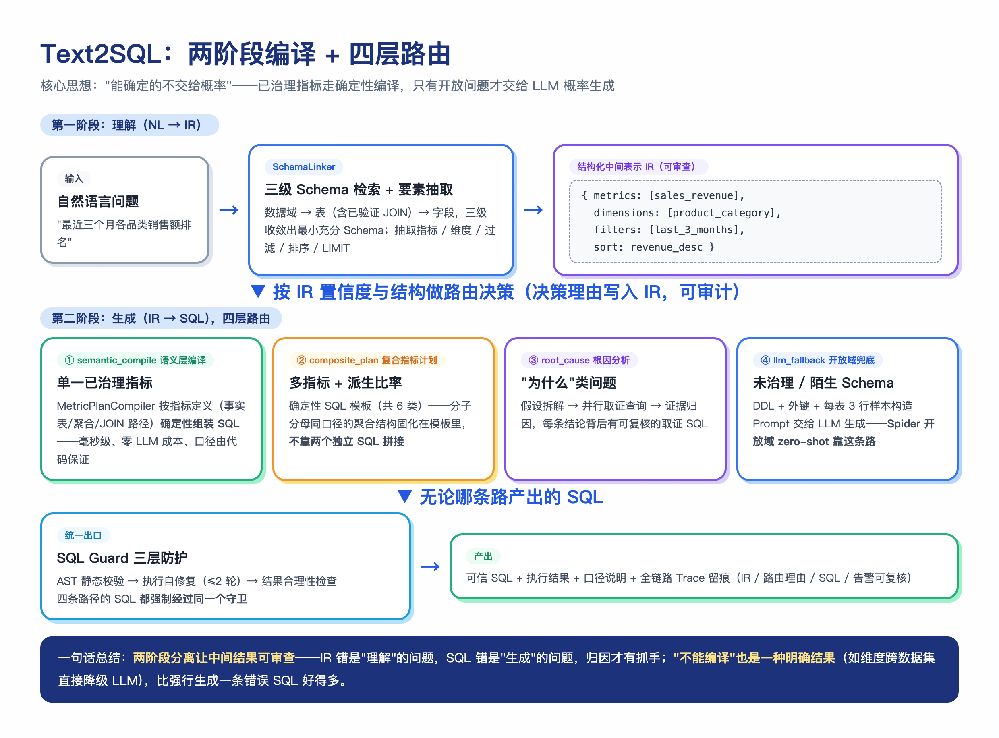

第一阶段 SchemaLinker 负责"理解"：抽取指标、维度、过滤、排序形成 IR；第二阶段编译器负责"生成"：按 IR 组装 SQL。两阶段分离使中间结果可审查——IR 里能看到路由决策的原因（"命中已治理复合 Metric Plan" / "维度跨数据集，降级 LLM 规划"），出错时可以定位是理解错还是生成错。

### 复合指标计划

针对**多指标 + 派生比率**类问题（共 6 类：支付方式统计、跨库订单发票对比、品类差评拆解、流派收入效率、卖家延迟率 TOP5、流派收入驱动）使用确定性 SQL 模板。这类问题的难点是分子分母口径必须一致——比如延迟率 = 延迟单量 / 总单量，WHERE 不能提前过滤掉分母，模板里固化了正确的聚合结构。

**为什么这类问题必须模板化、不能让 LLM 即兴生成？**对比一下两条路：

| 维度 | LLM 即兴生成 | 确定性模板 |
|---|---|---|
| 分子分母口径 | 凭语感，WHERE 放错位置就全错 | 固化在同一聚合内，结构上不可能错 |
| 稳定性 | 同一问题两次生成可能不一样 | 每次执行结果完全一致（可回归测试） |
| 审查成本 | 每次都要人工核对 | Gold SQL 逐行比对一次，固化后永久信任 |
| 失败表现 | 静默错数（最危险——结果"看起来对"） | 要么对、要么报错，不会静默错 |

**一个真实的口径失败案例**：让模型写"各州卖家延迟率"，模型生成了这样的 SQL——

```sql
-- 模型即兴生成（错误版）：WHERE 先过滤了延迟订单
SELECT seller_state, COUNT(*) * 100.0 / (SELECT COUNT(*) FROM orders) AS late_pct
FROM orders WHERE is_late = 1          -- ← 分母口径对不上：分子是"延迟且在某州"，
GROUP BY seller_state                   --    分母却是"全国总单量"，比率直接失真
```

错误极其隐蔽：语法正确、能执行、结果有数字——但每个数字都是错的。这就是派生比率类问题的典型陷阱：**聚合过滤的位置差一厘米，业务含义差一公里**。模板的解法是把分子分母锁进同一个聚合表达式（`SUM(CASE WHEN ...) / COUNT(*)`），从结构上消灭"分母被提前过滤"的可能。

以卖家延迟率 TOP5（seller_delay_breakdown）为例，复合计划的模板产物：

```sql
SELECT s.seller_id, s.seller_state,
  SUM(CASE WHEN o.order_delivered_carrier_date > oi.shipping_limit_date THEN 1 ELSE 0 END) AS late,
  COUNT(*) AS total,
  ROUND(SUM(CASE WHEN o.order_delivered_carrier_date > oi.shipping_limit_date THEN 1 ELSE 0 END) * 100.0 / COUNT(*), 1) AS late_pct
FROM olist_order_items_dataset oi
JOIN olist_sellers_dataset s ON oi.seller_id = s.seller_id
JOIN olist_orders_dataset o ON oi.order_id = o.order_id
WHERE o.order_delivered_carrier_date IS NOT NULL
GROUP BY s.seller_id, s.seller_state
ORDER BY late_pct DESC LIMIT 5
```

这个模板固化了三个容易错的点：**延迟的判定字段**（承运日期 vs 发货截止日，不是客户收货日）、**NULL 过滤**（未发货订单不参与统计）、**比率的分子分母在同一聚合内计算**（不存在分母被提前过滤的可能）。模板经过 Gold SQL 逐行比对验证并有回归测试固化。

### 语义层的编译过程详解

`MetricPlanCompiler` 的编译分四步，每步都可独立审查：

1. **Plan 校验（validate_plan）**：指标必须已注册；维度必须属于该指标的 `dimensions` 支持列表（防止"销售额按流派分组"这种跨域错配）；排序字段必须是已声明的指标；同一指标的维度必须同属一个数据集。任何一条不满足，整个 Plan 降级 LLM 并记录原因。

2. **指标解析**：按 `aggregation` 类型选择聚合骨架——`SUM(price)` / `COUNT(DISTINCT order_id)` / `RATE`（`SUM(CASE WHEN 条件 THEN 1 ELSE 0 END) * 100.0 / COUNT(*)`）/ `CUSTOM`（直接使用预定义 SQL 模板，如回头客数的 HAVING 子查询）。

3. **维度展开**：从 `DIMENSION_MAP` 取出维度的来源字段和 JOIN 路径，按依赖顺序组装 JOIN 子句（如品类维度需要 order_items → products → category_translation 两级关联）。

4. **SQL 组装**：SELECT 维度 + 聚合指标 → FROM 主事实表 → JOIN 维度路径 → WHERE 受控过滤 → GROUP BY → ORDER BY → LIMIT，必要时按指标定义的 `round_decimal` 加 `ROUND(..., 2)`。

复合计划则跳过单指标拼接，直接使用固化的完整 SQL 模板，因为两个独立编译的指标 SQL 拼在一起，分子分母口径几乎必然出错。

## LangGraph 多智能体编排

### 为什么选 LangGraph 而不是自己写 if-else

if-else 写多 Agent 调用顺序，状态（中间结果）需要手动传递，每加一个节点就要改所有下游判断逻辑。LangGraph 的 StateGraph 把所有中间状态放在 `AgentState` 里，每个节点只读写自己关心的字段，加节点就是 `workflow.add_node(...)` + `workflow.add_edge(...)`，不影响现有逻辑；条件边让"根据中间结果决定下一步"成为声明式配置；检查点机制让长对话状态持久化开箱即用。

LangGraph 的四个核心概念：

- **State（状态）**：全图共享的 TypedDict，所有中间结果都挂在上面，节点间不直接传参；

- **Node（节点）**：一个处理函数，输入 State、输出对部分字段的更新（reducer 合并：多个节点写同一字段时按预定义规则合并，比如列表追加而不是互相覆盖）；

- **Edge / Conditional Edge（边 / 条件边）**：固定边表示"执行完 A 必到 B"，条件边根据 State 内容动态决定下一个节点——Supervisor 的路由分发就是一条条件边；

- **Checkpointer（检查点）**：每个节点执行后的状态快照，支持中断恢复和多轮对话状态持久化。

### 本项目的编排图

编排图共 14 个节点，Supervisor 按问题复杂度分流到四种编排模式：

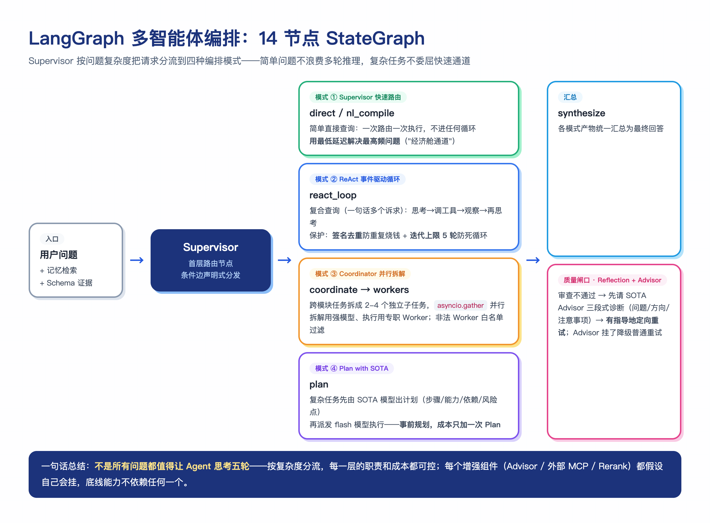

### StateGraph 的真实代码结构

编排图的构建就是声明式的节点与边注册，新增能力不影响既有逻辑：

```python
workflow = StateGraph(AgentState)
workflow.add_node("supervisor", self._supervisor_node)    # 首层路由
workflow.add_node("react_loop", self._react_node)         # ReAct 循环
workflow.add_node("coordinate", self._coordinate_node)    # 并行拆解
workflow.add_node("root_cause", self._root_cause_node)    # 根因规划链
workflow.add_node("reflection", self._reflection_node)    # 质量审查
workflow.add_node("synthesize", self._synthesize_node)    # 汇总
# ... 共 14 个节点
workflow.add_conditional_edges("supervisor", self._route_by_intent)  # 按意图分流
workflow.add_edge("synthesize", "reflection")
```

`AgentState` 是全图共享的状态载体，每个节点只读写自己关心的字段：

| 字段 | 写入节点 | 下游消费者 |
|---|---|---|
| `intent` / `schema_linking` | supervisor / SchemaLinker | 路由、Trace |
| `metric_plan` / `compiled_sql` | nl_compile | SQL Guard、synthesize |
| `mcp_results` | mcp_tools / react_loop | synthesize |
| `rag_result` / `memory_result` | rag_agent / memory_agent | synthesize |
| `rca_result` | root_cause | synthesize |
| `reflection_passed` / `reflection_feedback` | reflection | 重试决策 |

### Supervisor 模式：快速路由

大部分用户问题其实是简单问题（"查一下各州订单量"），如果所有问题都进 ReAct 循环，每次都要多轮 LLM 调用，延迟和 token 成本成倍浪费。Supervisor 是 StateGraph 的首层节点，负责意图分发——直接查询走快速链路，一次路由一次执行，不进入任何循环。快速路径用最低的延迟和成本解决最高频的问题，是系统的"经济舱通道"。

路由在代码里就是一条条件边——`add_conditional_edges("supervisor", self._route_by_intent)`，路由函数读取 `AgentState` 里的意图字段返回下一个节点名，LangGraph 负责跳转：

```python
workflow.add_conditional_edges("supervisor", self._route_by_intent)
# _route_by_intent(state) 的返回示例：
#   "nl_compile"  → 命中已治理指标，走语义层快速链路
#   "react_loop"  → 复合工具需求，进 ReAct 循环
#   "coordinate"  → 跨模块任务，并行拆解
#   "direct"      → 闲聊/无法识别，兜底直答
```

整条分流逻辑是声明式配置而不是嵌套 if-else——新增一条链路只需要注册新节点 + 在路由函数里多一个返回分支，既有节点代码零改动。

### ReAct 模式：事件驱动的 Agent Loop

Supervisor 快速路径解决的是"一次调用就能回答"的问题；但有些问题天然需要多步——先查表结构拿到字段名、再写 SQL 查数据、再做趋势分析，下一步依赖上一步的结果，路由层无法预知。这类复合查询进入 ReAct 循环。

核心是一个由事件驱动的 while loop：用户消息（user_message）、模型发起工具调用（tool_use）、工具返回结果（tool_result），每一类事件都推动 loop 进入下一轮。模型在循环中反复经历"理解当前上下文 → 思考下一步 → 调用工具 → 等待结果 → 基于新结果继续思考"，直到自主判断信息足够，按 JSON action 协议输出 `final` 结束循环：

```json
{"action": "tool", "tool": "execute_sql_guarded", "args": {"sql": "..."}, "thought": "先拿到各品类销售额数据"}
{"action": "final", "answer": "...", "thought": "数据已足够，可以归因"}
```

思考与行动解耦，模型自己决定"什么时候查、查什么、什么时候停"，不需要人类逐步指导。

循环主体的真实实现（`backend/core/react_agent.py`），两个防失控设计都落在代码里：

```python
called_tools = set()          # 已成功调用的"工具+参数"签名，防重复
observation = ""              # 累积的工具观察结果

for i in range(1, max_iterations + 1):          # 迭代上限，默认 5
    user_prompt = f"用户问题：{query}\n"
    if observation:
        user_prompt += f"\n此前的工具调用与结果：\n{observation}\n"
    user_prompt += f"\n（第 {i}/{max_iterations} 轮）请输出 JSON 决定下一步。"

    resp = await self.model.ainvoke([("system", system), ("human", user_prompt)])
    decision = self._parse(resp.content)        # 解析 JSON action

    if decision.get("action") == "final":       # 模型自主判断信息足够 → 结束
        return {"answer": decision["answer"], ...}

    # 签名去重：相同工具+相同参数的重复调用直接拦截
    sig = f"{decision['tool']}:{json.dumps(decision.get('args', {}), sort_keys=True)}"
    if sig in called_tools:
        observation += "\n[系统提示] 工具已调用过，禁止重复调用，请基于已有结果决策或给出最终答案。\n"
        continue
    called_tools.add(sig)

    result = await tool_executor(decision["tool"], decision.get("args", {}))
    observation += f"\n--- 工具返回 ---\n{result}\n"     # 观察结果进入下一轮

# 迭代耗尽：换一个提示词强制总结，绝不允许不返回
resp = await self.model.ainvoke([
    ("system", "基于已有查询结果直接回答，不要再调用工具。"), ...])
```

两个保护机制对应 ReAct 范式最常见的两个工程事故：**签名去重**防"重复调用烧钱"（模型第 3 轮又试图调同一个 SQL 时，系统拦截并在提示里反馈"该工具已调用过且结果是 X"，引导它走向 final 而不是原地打转）；**迭代上限**防"死循环不返回"（5 轮耗尽后强制总结输出）。解析失败也有兜底：只要已有观察结果就基于现有信息总结，而不是把错误抛给用户。

一次真实的 ReAct 循环 trace（用户问"查一下月度销售趋势，顺便看看哪个品类差评最多"）：

```text
第 1 轮 thought: 需要月度销售数据，先调 SQL 工具
  → tool: execute_sql_guarded(monthly_revenue_sql) ✓
第 2 轮 thought: 销售趋势已拿到，还差品类差评数据
  → tool: execute_sql_guarded(category_bad_review_sql) ✓
第 3 轮 thought: 两类数据都齐了，可以综合回答
  → final: "月度销售趋势 ... 差评最多的品类是 ..."

迭代 3 次，工具调用 2 次，无重复调用，正常收敛
```

### Coordinator 模式：跨模块并行拆解

当问题同时涉及多个独立模块（业务数据 + 知识库规则 + 个人历史），串行执行多个独立子任务是纯粹的延迟浪费。Coordinator（强模型）把任务拆成 2-4 个独立子查询，按类型分派给专职 Worker（data_worker / schema_worker / memory_worker），通过 `asyncio.gather` 并行执行，结果分流到各自 state 字段，汇总节点无感知。拆解结果会过白名单校验，非法 Worker 类型直接过滤。

并行拆解把总耗时从"各子任务之和"降为"最慢子任务"；同时这是强弱模型分工——拆解这种高价值决策交给强模型，执行交给专职 Worker，成本与质量兼顾。

Coordinator 的拆解输出示例（用户问"帮我分析下 Q4 销售情况，结合我上次关注的品类，再看看平台退货政策怎么说"）：

```json
{
  "subtasks": [
    {"worker": "data_worker",   "query": "Olist Q4 各月销售额与订单量"},
    {"worker": "memory_worker", "query": "用户上次关注的品类偏好"},
    {"worker": "schema_worker", "query": "平台退货政策的关键条款"}
  ]
}
```

三个子任务互不依赖，`asyncio.gather` 并行执行；拆解结果过白名单校验（worker 必须是 data/schema/memory 三种之一），模型编造的不存在执行器直接被过滤并降级为单任务串行。

### Reflection + Advisor 模式：有指导的重试

盲目重试的期望收益很低——同样的输入大概率得到同样的坏结果。Reflection 节点对最终答案做质量审查，判定不通过时**不是直接重试**，而是先调用 Advisor（SOTA 强模型）——Advisor 拿到主 Agent 的完整上下文（用户问题、已调用工具及结果、当前困惑），输出三段式诊断：【问题诊断】【方向建议】【注意事项】，注入重试上下文做"有指导的重试"。Advisor 不允许使用任何工具，只给判断；Advisor 不可用时自动降级为普通重试。

Advisor 把"再试一次"变成"带着诊断意见再试一次"；同时它是成本分级设计：便宜的 flash 模型干执行，贵的 SOTA 模型只花在"诊断"这个刀刃上。

### Plan with SOTA：先规划后执行

复杂任务先自动切换到 SOTA 模型做 Plan——拆解步骤、标注每步所需能力（tool / rag / memory）、标注依赖关系（可并行 / 必须串行）和风险点（大数据量 / 复杂聚合步骤标 [耗时] 并给兜底动作），再把 Plan 派发给 flash 模型执行。弥补 flash 级模型在方案设计和前置推理上的短板，成本只增加一次 Plan 调用。

下图把"贵模型出脑、便宜模型出手"的分工和成本账一次性讲清：

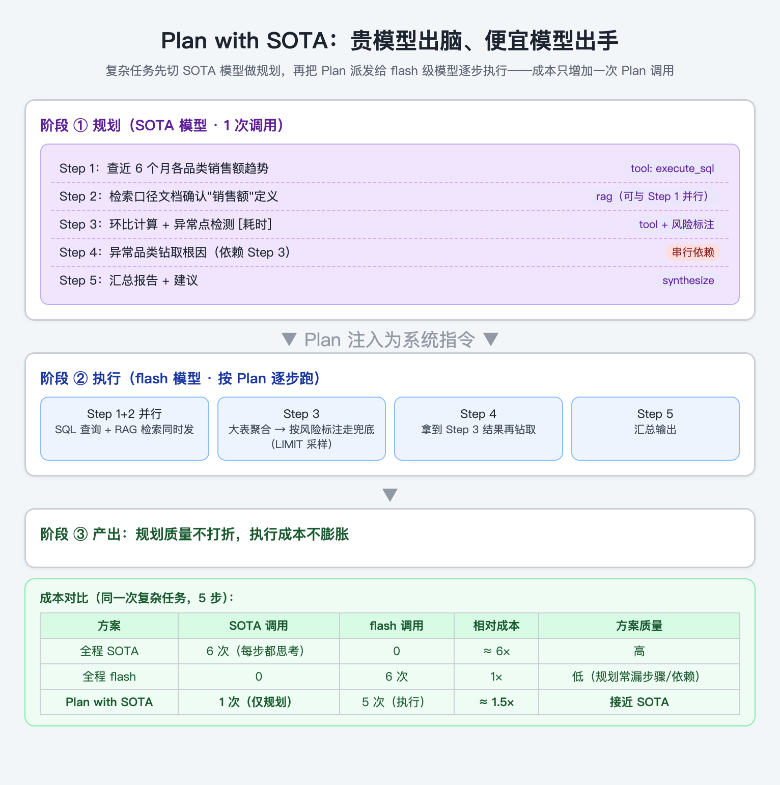

**这是"规划与执行分离"（Planner-Executor）的经典架构八股**，和 ReAct 的关键区别在于"思考发生在什么时候"：

- **ReAct**：边想边做——每一步都"思考→行动→观察"，决策分布在每一轮。优点是灵活（能根据中间结果随时调整方向），缺点是每步都要付一次完整推理的成本，且小模型容易在多步后"忘记最初目标"；
- **Plan with SOTA**：先想清楚再做——规划一次性完成，执行只是按图施工。优点是规划质量由最强模型保证、执行成本被压到最低、步骤间的依赖/并行关系在动手前就已明确；缺点是中间结果若与预期偏差大，需要重规划（本项目用 Reflection 兜底）。

**什么任务该走 Plan with SOTA 而不是 ReAct？**两个判断标准：一是**步骤可预知**（"查趋势→找异常→钻取根因→出报告"这类分析任务，动手前就能列出完整步骤）；二是**步骤数 ≥ 3**（两三个工具调用以内的小任务，ReAct 的灵活收益更大，规划反而是浪费）。反过来，**探索型任务**（"帮我看看这份数据里有什么有意思的东西"——下一步取决于上一步看到了什么）必须走 ReAct，提前规划没有意义。

**成本账**：一次 5 步的复杂分析，全程 SOTA 约 6 次高价调用；全程 flash 约 6 次低价调用但规划质量差（常漏步骤、搞错依赖）；Plan with SOTA 是 1 次高价（规划）+ 5 次低价（执行）≈ 1.5 倍成本，拿到接近 SOTA 的方案质量。本质上是**用一次贵调用买断了整个方案的设计质量**。

## 大模型的会话记忆

### 什么是长期记忆，什么是短期记忆

大模型本身是**无状态的**，每次生成回答只能看到当前输入给它的 Prompt。所谓记忆，本质上是把历史信息以某种方式重新提供给模型。

- **短期记忆**：当前会话中的历史上下文。本项目用 Redis 会话快照实现——每轮对话后把会话状态（消息历史 + AgentState）序列化、zlib 压缩后写入 Redis，支持服务重启后 `--resume` 恢复，多轮连贯性由最近轮次上下文 + 检查点保证。

- **长期记忆**：存储在模型外部的持久化记忆系统，跨会话保留，需要时通过检索动态注入，而不是固定拼进每次 Prompt。

两者解决不同问题：短期记忆保证"这轮对话接得上"，长期记忆保证"上次说过的偏好还记得"。长期记忆的作用可以拆细三点：**个性化**（记住用户偏好，回答更贴合个人习惯）、**内容持久化**（关键信息沉淀下来，避免用户反复陈述）、**跨会话性**（上周会话的结论，这周还能接上）。

### 两种记忆的详细对比（面试高频对比题）

| 维度 | 短期记忆 | 长期记忆 |
|---|---|---|
| 存储目标 | 维持当前会话的上下文连续性，支持指代和连续提问 | 跨会话保留偏好、事实与历史事件，实现个性化 |
| 数据形态 | 原始对话文本为主（窗口内原文 + 更早历史的摘要） | 从对话中抽取沉淀的关键信息（结构化 + 向量化） |
| 存储介质 | Redis 等内存缓存（本项目是会话快照，24h TTL） | 向量数据库（本项目是 Milvus）+ 结构化元数据 |
| 调用机制 | **被动拼接**：固定把最近 N 轮拼进 Prompt | **触发式**：按需检索，召回后动态注入 Prompt |
| 生命周期 | 会话级，会话结束 / 超时自动失效 | 用户级，主动删除或触发清理策略前长期存在 |
| 数据规模 | 小，受上下文窗口约束（本项目压在 4K token 内） | 持续积累，存储规模可横向扩展 |

记忆系统的设计核心其实是两个决策：**什么时候存**（哪些信息值得沉淀——本项目是事件触发 + 后台压缩两条路径，importance 由 LLM 评分）和**什么时候回忆**（何时检索、检索哪类、召回多少——本项目按 memory_type 并行检索 + 三因子融合排序取 Top-K）。两个决策的具体实现见后文"记忆的写入时机与流程"与三级分层记忆的召回公式。

### 短期记忆的三种策略对比

| 策略 | 做法 | 优点 | 缺点 |
|---|---|---|---|
| 滑动窗口 | 只保留最近 N 轮 | 简单、低成本 | 早期信息直接丢失 |
| 全量摘要 | 历史全部压缩成摘要 | 信息不丢 | 摘要是有损的，细节模糊 |
| 窗口+摘要（本项目） | 最近 N 轮原文 + 更早历史摘要 + 压缩前存档 | 细节与梗概兼顾 | 实现复杂度最高 |

### 三级分层记忆：语义 / 情节 / 程序

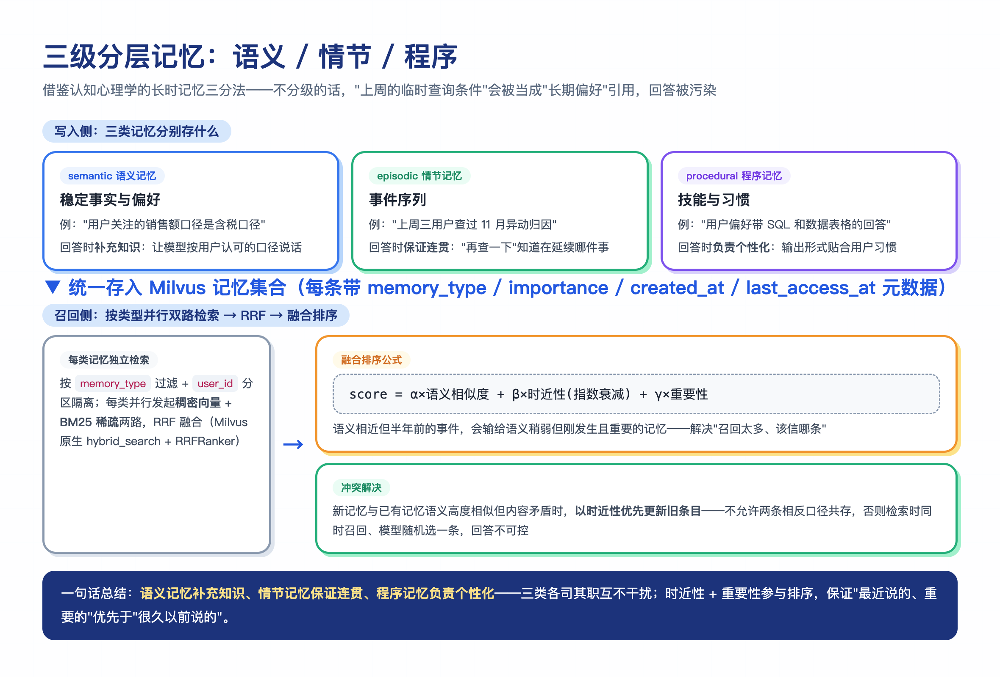

借鉴认知心理学的长时记忆三分法，把长期信息分三类存入 Milvus 记忆集合：

- **语义记忆**：稳定的事实与偏好（"用户关注的指标口径是含税销售额"）；
- **情节记忆**：事件序列（"上周三用户查过 11 月异动归因"）；
- **程序记忆**：技能与习惯（"用户偏好带 SQL 和数据表格的回答"）。

存储层的集合 Schema 带完整元数据：

```text
id（主键）/ user_id（分区键）/ thread_id / memory_type（三级分类）
content（文本，启用中文分词）/ summary_id（关联摘要）
importance（重要性评分）/ created_at / last_access_at（时近性依据）
vector（HNSW 稠密索引，COSINE）/ sparse_vector（BM25 稀疏索引）
```

召回时按 `memory_type` 分类并行做双路检索（稠密语义泛化 + BM25 关键词精确），经 RRF 融合后，再按 **`alpha × 语义相似度 + beta × 时近性（指数衰减）+ gamma × 重要性`** 的加权公式做最终排序，只注入与当前问题相关的 Top-K 条目。

为什么要分级：如果不分级，过期事件会被当作事实引用（把"上周的临时查询条件"误认为长期偏好），回答被污染。三级分离后语义记忆补充知识、情节记忆保证连贯、程序记忆负责个性化，互不干扰；融合排序解决"召回的记忆太多、该信哪条"的问题——语义相近但半年前的事件，会输给语义稍弱但刚发生且重要的记忆。同时"用户偏好的口径"可以跨会话复用，而一次性的 SQL 结果不会无限占用上下文窗口。

召回的真实实现（`backend/memory/memory_manager.py`）：每类记忆独立并行发起稠密+稀疏两路，Milvus 原生 `hybrid_search` 内部完成 RRF 融合；某类混合检索失败自动降级为纯稠密检索：

```python
memory_configs = {
    "semantic":   {"k": semantic_k,   "filter": f"user_id == {user_id} and memory_type == 'semantic'"},
    "episodic":   {"k": episodic_k,   "filter": f"user_id == {user_id} and memory_type == 'episodic'"},
    "procedural": {"k": procedural_k, "filter": f"user_id == {user_id} and memory_type == 'procedural'"},
}

# 每类记忆：稠密 + 稀疏 双路请求
dense_req = AnnSearchRequest(data=[dense_vector], anns_field="vector",
    param={"metric_type": "COSINE", "params": {"ef": 64}},
    limit=k * 6, expr=filter_expr)
sparse_req = AnnSearchRequest(data=[query], anns_field="sparse_vector",
    param={"metric_type": "BM25"}, limit=k * 4, expr=filter_expr)

# Milvus 原生 hybrid_search + RRFRanker 一次完成双路召回与融合
results = await self.client.hybrid_search(
    collection_name=self.collection_name,
    reqs=[dense_req, sparse_req],
    ranker=RRFRanker(),
    limit=k * 3,
    output_fields=["id", "memory_type", "content", "importance", "last_access_at"],
)

# 四类记忆并行检索
all_results = await asyncio.gather(
    *[search_memory_type(t, cfg) for t, cfg in memory_configs.items()],
    return_exceptions=True)
```

注意两点：`filter_expr` 里同时带 `user_id` 和 `memory_type`——前者是多租户隔离（ Milvus 分区键），后者是三级分层的实现基础；`hybrid_search` 失败时降级为纯稠密 `search`，与检索链路"优先可用性"的降级哲学一致。

融合排序的实际计算示例（alpha=0.5, beta=0.3, gamma=0.2）：

```text
记忆 A："用户偏好含税口径"（semantic）
  0.92（相似度）× 0.5 + 0.30（30 天前）× 0.3 + 0.9（重要性）× 0.2 = 0.73
记忆 B："用户昨天问过差评率"（episodic）
  0.65（相似度）× 0.5 + 0.98（1 天前）× 0.3 + 0.5（重要性）× 0.2 = 0.72
记忆 C："用户喜欢带表格的回答"（procedural）
  0.40（相似度）× 0.5 + 0.60（时近性）× 0.3 + 0.6（重要性）× 0.2 = 0.50

→ 最终注入 A、B（Top-2），C 被截断
```

时近性按指数衰减计算（`DECAY_RATE ^ 距今天数`），越久远的记忆衰减越多；importance 在写入时由 LLM 一并评分。

### 记忆冲突解决

新旧记忆冲突是当前未解决的问题。例如“含税”改成“不含税”，现有代码只按向量相似度 0.9 去重，可能误丢新声明，并不会自动以新覆盖旧。

### 记忆的写入时机与流程

记忆不是每轮对话都写，而是**事件触发 + 后台压缩**两条路径：

1. **实时写入**：对话中出现明确的偏好声明或关键事实（"以后都按不含税口径算"）时，LLM 抽取为结构化记忆条目（内容 + memory_type + importance 评分）直接写入；

2. **后台压缩**：后台任务定期扫描会话历史，把长对话压缩为摘要记忆（关联 `summary_id`），同时把一次性的大结果集挡在记忆库外——只有结论入库，原始数据不入库。

每条记忆写入时同步生成稠密向量（Embedding）和稀疏向量（Milvus 内置 BM25 Function 从 content 自动生成），`importance` 评分由 LLM 在抽取时一并给出（用户明确要求记住的 > 系统推断的事实 > 临时上下文）。

### Redis 会话快照的结构

```json
{
  "session_id": "sess_1001_a1b2c3d4",
  "user_id": 1001,
  "messages": [{"role": "user", "content": "..."}, ...],
  "state": {"intent": "data_query", "schema_linking": {...}},
  "summary": "用户在做 Olist 品类销售分析...",
  "token_count": 3200,
  "updated_at": "2026-08-27T10:00:00",
  "version": 1
}
```

快照整体经 zlib 压缩后写入 Redis（key: `nexusmind:session:{session_id}`，24h TTL），用户维度另维护 ZSet（Redis 的有序集合，元素按分数排序，这里分数是时间戳）索引支持会话列表查询。**踩过的坑：**二进制快照被 `decode_responses=True` 的文本客户端强制 UTF-8 解码导致 `UnicodeDecodeError`，修复方式是二进制数据走独立客户端连接——已固化回归测试。

## 多轮对话的上下文聚合

多轮对话中用户的当前问题往往依赖上文："那把圣保罗州的品类拆一下"里的"那"指代什么，单看当前一句无从得知。上下文聚合就是**把当前 Query 和历史对话组装成一个自包含的请求**，再交给下游链路。

本项目的做法分两层：

1. **查询改写（QueryRewriter）**：LLM 结合最近对话历史做指代消解（"它/那个州"→ 具体实体）和省略补全（"再查一下"→ 补全查询主题），输出自包含 Query，改写失败降级为原 Query；

2. **短期记忆注入**：最近若干轮对话原文（压缩后则是摘要 + 最近轮次）随 Query 一起进入编排，意图识别和 Schema Linking 都能看到上下文——"那"不仅能被改写掉，路由层也能理解当前问题属于哪条链路的延续。

聚合的位置在链路最前端：先聚合、再识别意图、再检索 Schema。顺序不能反——拿未消解的 Query 去检索，召回的 Schema 必然是错的。

改写的真实实现（`backend/core/query_rewriter.py`）——核心是"把最近对话历史 + 当前问题一起给模型，让它输出自包含查询"，但 v2 在外面包了四层工程优化，避免无谓的 LLM 调用和坏改写：

```python
async def rewrite(self, query: str, conversation_history=None) -> str:
    # 1. 快速短路：无历史、或无指代/省略标记的 query 不调 LLM 直接返回
    if not self._needs_rewrite(query, conversation_history):
        return query

    # 2. 历史截断：每条限 400 字、总量限 2400 字，防长工具结果灌进改写 prompt
    history_text = self._build_history_text(conversation_history or [])

    # 3. LRU 缓存：相同 (query + 近期历史) 命中直接返回，不重复调 LLM
    key = self._cache_key(query, history_text)
    cached = self._cache_get(key)
    if cached is not None:
        return cached

    # ... 调 LLM，解析 JSON ...
    if need_rewrite and rewritten and rewritten != query:
        # 4. 输出校验：改写结果与原文零词重合（改跑题）或异常膨胀（拼接事故）则回退原文
        if self._is_sane(query, rewritten):
            return rewritten
    return query
```

四层优化的取舍：

- **快速短路**：`_needs_rewrite` 先判"有没有对话历史"（首问一定不改写），再用正则匹配指代/省略标记（`它/这个/那个/再/继续/上次/...呢$`）。命中的才值得花 LLM；不命中的完整问句（"查询本月各客户等级的订单数量"）直接放行——这一层砍掉的是绝大多数无指代追问的改写开销。
- **历史截断**：每条消息 `[:400]`、总量 `[:2400]`，从最新往前装满为止。工具结果动辄几 KB 全塞进改写 prompt 既贵又扰动模型，截断后只保留对指代消解真正有用的近期上下文。
- **LRU 缓存**：key 是 `(query + 截断后历史文本)` 的 md5，上限 128，相同上下文重复问不重复调模型。
- **输出校验**：`_is_sane` 检查改写结果与原文是否有词级或字符级重合（零重合 = 改跑题）、是否异常膨胀（超 4 倍长度 = 拼接事故），任一不通过就回退原文——**宁可不改也不要改错**，与"改写是增强不是依赖"的设计原则一致。

提示词里的关键约束（节选）："模糊指代明确化（用对话历史中最近的对应实体替换'它/这个/那个'）、省略内容补全（'再查一下'需补全主题）、**如果当前 query 已经是自包含的完整表述，可以不做修改直接返回**"。最后这条对应`need_rewrite` 标志——模型自己判断"这轮要不要改"，避免对本来完整的问题过度改写引入噪声。改写失败（模型报错、JSON 解析失败、输出校验不过）时都 `except` 回退原 Query——**改写是增强不是依赖，挂了不阻塞主链路**。

一次真实改写（承接上面"各州订单量"的追问）：

```text
对话历史：user: 查一下 Olist 各州订单量排名
         assistant: 圣保罗州(SP)以 41,760 单位居第一...
当前输入：那把圣保罗州的品类拆一下
  ↓ QueryRewriter
改写结果：拆解 Olist 圣保罗州(customer_state='SP')的各品类订单量
  ↓ 自包含，可独立送检索与意图识别
```

### 上下文聚合的四条原则

参考业界的实践并结合本项目实测，聚合时遵循：

- **以本轮 Query 为主**：本轮问题已表达完整时直接保留，不改写。过度改写反而会引入噪声；

> 历史 Query：查询今年各地区的销售额。
> 本轮 Query：查询本月各客户等级的订单数量。
> 聚合结果：查询本月各客户等级的订单数量。（本轮已完整，不改动）

- **存在省略时才补充**：本轮缺少指标、维度或筛选条件时，才从历史上文补充；

> 历史 Query：查询今年各地区的销售额。
> 本轮 Query：只看华东地区。
> 聚合结果：查询今年华东地区的销售额。

- **存在指代时才改写**：出现"这个""刚才的结果""第一名"等指代时，结合历史 Query、Assistant 回答或表格元信息明确指代内容；

> 历史结果：华东地区销售额排名第一。
> 本轮 Query：第一名是多少？
> 聚合结果：华东地区的销售额是多少？

- **不引入无关信息**：历史上下文中与本轮无关的条件不带入聚合结果——历史上文是辅助，不是堆叠。

### 上下文的内容组成

聚合时给模型的上下文包含：系统提示词（角色与规则）、用户 Query（本轮 + 历史）、Assistant 回答、以及**表格元信息**（表标题、表头、行数、生成该表格的 SQL）。注意表格的**数据部分不进入聚合上下文**——数据部分可能很长，聚合和意图判断只需要表格元信息；只有当请求被路由到数据分析链路时，才把具体数据加入上下文。这是控制 token 成本的关键细节。

## 必要时澄清

不是所有模糊问题都应该让模型硬着头皮猜。本项目在两个节点允许系统主动澄清：

- **意图低置信时**：三路融合的加权最高分低于阈值，说明系统对"用户到底要查数还是要归因"没有把握——此时返回澄清问题（"您是想查询具体数值，还是分析变化原因？"），而不是强行路由。路由错的代价远高于多问一句；

- **关键口径歧义时**：用户说"销售额"而业务里同时存在含税/不含税两个口径，这类**会实质影响查询结果的歧义**才澄清；无关紧要的模糊（如时间默认最近一年）用默认值继续，不打断用户。

设计原则：**澄清是有成本的，只有"猜错的代价比打断用户更大"时才澄清**。

## 混合检索实现

### 单存储引擎 vs 双存储引擎

下图把两种组织方式的架构差异和优缺点摆在一起——左边是本项目选的单引擎方案（Milvus 一套系统搞定稠密+稀疏+融合），右边是双引擎方案（Milvus + ES 各管一路、应用层自行归并）：

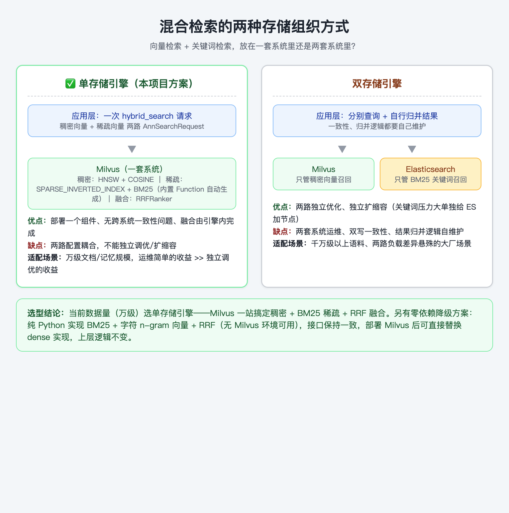

混合检索需要同时支持向量检索和关键词检索，工程上有两种组织方式：

- **单存储引擎**：向量和关键词索引在同一个系统里维护（如 Milvus 同时维护稠密向量索引和 BM25 稀疏索引，稀疏向量由内置 Function 从文本自动生成）。查询时一次请求发起两路召回，结果由系统内部融合。优点是部署简单、无跨系统一致性问题、运维成本低；缺点是两路检索的配置耦合在一起，不能独立调优。

- **双存储引擎**：向量库（如 Milvus）和搜索引擎（如 Elasticsearch）各管一路，应用层分别查询再归并结果。优点是两路可独立优化、独立扩缩容（比如关键词检索压力大时单独给 ES 加节点）；缺点是要维护两套系统、处理两边数据的一致性和结果归并逻辑。

**本项目方案选择：**业务规模下选单存储引擎（Milvus 一站搞定稠密 + BM25 稀疏），因为当前数据量（万级文档/记忆）远没到需要独立扩缩容的程度，运维简单的收益大于独立调优的收益。另外 ChatBI 的 Schema 知识库还有一个零依赖的本地实现（BM25 + 字符 n-gram 向量 + RRF，纯 Python 无需任何外部服务）作为无 Milvus 环境的降级方案——接口保持一致，部署了 Milvus / EmbeddingProvider 时可直接替换 dense 检索实现，上层逻辑不变。

### 父子块切分

**要解决的问题：**文档入库前必须切成小块（chunk），因为 Embedding 模型对长文本的向量化会出现"语义稀释"——一块里话题太多，向量被平均化，检索时什么都匹配不准。但切多小是个两难：

- 切小块：召回精确（每个块语义聚焦），但块内上下文残缺，模型拿到的片段前言不搭后语；
- 切大块：上下文完整，但召回粗糙（块太大，向量表达不聚焦，且塞进上下文浪费 token）。

**父子块（Parent-Child Chunking）就是"用小块检索、用大塊回答"**：入库时做两级切分——先切成较大的**父块**（保留完整段落语义，比如一整节政策条文），再把每个父块切成细粒度的**子块**（一两句话，用于精确召回）。

具体长什么样（以退款政策文档为例）：

```text
父块 P1（约 500 字）：
  "退款政策：一、配送超时订单的退款规则。1. 超时 15 分钟内...
   2. 超时 15-30 分钟赔付 5 元... 3. 超时 30 分钟以上..."
  ├── 子块 P1-C1："超时 15 分钟内不支持退款"
  ├── 子块 P1-C2："超时 15-30 分钟赔付 5 元红包"
  └── 子块 P1-C3："超时 30 分钟以上支持全额退款并赔付 8 元"
```

**入库阶段**：子块逐条生成 Embedding 写入向量库，元数据里记录 `parent_id` 和内容 hash；父块原文存 PostgreSQL。

**召回阶段**：用户问"超时 20 分钟能退吗"，向量检索命中子块 P1-C2（细粒度、精准匹配"15-30 分钟"这个区间）；然后按 `parent_id` 取回父块 P1 的完整条文交给模型——**检索的精度由子块保证，回答的上下文完整性由父块保证**。

**入库去重**：每个子块计算 sha256 内容哈希，入库前先查重——同一文档重复入库（或两个文档含相同段落）不会产生重复块，保证知识库可反复增量更新而不膨胀。

一张图看清入库与查询的完整数据流：

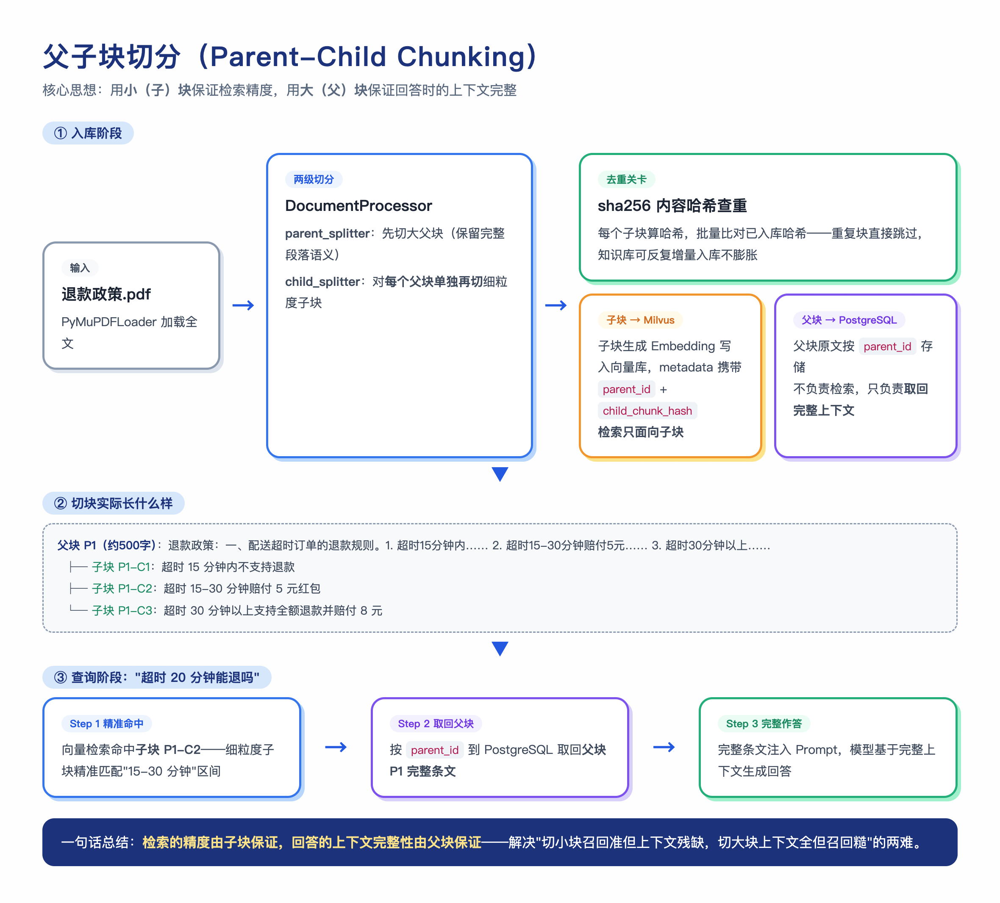

代码实现（`backend/rag/documents_process.py`，已简化注释）：

```python
class DocumentProcessor:
    def __init__(self, hash_storage=None):
        # 两个切分器：父块大、子块小，递归按 段落→句子 边界切
        self.parent_splitter = RecursiveCharacterTextSplitter(
            chunk_size=config.parent_chunk_size,
            chunk_overlap=config.parent_chunk_overlap)
        self.child_splitter = RecursiveCharacterTextSplitter(
            chunk_size=config.child_chunk_size,
            chunk_overlap=config.child_chunk_overlap)

    async def process_document(self, temp_file_path, filename, file_hash, ...):
        documents = loader.load()                          # 1. 加载 PDF/DOCX
        parent_chunks = self.parent_splitter.split_documents(documents)

        for parent_index, parent_chunk in enumerate(parent_chunks):
            parent_id = str(uuid.uuid4())                  # 2. 每个父块一个 UUID
            parent_data_list.append({"parent_id": parent_id,
                                     "text": parent_chunk.page_content, ...})

            # 3. 关键一步：子块是对“单个父块”再切分，天然形成从属关系
            for child_chunk in self.child_splitter.split_documents([parent_chunk]):
                child_hash = hashlib.sha256(
                    child_chunk.page_content.encode()).hexdigest()
                child_chunk.metadata.update({
                    "parent_id": parent_id,                # 子块记下自己的父块
                    "child_chunk_hash": child_hash,        # 去重凭据
                    ...
                })

        # 4. 批量查重：已入库过的子块哈希直接跳过（增量入库不膨胀）
        existing = await self.hash_storage.batch_check_duplicates(all_hashes, ...)
        new_child_items = [c for c in all_child_items
                           if sha256(c) not in existing]

        # 5. 三路并行落库：子块→Milvus、父块→PostgreSQL、哈希→去重表
        await asyncio.gather(
            milvus_client.add_chunks_batch(chunks=new_child_items, ...),
            postgresql_client.add_parent_chunk_batch(parent_data_list, ...),
            self.hash_storage.batch_add_chunk_hashes(new_hashes, ...))
```

注意第 3 步：`child_splitter.split_documents([parent_chunk])` 是"对每个父块单独再切"，而不是全文平铺切两遍——子块与父块的从属关系就是这么建立的，每个子块的 metadata 里都带着 `parent_id`。第 4 步的 sha256 查重让"同一文档重复入库"和"两个文档含相同段落"都不产生重复块。

### BM25：关键词检索的原理

BM25 是经典的关键词相关性评分算法。不用记公式，先建立直观理解：**一个词对文档的区分能力，取决于它有多"稀有"和在这篇文档里出现多频繁**。

- **TF（词频）**：词在本文档中出现次数越多，本文档越可能相关——查"差评率"，含 3 次"差评率"的文档比含 1 次的更相关；

- **IDF（逆文档频率）**：词在整个语料库里越稀有，区分能力越强——"的""了"几乎每个文档都有（IDF 低，基本无区分度），"差评率"只在评价相关文档出现（IDF 高，是强信号）；

- **长度归一化**：长文档天然词多，不能让它占便宜——BM25 会按文档长度与平均长度的比值做惩罚，防止长文档靠"词多"霸榜。

本项目的实现（`hybrid_knowledge.py`）：

```text
score = Σ_idf(t) × tf(t)×(k1+1) / (tf(t) + k1×(1-b+b×|d|/avg_len))
idf(t) = ln(1 + (N - df(t) + 0.5) / (df(t) + 0.5))
k1 = 1.5, b = 0.75
```

两个参数的含义：**k1=1.5** 控制词频饱和度——出现 10 次不比出现 3 次重要太多（词频收益递减）；**b=0.75** 控制长度惩罚强度（0 表示不惩罚长文档，1 表示完全归一化）。

一个具体的打分例子：语料库 50 个 Schema 文档，"差评率"只出现在 3 个文档中（稀有 → IDF ≈ 2.9），"指标"出现在 30 个文档中（常见 → IDF ≈ 0.5）。用户查"差评率口径"时，"差评率"贡献的分数是"指标"的近 6 倍——**BM25 自动把注意力集中到稀有术语上**，这正是它能保住表名、字段名这类精确匹配的原因。

分词同时保留英文标识符、SQL token 和中文词串，并对中文做 2-gram 切分获取语义近似——保证 `product_category_name` 这类字段名和"差评率"这类中文术语都能被精确命中。

代码实现（`backend/chatbi/hybrid_knowledge.py`）——先看分词，它是"中文术语也能命中"的关键：

```python
def _tokens(text: str) -> List[str]:
    # 中文字串、英文标识符与 SQL token 均保留；同时对中文做 2-gram
    raw = re.findall(r"[a-zA-Z_][\w.]*|[\u4e00-\u9fff]{1,}|\d+", text.lower())
    grams = [word[i:i+2] for word in raw
             if re.fullmatch(r"[\u4e00-\u9fff]+", word)
             for i in range(max(0, len(word) - 1))]
    return raw + grams

_tokens("差评率最高的品类 product_category_name")
# → ['差评率最高的品类', 'product_category_name',   ← 原始词串
#    '差评','评率','率最','最高','高的','的品','品类']  ← 2-gram 滑窗
```

为什么中文要 2-gram？英文有空格天然分词，中文没有。如果直接把"差评率最高的品类"当一个整词，用户单独查"差评率"时词面对不上就召回失败；切成 2-gram 后，"差评率"会以"差评"+"评率"两个 gram 命中含它的任何文档——用一点精度换召回，对中文检索是标准做法。

再看评分主函数，就是前面公式的一行不漏的翻译：

```python
def _bm25(self, query_tokens: List[str]) -> List[float]:
    k1, b = 1.5, 0.75
    qtf = Counter(query_tokens)
    scores = []
    total = len(self.documents)
    for tokens in self.doc_tokens:
        tf = Counter(tokens)
        score = 0.0
        for term in qtf:
            if term not in tf:
                continue                       # 文档不含该词，不贡献分数
            # IDF：词在整个语料库越稀有，权重越高
            idf = math.log(1 + (total - self.df[term] + 0.5)
                           / (self.df[term] + 0.5))
            # TF 饱和 + 长度归一化：词频收益递减，长文档被惩罚
            score += idf * (tf[term] * (k1 + 1)) / (
                tf[term] + k1 * (1 - b + b * len(tokens) / self.avg_len))
        scores.append(score)
    return scores
```

`self.df`（每个词出现在多少篇文档中）和 `self.avg_len`（平均文档长度）在初始化时一次性算好——建索引时预计算统计量，查询时只做打分，这是 BM25 能毫秒级响应的原因。

### RRF 融合

双路检索各产出一张排行榜，但**两张榜的分数不能直接比**：稠密检索的余弦相似度在 0-1 之间，BM25 的分数没有上界（可能是几也可能是几十）。直接加权需要先归一化（把两路分数缩放到同一区间），而归一化对分数分布很敏感——某一路分数整体偏高就会压制另一路。

RRF（Reciprocal Rank Fusion）的思路是**只用排名，不用分数**：

```text
RRF_score(d) = Σ 1/(60 + rank_i(d))
```

`60` 是平滑常数，防止第一名权重过大。

一个具体的融合例子：候选文档 X 在向量路排第 1、BM25 路排第 8；文档 Y 在两路都排第 3。

```text
X: 1/(60+1) + 1/(60+8) = 0.0164 + 0.0147 = 0.0311
Y: 1/(60+3) + 1/(60+3) = 0.0159 + 0.0159 = 0.0317
→ Y 胜出
```

X 虽然在向量路拿了第一，但 BM25 路第 8 名说明它的关键词匹配弱；Y 两路都靠前，是更稳健的候选。**RRF 天然奖励"两路都认可"的文档，惩罚"只在一路拔尖"的文档**——这恰好是混合检索想要的效果。不依赖分数量纲、不需要归一化、任何一路检索器替换都不影响融合逻辑，工程上比分数加权稳定得多。

代码实现（`backend/chatbi/hybrid_knowledge.py` 的 `retrieve`，全文核心就这几行）：

```python
def retrieve(self, query: str, top_k: int = 6) -> List[KnowledgeDocument]:
    tokens = _tokens(query)
    bm25, vector = self._bm25(tokens), self._vector(tokens)   # 两路独立打分

    rrf = defaultdict(float)
    for ranking in (
        # 各自按分数排出名次——注意这里只用排序结果，分数本身被丢弃
        sorted(range(len(self.documents)), key=lambda i: bm25[i],   reverse=True),
        sorted(range(len(self.documents)), key=lambda i: vector[i], reverse=True),
    ):
        for rank, index in enumerate(ranking, start=1):
            rrf[index] += 1.0 / (60 + rank)    # 每个文档累加两路的排名分

    selected = sorted(rrf, key=rrf.get, reverse=True)[:top_k]
    return [KnowledgeDocument(**{**self.documents[i].__dict__,
                                 "score": round(rrf[i], 6)}) for i in selected]
```

整个融合没有任何分数量纲的假设：`sorted(...)` 之后分数就被丢掉了，进入累加的只有名次。这也是为什么这套代码在"稠密路从本地 n-gram 向量换成 Milvus + bge-m3"时一行都不用改——只要每路能给出排名，融合逻辑就成立。

### 一次完整的检索流程

混合检索的主链路与降级路径全景：

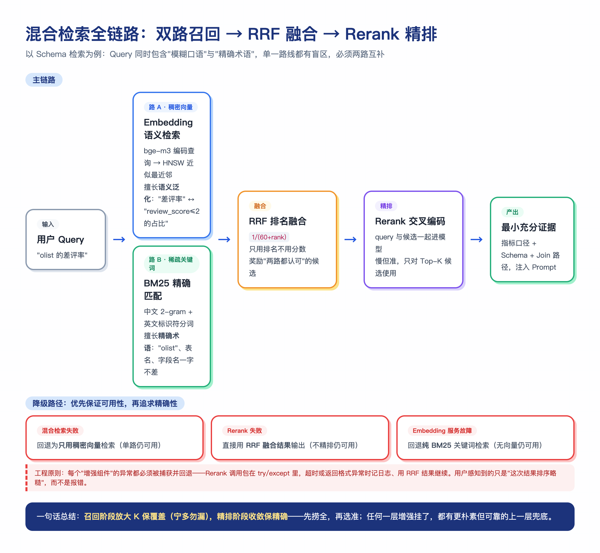

以用户问"差评率最高的品类"为例，走完整个链路：

```text
Query: "差评率最高的品类"
  ↓ 分词（中文词串 + 2-gram + 英文标识符）
tokens: ["差评率", "差评", "评率", "最高", "品类", ...]
  ↓ 双路召回
BM25 路 Top："差评率指标定义"（精确术语命中）
向量路 Top："评价域 Schema""品类维度定义"（语义相近）
  ↓ RRF 融合（1/(60+rank) 加权）
融合 Top-6：差评率指标、评价域、品类维度、销售额指标、订单域、已验证SQL示例
  ↓ （部署了 Rerank 时）精排收敛
最终注入：差评率指标口径 + 评价域 Schema + 品类维度 Join 路径
```

**召回数量的设计**：检索词少时适当扩大每路 Top-K 避免遗漏；检索词多时降低单个词 Top-K 减少重复候选；所有检索词结果合并去重形成粗召回集合——先保召回率，再由 Rerank 保精确率。

### Rerank 精排

**Rerank（重排序）是在初步召回的候选集上，对"查询—候选"相关性做深度评估并重新排序的精排阶段。**检索链路的两个阶段目标不同：召回阶段求"**全**"——尽可能覆盖所有潜在相关候选，宁可多捞不漏；精排阶段求"**准**"——把真正相关的候选项顶到最前面。向量相似度主要关注全局语义特征，难以建模查询与候选之间的细粒度交互，所以粗排结果往往排序不准、真正相关的文档位置靠后；Rerank 就是来修正这个排序偏差的。

**Rerank 模型和 Embedding 模型有什么区别（面试高频对比题）**，三点说清：

| 维度 | Embedding 模型（双塔 / Bi-Encoder） | Rerank 模型（交叉编码 / Cross-Encoder） |
|---|---|---|
| 核心作用 | 把查询和文档分别编码成向量，通过向量相似度匹配，负责大规模候选**召回（Recall）** | 对"查询—文档"对联合编码，直接输出相关性分数，负责**精细排序（Ranking）** |
| 模型架构（核心区别） | 双方独立编码，文档向量可**离线预计算**，检索时只算向量点积/余弦，效率高 | 查询与文档拼接后一起进 Transformer，注意力机制看到双向交互、精度最高，但每对都要单独算，**无法预计算** |
| 效率与精度 | 快，适合百万级全量召回，但语义匹配较粗糙、精度有限 | 准，但开销大，只能对粗排后的几十~几百个候选使用 |

工程上"粗排走量、精排提质"是标准搭配：双塔从全量语料召回 Top-N（快，覆盖优先），交叉编码对 Top-N 重排（准，质量优先）。本项目在混合检索召回候选后，用 Rerank 模型筛出最相关的 Schema / 文档证据。

**降级路径：优先保证可用性，再追求精确性。**检索链路的每一层增强（混合、Rerank）都是"锦上添花"而不是"生死依赖"——每一层失败都能回退到更朴素但更可靠的上一层：

```text
完整链路：稠密 + BM25 双路召回 → RRF 融合 → Rerank 精排
                 │                     │            │
                 ▼                     ▼            ▼
混合检索失败   →   只用稠密向量检索（单路，仍可用）
Rerank 失败   →   直接用 RRF 融合结果（不精排，仍可用）
Embedding 服务故障 → 纯 BM25 关键词检索（无向量，仍可用）
```

这套降级在工程上对应一个原则：**每个"增强组件"的异常都必须被捕获并回退，绝不允许因为精排模型抖动导致整个检索 500**。Rerank 调用包在 try/except 里，超时或返回格式异常时记日志、用 RRF 结果继续——用户感知到的只是"这次结果排序略糙"，而不是报错。

### 工程踩坑

不同厂商的 Rerank 响应格式不一致（DashScope 返回 `document: {text}`，SiliconFlow 可能返回 `document: null`），原代码用 `if "document" in item` 判断格式导致对 `None` 下标崩溃，修复为判断 `document` 非空——对第三方响应的格式假设必须做防御性判断，且每种格式都要有测试用例。

### 向量数据库中的存储格式

以记忆集合为例，存入 Milvus 的每条记录是"向量 + 标量元数据"的组合：

```json
{
  "user_id": 1001,
  "thread_id": "sess_1001_a1b2c3d4",
  "memory_type": "semantic",
  "content": "用户偏好销售额按不含税口径统计",
  "importance": 0.85,
  "created_at": 1787788800,
  "last_access_at": 1787792400,
  "vector": [0.012, -0.034, ...],
  "sparse_vector": {"用户": 0.42, "偏好": 0.38, "销售额": 0.51, ...}
}
```

检索时一次请求发起两路 AnnSearchRequest（稠密向量走 HNSW + COSINE，稀疏向量走 SPARSE_INVERTED_INDEX + BM25），由 Milvus 内置的 `RRFRanker` 完成融合排序，返回后带 `importance`、`last_access_at` 等标量字段，交给上层的"相似度 × 时近性 × 重要性"二次排序。标量字段上的 INVERTED 索引支持按 user_id / memory_type 高效过滤——**先过滤再检索**，避免全库扫描其他用户的数据，这也是多租户隔离的实现基础（`user_id` 同时是分区键）。

## 向量数据库

### 选型：为什么是 Milvus

项目实测过 Milvus Lite 和 Milvus standalone 双模式，通过连接地址形态自动切换——本地文件路径走 Lite 快速路径（零依赖、适合原型），TCP 地址走完整版原生逻辑（适合生产），**一套代码同时覆盖原型和生产**。

真实踩坑沉淀的兼容层：Lite 不支持 `wait_for_creating_index` 等管理 RPC（用补丁跳过）、分词器只支持 `jieba` 不支持 `chinese`。

下面这张图把"一条向量长什么样"和"HNSW 怎么分层检索"放在一起——左边是 Milvus 记忆集合的完整存储格式与索引参数，右边是查询向量在分层小世界图里从最稀疏层入口一路贪心下沉到 Layer 0 命中 TopK 的检索路径：

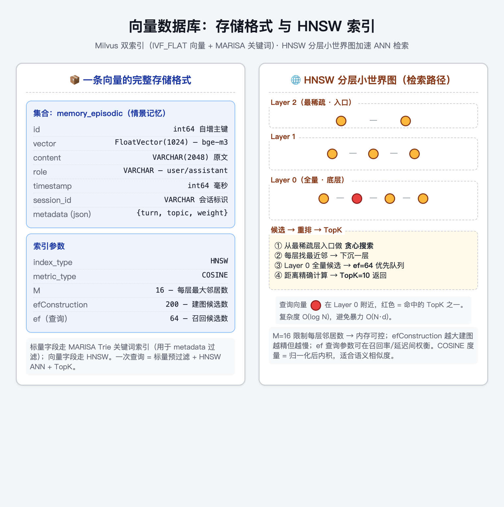

向量数据库里有三类索引，分别服务三种不同的查询。逐一展开讲：

#### 稠密向量索引：HNSW

**先理解要解决的问题：**每条记忆/文档被 Embedding 成一个 1024 维的向量，检索就是"在几十万条向量里找和 query 向量最像的 K 条"。最笨的办法是暴力计算 query 和每条向量的距离——O(N) 复杂度，数据量一大就完全不可接受。

**HNSW（分层可导航小世界图）的思路可以类比"地图导航"：**要从全国找离目标最近的城市，不会一个城市一个城市地比——先看省级地图锁定大致区域，再看市级地图缩小范围，最后看区县地图精确定位。HNSW 把向量组织成多层图：

- **最上层**只有少量节点（稀疏），边很长——负责"快速跳到大致区域"；
- **越往下层**节点越多、边越短——负责"在小范围内精细搜索"；
- **最底层**包含全部节点——负责最终的精确近邻确认。

查询时从顶层某个入口节点出发，每层都贪心走到"离 query 更近的邻居"，一层层下沉，复杂度约 O(log N)——十万级向量也只需要几十次距离计算。

**两个关键参数的权衡：**

- **M=16**（每个节点的最大连接数）：连接越密，"导航"越不容易走进死胡同，召回率越高，但内存和构建成本越大。M=16 是业界常用的平衡点；

- **efConstruction=200**（建索引时的搜索宽度）：建图时每插入一个节点要搜多宽来找它的邻居。宽度越大，图的质量越高（查询召回率越高），但构建越慢。200 对万级数据是偏质量的选择。

**度量方式选 COSINE（余弦相似度）而不是 L2（欧氏距离）**：余弦相似度只关心两个向量的"方向"是否一致，不关心绝对长度——文本 Embedding 的语义主要体现在方向上，长文本的向量模长天然更大，用 L2 会让长文档系统性吃亏。

#### 稀疏向量索引：SPARSE_INVERTED_INDEX

稀疏向量是 BM25 的向量形态：向量的每一维对应一个词表里的词，绝大多数维是 0（所以叫"稀疏"），非零维的值是这个词的 BM25 权重。**倒排索引**就是"从词反查文档"的索引：为每个词维护一个"哪些文档包含它、权重多少"的列表。查询"差评率"时，不用扫描所有文档，直接查"差评率"这个词的倒排列表——这是搜索引擎几十年验证过的高效结构，Milvus 把它原生支持了。

#### 标量索引：INVERTED 倒排

非向量的普通字段（user_id、memory_type、importance 等）建倒排索引，支持 `user_id = 1001 AND memory_type = 'semantic'` 这种过滤的高效执行。**先过滤再检索**是向量数据库的重要实践：先在标量索引上把候选集从全库缩到"当前用户的记忆"，再在缩小的集合里做向量检索——避免全库扫描其他用户的数据，这也是多租户隔离的实现基础（user_id 同时是分区键）。

### 记忆集合的完整建表示例

```python
schema = client.create_schema(enable_dynamic_field=True)
schema.add_field("id", DataType.INT64, is_primary=True, auto_id=True)
schema.add_field("user_id", DataType.INT64, is_partition_key=True)   # 分区键 = 多租户隔离
schema.add_field("thread_id", DataType.VARCHAR, max_length=100)
schema.add_field("memory_type", DataType.VARCHAR, max_length=30)     # semantic / episodic / procedural
schema.add_field("content", DataType.VARCHAR, max_length=65535,
                 enable_analyzer=True, analyzer_params={"type": "chinese"})
schema.add_field("importance", DataType.FLOAT)
schema.add_field("vector", DataType.FLOAT_VECTOR, dim=1024)          # bge-m3 稠密向量
schema.add_field("sparse_vector", DataType.SPARSE_FLOAT_VECTOR)      # BM25 稀疏向量

# BM25 内置函数：稀疏向量无需外部计算，Milvus 从 content 自动生成
schema.add_function(Function("bm25_func", FunctionType.BM25,
                             input_field_names=["content"],
                             output_field_names=["sparse_vector"]))

index_params = client.prepare_index_params()
index_params.add_index("vector", index_type="HNSW", metric_type="COSINE",
                       params={"M": 16, "efConstruction": 200})
index_params.add_index("sparse_vector", index_type="SPARSE_INVERTED_INDEX",
                       metric_type="BM25")
```

HNSW 的两个关键参数：**M=16** 控制每个节点的最大连接数（越大召回率越高、内存越大），**efConstruction=200** 控制建索引时的搜索宽度（越大索引质量越高、构建越慢）。这是召回率与资源消耗之间的标准权衡。

## 上下文管理

对 Agent 来说，上下文不是简单地把历史消息塞进模型，而是每一轮请求前把系统规则、用户意图、工具结果和历史记忆重新整理成一份"可思考的材料"。本项目的上下文管理分三层：

### 上下文组装：为下一轮思考做准备

**先理解为什么需要"组装"：**大模型每轮请求看到的只有一份消息列表，不会自动携带任何历史。所谓"模型记得之前说过什么"，真相是**系统每轮都把相关历史重新塞进 Prompt**。所以每一轮请求前，系统都要把散落各处的信息（规则、记忆、检索证据、工具结果）重新整理成一份"可思考的材料"——这个动作就是上下文组装。

本项目按模板组装为三部分，各部分职责不同：

- **system prompt**：Agent 的身份定义、能力描述、工具列表。这部分**永远不变、也永不压缩**——它是 Agent 正常工作的基础，改了它等于换了个人；

- **context prompt**：记忆检索结果、Schema 召回证据、命中 Skill 的流程知识。这部分**每轮动态生成**——同一用户连续问两个问题，注入的记忆条目和 Schema 证据是分别按当前问题重新检索的，而不是固定拼接一份"万年不变"的上下文；

- **user/tool prompt**：当前问题与本轮工具结果。

一个组装后的实际形态（用户问"那把圣保罗州拆一下"的当轮请求）：

```text
[system] 你是 NexusMind 数据分析 Agent...可用工具：execute_sql_guarded...
[system] 【相关记忆】用户偏好：结果按降序表格展示（语义记忆，相似度0.88）
[system] 【Schema 证据】数据域 olist_order；表 olist_orders_dataset...
[system] 【历史对话摘要】用户在做 Olist 地域销售分析；已确认口径：订单量=COUNT(DISTINCT order_id)...
[user] 那把圣保罗州的品类拆一下
```

这样模型看到的每一轮上下文都是"当前问题最相关"的一份定制材料，而不是历史的简单堆叠。

### 自动压缩：给模型做记忆整理

当会话 Token 超过阈值（默认 6000）时自动触发压缩：

- **system 消息永远不压缩**——它包含 Agent 的身份定义和工具列表，是系统正常工作的基础，压缩只针对对话历史；
- **切分点回溯**：保留最近若干条消息时，如果切分点刚好落在 tool 消息上，自动往前回溯到最近的 assistant 消息，避免把一组完整的 tool_use + tool_result 拆开，保证模型后续看到的上下文结构完整；
- **轻量模型生成结构化摘要**：保留关键问题、已确认事实、用户偏好和待办事项，省略寒暄与中间推理；压缩前的完整 transcript 不落废——存档到 ContextStore，摘要消息里附 ref_id。

压缩后消息列表变为：system + 摘要消息 + 最近保留消息，上下文 token 大幅下降，但模型仍能通过摘要理解之前的关键进展。

压缩前后的消息结构对比：

```text
压缩前（61 条消息，约 8200 tokens）：
  [system] 身份与工具定义
  [user] 帮我查一下各州订单量 ...（58 条历史对话，含多轮大查询结果）
  [user] 那把圣保罗州的品类拆一下

压缩后（9 条消息，约 1900 tokens）：
  [system] 身份与工具定义                    ← 永不压缩
  [system] 【历史对话摘要（52 条消息已压缩）】 ← 轻量模型生成
           用户在做 Olist 地域销售分析；已确认口径：订单量=COUNT(DISTINCT order_id)；
           偏好：结果按降序表格展示；待办：圣保罗州品类拆解
           （完整对话已存档 ref_id=ctx_3f8a2b1c，可调用 recall_context 回忆）
  [user] ...（最近 6 条完整保留）
  [user] 那把圣保罗州的品类拆一下
```

**为什么按 token 阈值触发而不是保留最近 N 轮：**保留 N 轮对长消息和短消息一视同仁——10 轮闲聊可能只占几百 token，3 轮带大查询结果的对话可能就超窗口了。按 token 阈值触发才是真正面向上下文窗口资源的管理。

压缩逻辑的真实实现（`backend/memory/session_recovery.py` 的 `compress_if_needed`），四个关键设计都在代码里：

```python
token_count = self._estimate_tokens(messages)
if token_count < SESSION_COMPRESS_THRESHOLD:
    return messages                                  # 未超阈值，原样返回

# 1. system 消息永远不压缩，单独剥离
system_messages = [m for m in messages if m.get("role") == "system"]
chat_messages = [m for m in messages if m.get("role") != "system"]

# 2/3. 切分点回溯：从"保留最近6条"的切分位置往前找，
#      直到落在 assistant 消息上——不把 tool_use/tool_result 对拆开
split_idx = len(chat_messages) - 6
while split_idx > 0 and chat_messages[split_idx].get("role") != "assistant":
    split_idx -= 1
recent = chat_messages[split_idx:]
old    = chat_messages[:split_idx]

# 4. 压缩前的完整历史存档 ContextStore，摘要里附 ref_id 供"回忆"
transcript = "\n".join(f"[{m['role']}] {m['content']}" for m in old)
ref_id = get_context_store().save(content=transcript, source="compress_transcript")

# 5. 轻量模型生成结构化摘要（保留关键问题/已确认事实/偏好/待办）
summary = await llm_client.ainvoke([("human", 摘要提示词 + transcript)])
```

`while` 那三行就是"切分点回溯"的全部实现——简单但关键：如果切分点恰好落在 tool 消息上，模型会看到"有工具结果但没有发起调用"的残缺上下文，可能据此产生混乱推理；回溯到 assistant 保证每一组"提问→调用→结果"要么完整保留、要么整体进摘要。

### 动态上下文：让 Agent 可以"回忆"

上下文管理的三件套（组装 → 压缩 → 回忆）是同一套机制在三个时机上的接力，下图把三者的触发时机和产出关系一次性串起来：

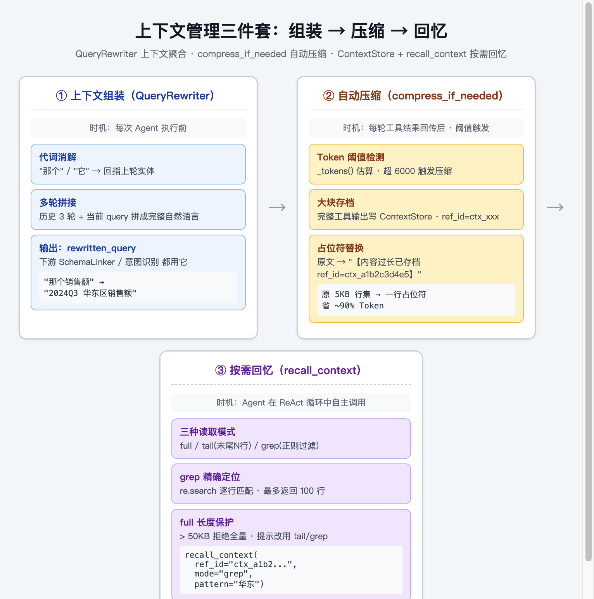

单纯截断是有损的——没有人能说明白 30k 够还是 40k 够，关键信息可能恰好被截掉。本项目的解法是**外置文件存储 + 按需回忆**：

1. **两级截断**：工具结果先按 token 比例粗截、再逐行精修（防截半行），token 估算区分中英文（中文约 1 token / 字，英文约 1 token / 词）；
2. **存档**：被截断的完整内容和压缩前的 transcript 以文件形式带 `ref_id` 存档到 ContextStore，运行时上下文里只保留占位符和引用地址；
3. **回忆**：Agent 需要时通过 `recall_context` 工具按 **grep（正则过滤行）/ tail（末尾 N 行）/ full（完整内容）** 三种模式主动召回。

**核心思想：把"截断丢信息"改造成"可检索的延迟加载"。**截断策略决定"现在看什么"，存档召回保证"需要的时候还能找到什么"。工程防护：ref_id 格式校验防路径穿越、单文件大小上限（200 万字符）、7 天过期自动清理。

`recall_context` 的三种读取模式各有专门的防护逻辑，真实实现（`backend/core/context_store.py` 的 `ContextStore.read`）——三种模式不是简单返回原文，而是各自带保护：

```python
def read(self, ref_id, mode="full", pattern="", tail_lines=50):
    path = self._path(ref_id)                       # ref_id 正则校验防路径穿越
    if not path.exists():
        return json.dumps({"error": f"ref_id {ref_id} 不存在或已过期"})

    content = json.loads(path.read_text())["content"]

    if mode == "tail":                              # 看末尾 N 行
        lines = content.split("\n")
        return json.dumps({"mode": "tail",
            "total_lines": len(lines),
            "showing_last": min(tail_lines, len(lines)),
            "content": "\n".join(lines[-tail_lines:])})

    if mode == "grep":                              # 正则过滤行
        matched = [f"L{i+1}: {line}"
                   for i, line in enumerate(content.split("\n"))
                   if re.search(pattern, line)]
        truncated = len(matched) > 100              # 匹配行数保护：最多 100 行
        return json.dumps({"mode": "grep", "pattern": pattern,
            "matched_lines": len(matched),
            "content": "\n".join(matched[:100]) +
                       ("\n...[更多匹配行省略]" if truncated else "")})

    if len(content) > 50_000:                       # full 模式长度保护
        return json.dumps({"mode": "full", "hint":
            "内容过长，建议改用 tail 或 grep", "head": content[:2000]})
    return json.dumps({"mode": "full", "content": content})
```

三种模式的设计意图：**grep 模式优先推荐**——Agent 通常只想确认某个关键词（如"华东区"），正则定位比全量加载省 90% token；**tail 模式**适合看最新追加内容（如工具最新输出）；**full 模式**带 50KB 上限，超过则拒绝全量返回并提示改用前两者——这不是吝啬，是防止 Agent 一次性把超大上下文塞回窗口触发新的压缩，形成"压缩→召回→再压缩"的死循环。

## MCP 与 Skills

### 什么是 MCP

MCP（Model Context Protocol，模型上下文协议）是 Anthropic 于 2024 年底推出并开源的开放标准协议，**定义了大语言模型与外部数据源、工具之间通信的统一规范**。可以把它理解为 AI 世界的 USB-C 接口：任何支持 MCP 的客户端都能"插入"任何实现了 MCP 协议的工具服务器，无需为每个组合单独编写胶水代码。通信基于 JSON-RPC 2.0，主流传输方式为 stdio（本地子进程）和 Streamable HTTP（远程服务化）。

### MCP 与 Function Calling 的区别

Function Calling 是 LLM 模型本身的内部能力，定义了模型如何识别意图并结构化输出调用参数；MCP 是与具体 LLM 无关的外部通信协议，定义这些调用请求如何在不同进程或网络节点间传输。Function Calling 解决"想做什么"，MCP 解决"怎么连通去做"。

### MCP 架构的三个角色

- **Host（宿主应用）**：运行 AI 的应用程序本身（如 NexusMind 这类 Agent 后端），负责接收用户请求、调用 LLM、管理上下文和工具调用流程；

- **Client（客户端）**：内嵌在 Host 中的协议转换层，维护与 MCP Server 的连接，处理 JSON-RPC 2.0 消息通信；

- **Server（服务器）**：功能提供层，把外部系统（数据库、知识库、第三方 API）标准化封装成 MCP 协议向外暴露工具。

### 三大核心原语：Tools / Resources / Prompts

MCP Server 向外暴露的能力分三类，这是 Agent 能力供给的基础：

- **Tools（工具）**：让 AI"**能做**"。可执行的函数，如查询数据库、发送邮件、操作文件——实际落地中用得最多的是这一类；
- **Resources（资源）**：让 AI"**能看**"。提供静态或动态的上下文数据，如本地文件内容、数据库记录、云存储数据；
- **Prompts（提示词模板）**：让 AI"**更专业**"。特定场景下可复用的结构化提示词，引导模型在代码审查、翻译等场景稳定发挥。

### 协议的生命周期

一次 MCP 会话分三个阶段：

1. **初始化（Initialize）**：握手阶段，客户端与服务器交换协议版本和能力信息（capabilities），确认双方支持哪些原语；
2. **运行（Operation）**：核心工作阶段——`tools/list` 动态发现工具、`resources/read` 读取资源、`tools/call` 执行调用；
3. **关闭（Shutdown）**：优雅断开连接、释放资源——stdio 场景对应子进程的优雅退出，超时未退出则强制 kill，防止僵尸进程。

### 两种传输方式的选型

- **Stdio（标准输入输出）**：Server 作为 Client 的子进程启动，基于进程管道通信。适合本地集成，生命周期绑定，简单高效，但不支持远程和多客户端；

- **Streamable HTTP**：基于 HTTP 协议，适合远程服务化部署，一个 Server 可服务多个 Client，需要 `Mcp-Session-Id` 管理会话状态。

### 什么是 Skill

Skill 简单说就是"**完整说明做一件事的流程**"——它和 Prompt 一样通过文字告诉大模型该怎么做，区别在于 **Prompt 是一次性加载的，Skill 是渐进式加载的**。一个 Skill 面向特定任务封装一套可复用的处理流程，告诉 Agent 在什么场景下、按什么规则、步骤和输出格式完成任务，通常以 `SKILL.md` 为核心文件，可附带脚本、模板、参考资料等。

### Skill 有什么用

Skill 把某一类任务的处理经验从系统提示词中独立出来（数据库查询、数据分析、报告生成各成一个 Skill），核心价值是**可扩展性**——一个 Agent 挂载多个 Skill，就能覆盖不同业务场景的流程化和规范化：

- 固化任务的处理步骤和业务规则；
- 为不同任务提供不同的上下文和输出要求；
- 复用已经验证过的处理流程，回答风格稳定一致；
- 避免所有规则堆积在一个系统 Prompt 里（Prompt 膨胀正是上下文管理的大敌）；
- 不同 Skill 可以独立修改、测试和扩展。

### Skill 的核心机制：渐进式加载

相比把所有规则写进系统 Prompt，Skill 的关键机制是**渐进式加载**——系统不会在启动时加载所有 Skill 的完整内容，而是分"发现能力"和"加载能力"两个阶段：

1. **发现能力**：系统启动时只加载所有 Skill 的名称和描述，用于判断每个 Skill 能做什么、应该在什么场景使用；

2. **按需加载**：用户请求与某个 Skill 的描述匹配时，才读取该 Skill 的完整内容（执行规则、输出要求、参考示例）注入上下文；

3. **按需取资源**：执行过程中需要的模板、脚本、参考资料再继续按需读取。

```text
加载全部 Skill 的名称和描述
            ↓
根据用户请求发现相关 Skill
            ↓
加载该 Skill 的完整指令
            ↓
按需读取脚本 / 模板 / 参考资料
            ↓
按 Skill 规则执行任务
```

这种"先元信息、再完整指令、最后资源"的方式避免了所有规则堆积在一个系统提示词中——Skill 越多，主 Prompt 也不会随之膨胀。

### Skill 的目录结构

一个完整的 Skill 通常是一个独立目录：

```text
database-query/
├── SKILL.md      # 核心文件（必备）：名称、描述、适用场景、执行步骤、输出要求
├── scripts/      # 可直接执行的脚本，完成固定重复操作
├── references/   # 业务规则、Schema 说明等参考内容
└── assets/       # 模板、示例文件等执行任务需要的资源
```

只有 `SKILL.md` 是必备文件，其余目录按任务需要添加。

### Skills 与 MCP 的分工

MCP 解决"**怎么接工具**"（协议与生命周期），Skills 解决"**调用工具时遵循什么流程**"（可复用的业务 SOP 与约束，检索后动态注入 Prompt）。

### 本项目 Skill 的落地形态

Skills 以 JSON 文件存放在 `skills/` 目录，运行时检索匹配后动态注入；同时承担**自进化的沉淀载体**——自进化引擎从 Bad Case 抽取出的规则，置信度达标后注册为新 Skill，下一次同类问题直接命中已验证的流程。这样 Skill 库不是一次性写死的，而是随系统运行持续增长：人工编写的 SOP 是种子，自进化抽取的规则是增量。新增工具不改主链路，新增业务流程只加一个 Skill 文件。

## 监控与治理

Agent 系统上线后最大的风险是"黑盒运行"——不知道哪个组件在拖后腿、哪次回答出了问题。本项目的监控治理分三层：

### Monitor：在线闭环监控与动态权重

三层架构——`MetricsCollector` 在每个 Agent 执行时采集延迟、token 消耗、成功率；`SlidingWindowAggregator` 维护滑动时间窗口（最多 1000 条 / 5 分钟）聚合出 p99 延迟、成功率、平均 token；`WeightAdjuster` 按聚合结果在线调整路由权重：成功率 < 95% 权重减半，p99 > 3s 再减半，p99 > 5s 降为 0.1，持续稳定（成功率 > 99% 且 p99 < 1s）则权重上浮。

Monitor 会更新性能权重，但当前 Supervisor 只记录性能路由建议，没有用它覆盖策略路由。自动切流仍需接入路由决策并通过故障演练验证。

权重调整规则的真实实现（`backend/evaluation/monitor.py` 的 `WeightAdjuster.adjust`）——前面那串数字规则就是这段代码：

```python
def adjust(self, metrics: Dict[str, AgentMetrics]):
    for name, m in metrics.items():
        weight = 1.0
        if m.success_rate < 0.95:          # 成功率掉线 → 权重减半
            weight *= 0.5
        if m.p99_latency_ms > 3000:        # 尾部延迟劣化 → 再减半
            weight *= 0.5
        if m.p99_latency_ms > 5000:        # 严重劣化 → 压到 0.1 近乎熔断
            weight = 0.1
        if m.success_rate > 0.99 and m.p99_latency_ms < 1000:
            weight = min(weight * 1.2, 2.0)  # 持续稳定 → 权重上浮，封顶 2 倍
        self.weights[name] = weight
```

这套规则的设计取向值得注意：**降级快、恢复慢**——一个 p99 超 5s 直接把权重打到 0.1（近乎熔断），但恢复要同时满足"成功率 >99% 且 p99 <1s"两个条件、且每次只上浮 1.2 倍封顶。宁可误伤一个抖动的 Agent 也不让用户反复踩到超时，这是在线系统对"差体验"的标准态度。同时注意触发降级的依据是 **p99 而不是平均延迟**——平均延迟会被大量正常请求稀释（99 个 100ms + 1 个 10s，平均才 200ms 看起来一切正常），p99 关注的是"最差的 1% 体验"，Agent 系统的故障往往是局部劣化而非全面崩溃，p99 能在成功率还没掉的时候就捕捉到这种劣化。

p99 的聚合来自滑动窗口（`SlidingWindowAggregator`）：每次 `add` 新记录时顺手清理超出 5 分钟窗口的旧记录，`aggregate` 时对窗口内该 Agent 的延迟排序取第 99 百分位——窗口让指标"只看最近"，昨天的抖动不会永远压着一个已经恢复的 Agent。

### TraceStore：全链路追踪与 Bad Case 采样

每个请求落一条 JSONL trace：问题、意图、路由决策、Schema Linking IR、Metric Plan、最终 SQL、各 Span 耗时、重试次数、错误上下文。采样策略：**错误必采、慢查询（>15s 可配）必采、发生重试必采、正常请求 10% 随机采样**，采样结果自动进入在线 Bad Case 库，驱动离线归因和自进化闭环——每一次结论可复核、每一个线上问题可定位。

一条真实的 trace 记录结构：

```json
{
  "trace_id": "a1b2c3d4e5f6",
  "timestamp": "2026-08-27T10:00:00",
  "session_id": "sess_1001_a1b2c3d4",
  "query": "各品类销售额排名",
  "intent": "data_query",
  "route": "semantic_compile",
  "schema_linking": {"metrics": ["sales_revenue"], "dimensions": ["product_category_name"]},
  "metric_plan": {"metrics": ["sales_revenue"], "sort": {"by": "sales_revenue"}},
  "compiled_sql": "SELECT ... ORDER BY sales_revenue DESC",
  "spans": [{"operationName": "nl_compile", "duration": 12}, ...],
  "latency_ms": 1450,
  "retry_count": 0,
  "status": "ok"
}
```

有了这份记录，任何一个线上结论都能回答四个问题：**用户问了什么、系统怎么理解的（IR）、实际执行了什么（SQL）、为什么这么路由（route + reasons）**——这是"可审计"的落点。

### 分布式追踪：MTrace 风格 Span

**先理解概念：**一次用户请求在系统内部会经过一串组件（Supervisor → RAG → Memory → LLM → SQL 执行……），当用户反馈"这次回答好慢"时，没有追踪系统你只能瞎猜是哪一环慢。**分布式追踪就是给每次请求的每个环节各盖一个"时间戳邮戳"，事后能完整回放这次请求的内部旅程。**

两个核心概念：

- **Span（跨度）**：一个环节的一次执行，记录"谁、什么时候开始、什么时候结束、是否成功、附带什么标签"。比如 `rag_retrieve` 这个 Span 记录 RAG 检索耗时 120ms、召回了 8 条证据；

- **Trace（追踪）**：一次完整请求对应的所有 Span 组成的树。树根是整个请求，子 Span 是各编排节点，子 Span 还可以再有自己的子 Span（比如 `chatbi_query` 内部再分出 `schema_link`、`sql_generate`、`sql_execute`）。Span 之间用 `parent_span_id` 记录父子关系，用同一个 `trace_id` 串成一棵完整的树。

本项目实现的是兼容 OpenTelemetry 概念的轻量版（MTrace 风格）：一次请求是一棵 Span 树（Supervisor / RAG / Memory / Synthesize 各为一个 Span），记录起止时间、耗时、状态、tags，支持父子关系与错误传播——某个子 Span 失败会沿着树向上标记，复盘时一眼看到失败是从哪个环节开始的。

一棵真实请求的 Span 树长这样：

```text
trace: ask_order_trend (总耗时 9.8s)
├── supervisor (30ms)
├── memory_retrieve (95ms)        tags: {hits: 3}
├── rag_retrieve (120ms)          tags: {dense: 8, bm25: 6, fused: 8}
├── chatbi_query (8.9s)           ← 瓶颈在这
│   ├── schema_link (1.2s)
│   ├── sql_generate (2.1s)
│   ├── sql_execute (0.4s)
│   └── llm_analyze (5.1s)        ← 真正的耗时大头
└── synthesize (0.5s)
```

LangGraph 节点跳转的耗时拆解完全可视化——哪一跳慢了一目了然。这套观测是性能优化的前提：**优化前先量化**。编排延迟从 29s 优化到约 10s 的每一步（哪些节点合并、哪些 LLM 调用换成快模型），都是先看 Span 拆解找到耗时大头，再对症下药——没有这套追踪，优化就是盲人摸象。

## SQL 守卫与评测指标

### SQL Guard 三层防护

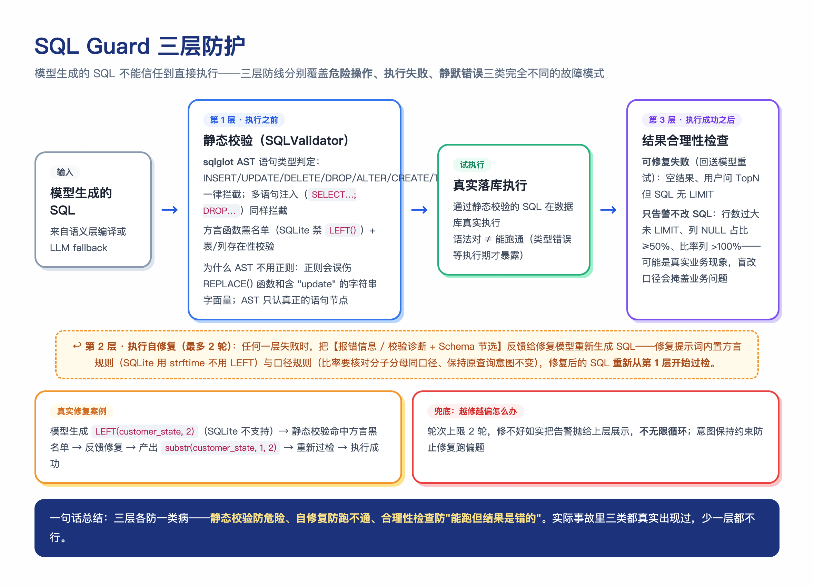

模型生成的 SQL 不能信任到直接执行——三层防线各有分工：

**第一层：静态校验（SQL 落库执行之前）。**用 sqlglot 把 SQL 解析成 AST（抽象语法树），在语法树节点上判断语句类型，写操作（INSERT / UPDATE / DELETE / DROP / ALTER / CREATE / TRUNCATE / PRAGMA / ATTACH）一律拦截，多语句注入（`SELECT ...; DROP TABLE ...`）同样拦截。为什么用 AST 而不是正则关键字匹配？正则会误伤：`REPLACE(name, 'a', 'b')` 字符串函数、含 "update" 子串的字段名都会被误拦；而 AST 只认真正的语句节点，不会误伤。第一层还做方言函数黑名单（比如 sqlite 场景禁用 `strftime`）和表名存在性校验——模型幻觉出不存在的表名，在这一层就被抓住。

**第二层：执行自修复（SQL 执行报错之后）。**数据库报错时，不是直接告诉用户"查询失败"，而是把**报错信息 + 相关 Schema**一起反馈给修复模型，让它重新生成 SQL，最多重试两轮。修复提示词里内置方言规则（比如"PostgreSQL 的字符串拼接用 `||` 不能用 `+`"）和口径规则（"比率要核对分子分母同口径"）——让模型修的不只是语法，还有语义。例子：模型把 `order_purchase_timestamp` 拼写成 `order_purchase_time`，SQLite 报 `no such column`，反馈后模型对照 Schema 改正列名，第二轮执行成功。

**第三层：结果合理性检查（SQL 执行成功之后）。**SQL 能跑通不代表结果对。检查项包括：空结果（大概率是过滤条件错了）、结果行数过大未加 LIMIT（可能拖垮传输和展示）、用户问 TopN 但 SQL 无 LIMIT（答非所问）、列 NULL 占比 ≥50%（可能 JOIN 键错了）、比率列出现 >100% 的值（口径错了）。第三层区分两类问题：**"空结果"和"TopN 无 LIMIT"视为可修复失败**，回送模型重试；**NULL / 比率异常只告警不改 SQL**——因为 NULL 可能是数据本身稀疏、比率 >100% 可能是合理的业务现象（比如复购率口径），盲改口径反而会掩盖真实业务问题。

### 评测指标：为什么 EX 不够

EX（Execution Accuracy）只回答"最终结果对不对"，无法定位错误环节——一道题做错了，EX 只能告诉你"错了"，但不知道是没选对表、没查全行还是值算错。本项目在 Spider 评测中保留四项指标构成诊断链：

- **EX（执行准确率，严格判等）**：Agent SQL 与 Gold SQL 在同一数据库上的执行结果集完全一致才计正确；
- **表命中率（Schema Linking）**：Agent SQL 引用的表名集合与 Gold 是否一致——定位"选错表"；
- **行召回率（Row Recall）**：Gold 应返回的行中被查全的比例——定位"过滤过严 / LIMIT 截断 / JOIN 缺失"；
- **字段准确率（Cell Accuracy）**：已匹配行中单元格值正确的比例——定位"口径错 / 聚合错"。

**诊断链怎么用：**四项指标看成一个漏斗——选对表（97.0%）→ 查全行（0.851）→ 值准确（0.898）→ 整体对（78.8%）。哪一层掉得最厉害，瓶颈就在哪。本项目的数据明确显示：表命中率显著高于行召回率，说明瓶颈不在 Schema Linking（选表已经很准）而在复杂过滤条件与 JOIN 完整性——后续优化应该围绕行召回展开（多阶段生成、执行反馈修复），而不是继续在选表上投入。**没有字段级指标，这个结论就得靠猜。**

# 主要流程解析

## 直观了解项目流程&亮点

下图是从用户提问到回复的全链路分层架构，自上而下六层串联，右下的治理层在线闭环反哺权重：

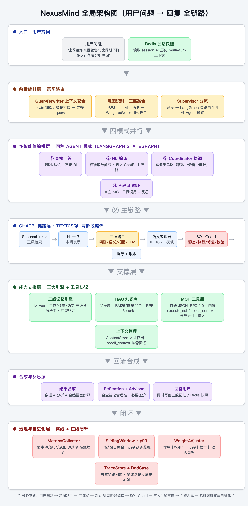

读懂这张图，就等于读懂了项目所有亮点是怎么串成一条线的：入口读 Redis 快照恢复多轮上下文 → 前置层做 QueryRewriter 聚合 + 三路意图识别 → Supervisor 把意图分流到四种 Agent 模式（直接/NL 编译/Coordinator/ReAct）→ ChatBI 链路走 SchemaLinker 三级检索、NL→IR 中间表示、四层路由、语义编译、SQL Guard 四层防护 → 三大引擎（三级记忆 / RAG / 工具路由）和上下文管理在底层支撑 → 合成反思后回写记忆 → 治理层按 p99 延迟和命中率在线调权，失败链路进 TraceStore 离线蒸馏反哺提示词。

下面用一个具体问题把 ChatBI 主链路走一遍：

```text
用户问题："最近三个月各品类销售额排名"
   │
   ▼
SchemaLinker ── 抽取 IR：metrics=[revenue], dimensions=[product_category],
   │                    filters=[last_3_months], sort=revenue_desc
   ▼
路由决策 ── 命中已治理指标，route = semantic_compile
   │
   ▼
MetricPlanCompiler ── 选择指标定义、正确 JOIN 路径、GROUP BY 与排序
   │
   ▼
SQL Guard ── AST 校验 → 执行 →（失败则自修复）→ 结果合理性检查
   │
   ▼
双 SQLite 数据集（ATTACH 跨库）执行
   │
   ▼
结果 + 口径解释 + Trace 记录（IR / SQL / 耗时 / 告警）
```

整个链路最重要的设计取舍：**已定义业务指标的 SQL 由编译器生成而非 LLM 即兴生成**，业务口径、关联路径和降级原因全部可追溯。

## 意图识别：三路融合加权投票

下图是意图识别的完整决策流程：三通道并行输出 → 三条仲裁规则先行 → 加权投票 → 低于阈值澄清而不是强行路由：

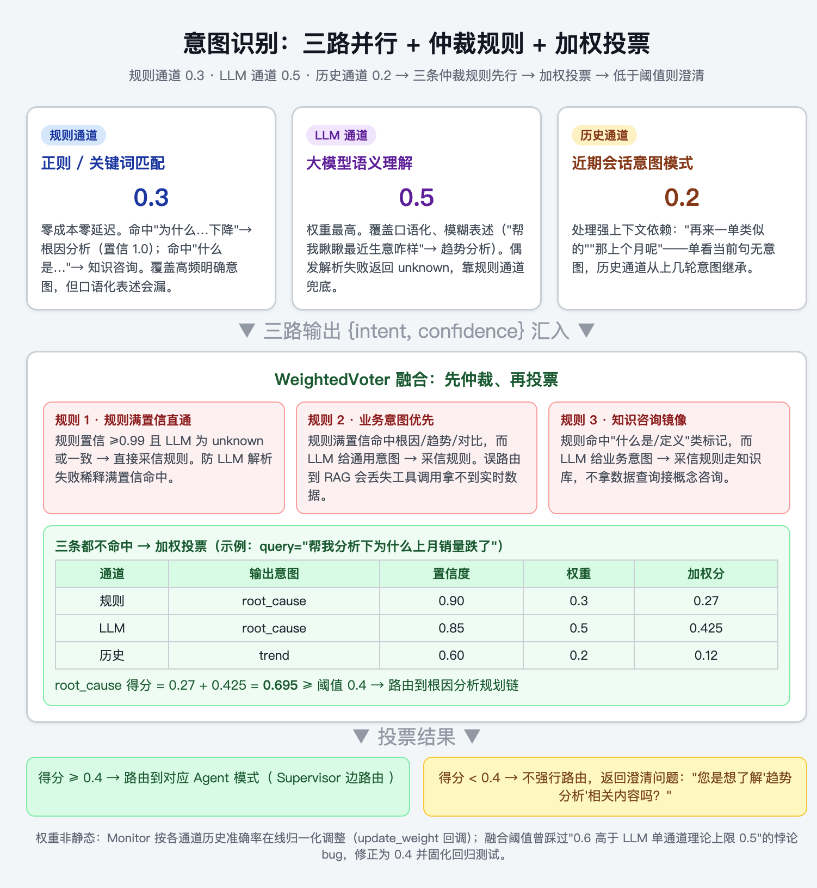

意图识别不是单通道规则匹配，而是三路并行 + 加权投票：

- **规则通道**（权重 0.3）：正则 / 关键词匹配，零成本零延迟，覆盖高频明确意图；
- **LLM 通道**（权重 0.5）：语义理解，覆盖口语化、模糊表述；
- **历史通道**（权重 0.2）：基于当前 session 近期原始 query 的 Embedding 相似度预测意图，处理"再来一单类似的"这类依赖上下文的表述。

`WeightedVoter` 按权重融合三通道输出，加权分数低于阈值时返回澄清问题而不是强行路由。权重不是静态配置——Monitor 按各通道历史准确率在线归一化调整：某通道准确率下降，权重自然降低，其他通道接管。

这里修过一个真实的阈值悖论 bug：融合阈值 0.6 高于 LLM 单通道的理论上限（权重 0.5 × 置信度 1.0 = 0.5），导致 LLM 再有把握也永远被拦截——修正为 0.4 后解决，已固化回归测试。

融合的真实实现（`backend/core/intent_recognition.py` 的 `WeightedVoter.fuse`）——它不是简单加权求和，投票之前有三条"仲裁规则"处理通道冲突：

```python
def fuse(self, rule_result, llm_result, history_result) -> FusionResult:
    # 仲裁规则 1：规则满置信命中，且 LLM 不可用(unknown)或与规则一致 → 直接采信规则
    # 背景：规则权重只有 0.3，会稀释满置信度命中；LLM 偶发解析失败时
    # "为什么销量下降"这种关键场景曾被误判为 unknown 触发澄清反问
    if (rule_result.intent != "unknown" and rule_result.confidence >= 0.99
            and (llm_result.intent == "unknown" or llm_result.intent == rule_result.intent)):
        return FusionResult(intent=rule_result.intent, confidence=rule_result.confidence)

    # 仲裁规则 2：规则满置信命中业务意图(根因/趋势/对比)，而 LLM 给了通用意图 → 采信规则
    # 业务关键词是高精度信号，误路由到 RAG 会丢失工具调用（拿不到实时数据）
    if (rule_result.intent in BUSINESS_INTENTS and rule_result.confidence >= 0.99
            and llm_result.intent not in BUSINESS_INTENTS and llm_result.intent != "unknown"):
        return FusionResult(intent=rule_result.intent, ...)

    # 仲裁规则 3（镜像）：规则命中"什么是/概念/定义"类知识咨询标记，
    # 而 LLM 给了业务意图 → 采信规则走知识库（避免拿数据查询去接概念咨询）
    ...

    # 三条都不命中 → 常规加权投票
    for r in [rule_result, llm_result, history_result]:
        scores[r.intent] += r.confidence * self.weights.get(r.source, 0.0)
    best_intent = max(scores, key=scores.get)
    if scores[best_intent] < self.threshold:           # 低于阈值 → 澄清而不是强行路由
        return FusionResult(intent="unknown",
                            clarifying_question=f"您的请求我不太确定，是想了解'{best_intent}'相关的内容吗？")
    return FusionResult(intent=best_intent, confidence=scores[best_intent])
```

三条仲裁规则都是**线上 Bad Case 倒逼出来的**：规则 1 解决"LLM 解析失败时规则满置信结果被稀释"；规则 2/3 解决"规则与 LLM 冲突时谁说了算"——业务意图和知识咨询两个方向各留了一条，因为两个方向的路由错误代价不对称（把根因问题路由到知识库问答，用户拿不到数据；把概念咨询路由到数据查询，用户拿不到解释）。

权重在线调整的实现也在同一个类里：`update_weight(source, correct)` 由 Monitor 在每次请求后回调，按各通道历史准确率重新归一化权重——某通道准确率下降，它的 `weights[source]` 自然被压小，其他通道接管。这里加了**冷启动门槛**：每通道累计样本不足 30 时保持初始权重（0.3/0.5/0.2）不调，防止前几次反馈把精心设计的初始权重拉平成均分——线上跑足量样本后才开始按真实准确率动态调权。

三路并行与历史通道语义化的工程实现（`backend/core/intent_recognition.py`）——四点优化：

**1. 真并行（`asyncio.gather`）。** 早期版本是`llm = await ...; history = await ...`串行，整体延迟 = 两路之和；改成 gather 后延迟 = max(LLM, 历史)，规则通道是本地正则微秒级不进 gather。对意图识别这种每请求必经的前置节点，直接砍掉一截尾延迟。

```python
import asyncio
rule_result = self.rule_recognizer.recognize(query)
llm_result, history_result = await asyncio.gather(
    self.llm_recognizer.recognize(query),
    self.history_recognizer.recognize(query, session_id),
)
```

**2. 历史通道语义化。** 旧实现把历史意图拼成 `"data_query -> data_query -> ?"` 做一次 embedding 比相似度，再用 `Counter.most_common` 取最频繁意图——本质还是频率先验，没真正用语义。新实现记录每轮 `(query, intent, query_embedding)`，识别时计算当前 query 与历史各轮原始 query 的余弦相似度，取最相似那轮的意图作为预测，相似度映射成置信度（封顶 0.9）。历史 query 的 embedding 懒计算并缓存进轮次记录，二次命中不再重复 embed。

**3. session 级 LRU。** `_history_cache` 用 `OrderedDict` 实现 session 级 LRU，活跃 session `move_to_end`，超 200 个 session 时淘汰最久未活跃的——防止长跑服务 session 缓存无限缓涨。

**4. 权重冷启动门槛**（见上）。

**原因类问句的路由示例：**

```text
用户问题："为什么 11 月销售额比 10 月少这么多"

规则通道识别“为什么……比……少”，返回 root_cause，confidence=1.0。
满置信度业务规则可直接选根因分析；无需为这个例子假设 LLM 和历史通道的分数。
规则未覆盖的其他问法再由模型和历史信号参与判断。
```

两个工程细节：

- **规则通道短路**：正则完全命中（confidence=1.0）且 LLM 通道偶发解析失败时，直接出结果——否则规则权重 0.3 会稀释满置信度命中，高确定性的意图反而被拖累；

- **低分澄清**：加权最高分低于阈值时，系统不强行路由，而是返回澄清问题（"您是想查询具体数值，还是分析变化原因？"）——**宁可多问一句，不可路由错链路**。

### 意图识别的结构化输出

LLM 通道不输出自由文本，而是按固定 JSON 格式输出，后端只解析结构化字段：

```json
{
  "intent": "data_query | root_cause | knowledge_qa | chat",
  "confidence": 0.92,
  "reason": "判断原因",
  "standalone_query": "聚合后可独立理解的完整 Query"
}
```

**Tips：路由为什么不宜划分得过细？**路由节点只能根据用户 Query 和对话上下文判断意图，此时还没看到后续的 Schema 和工具——分类过细容易在路由阶段误判，导致后续进入错误链路。路由本质是把决策风险前置，因此各链路的边界必须清晰稳定。本项目的链路划分（语义编译 / 复合计划 / 根因 / LLM fallback / 知识问答 / 直答）就是按"边界清晰"而非"粒度最细"的原则设计的。

## Schema Linking：NL → IR

Schema Linking 的完整流程分四个阶段：

```text
核心要素抽取（指标/维度/过滤/排序/LIMIT）
       ↓
三级 Schema 检索（数据域 → 表/Join → 字段）
       ↓
复合计划与根因识别（复合计划匹配 / 复杂推理词检测）
       ↓
组装 IR + 置信度评估 + 路由决策
```

### 核心要素抽取

从聚合后的 Query 中抽取五类要素：指标（别名词典匹配）、维度（别名表）、过滤（受控枚举）、排序（排名/最高→DESC，最低→ASC）、LIMIT（"前 N""Top N"正则提取）。要素尽量保留用户原始表达对应的业务概念，不提前猜测物理字段——物理字段的映射交给 Schema 检索和编译器完成。

### 三级 Schema 检索

`SchemaRetriever.retrieve()` 按三级收敛：先在数据域语料上做混合检索选出 Top-3 域，再在域内候选表 + 全局直命中表上做表级检索选出 Top-5 表，最后只在命中表内展开被 Query 真实提及的字段。每级命中都带 RRF 融合分和层级标签，检索结果本身可解释。

早期版本是“关键词子串计数”伪装的检索（`_score` 遍历 aliases 看是否子串出现），有三个问题：中文语义近似抓不住（“下单”与“订单”同义但子串不重合）、字段层有“`score == 0` 就整表倾泻所有列”的 bug（无命中时把全表字段塞进 Prompt，反而拉高噪声）、Schema 硬编码在 Python 字典里扩展要改代码。v2 把三件事都修了：

**1. 真实混合检索（BM25 + 稀疏向量 + RRF）。** 与 `hybrid_knowledge` 同源的一套检索原语：中英文混合分词（英文标识符/SQL token 原样、中文走 2-gram 拿语义近似），对每级语料同时跑 BM25 排序和稀疏向量余弦排序，再用 Reciprocal Rank Fusion 融合两份 ranking——避免单一信号独占，兼顾中文关键词与 SQL 标识符。

```python
class _LevelIndex:
    """一级语料的混合检索索引：BM25 排序与稀疏向量余弦排序做 RRF 融合。"""
    def __init__(self, corpus: List[str]):
        self.doc_tokens = [_tokens(doc) for doc in corpus]
        self.avg_len = sum(map(len, self.doc_tokens)) / max(1, len(self.doc_tokens))
        self.df = Counter(term for tokens in self.doc_tokens for term in set(tokens))

    def rank(self, query: str) -> List[Tuple[int, float]]:
        tokens = _tokens(query)
        bm25, vector = self._bm25(tokens), self._vector(tokens)
        rrf = defaultdict(float)
        for scores in (bm25, vector):
            for r, idx in enumerate(sorted(range(self.size),
                    key=lambda i: scores[i], reverse=True), start=1):
                rrf[idx] += 1.0 / (60 + r)
        # RRF 分恒为正，额外要求至少一路有真实命中（bm25>0 或 vector>0）
        return sorted(((i, s) for i, s in rrf.items()
                       if bm25[i] > 0 or vector[i] > 0),
                      key=lambda p: p[1], reverse=True)
```

**2. 配置化。** 数据域和表定义从 `docs/knowledge/schema_registry.json` 加载，新增数据集只需追加 JSON（aliases 参与域级检索，columns/joins 参与表级检索与 Prompt 组装），不用改 Python；文件缺失/损坏时回退到内置默认注册表，保证可运行。

**3. 修字段倾泻 bug + 召回兜底。** Level 3 字段层只输出 query 中真实出现（分词后词级或字符级重合）的列，不再因为“表无命中”就把全表列灌进 Prompt；Level 2 表层加了“域内候选 + 全局直命中表”双路并集——防止域级漏判导致表被丢；全部表无命中时保留每个选中域的首表做 schema 兜底，绝不返回空。

**4. LRU 缓存。** 相同 `(query, top_domains, top_tables)` 命中缓存直接返回，热点问题不重复跑检索；缓存上限 256，满了淘汰最久未用。

### 组装 IR

`SchemaLinker.link()` 产出结构化中间表示 `SchemaLinkingIR`：

```json
{
  "query": "最近三个月各品类销售额排名",
  "metrics": ["sales_revenue"],
  "dimensions": ["product_category_name"],
  "filters": {"last_3_months": true},
  "sort": {"by": "sales_revenue", "order": "DESC"},
  "limit": null,
  "route": "semantic_compile",
  "reasons": ["单一已治理指标，维度数据集一致，可确定性编译"]
}
```

抽取分四路：指标命中（别名词典匹配，`match_metrics_by_query`）、复合计划识别、维度识别（维度别名表）、受控枚举过滤（只接受固定状态值如 delivered/canceled，不把自然语言直接拼进 SQL——从设计上杜绝注入和脏值）。同时记录 `confidence` 与 `reasons`：路由决策的每一步都有可解释的理由。

置信度不是拍脑袋，是按命中证据量计算的：

```text
confidence = min(1.0, 0.25×命中指标数 + 0.15×命中维度数 + 0.10×命中表数)
```

路由判定的完整真值表：

| 条件 | 路由 | 理由 |
|---|---|---|
| 命中复合计划 | semantic_compile（模板） | 命中已治理复合 Metric Plan |
| 单一已治理指标 + 维度同数据集 + 无根因/对比词 | semantic_compile | 可确定性编译 |
| 单一指标但维度跨数据集 | llm_fallback | 维度跨数据集，降级 LLM 规划 |
| 含"为什么/对比/相比"等推理词 | root_cause / llm_fallback | 复合分析问题，保留 LLM 分解 |
| 命中多个指标（非复合计划） | llm_fallback | 需 LLM 规划或显式多指标计划 |
| 未命中任何已治理指标 | llm_fallback | 未命中已治理指标，降级 LLM |

## 路由决策：四层路由

- **语义编译**：单一已治理指标 + 维度属于同一数据集 + 无根因 / 对比类推理词 → 确定性编译；
- **复合计划**：命中 6 类复合指标计划（多指标 + 派生比率类问题）→ SQL 模板编译；
- **根因规划**：含"为什么 / 原因 / 异动"等词 → 根因分析规划链；
- **LLM fallback**：未命中已治理指标 → LLM 自由生成，但仍需过 SQL Guard。

**维度跨数据集的处理：**每个指标定义标注所属数据集（olist / chinook），SchemaLinker 校验识别出的维度与指标是否同域——跨域（比如"销售额按 Chinook 流派分组"）直接判定不可编译，降级 LLM 并在 IR 记录原因。"不能编译"也是一种需要明确表达的结果，比强行生成一条错误 SQL 好得多。

## 语义层确定性编译

`MetricPlanCompiler.compile(plan)` 按指标定义组装 SQL：主事实表 + 聚合方式（SUM / COUNTD / RATE / CUSTOM 模板）+ 维度 JOIN 路径 + 过滤 + 排序 + LIMIT。编译前 `validate_plan` 校验指标与维度的合法性（维度必须属于该指标的支持列表），非法 Plan 直接降级 LLM 并记录原因。

以"各州订单量排名"为例，编译产物：

```sql
SELECT c.customer_state, COUNT(DISTINCT o.order_id) AS order_count
FROM olist_orders_dataset o
JOIN olist_customers_dataset c ON o.customer_id = c.customer_id
GROUP BY c.customer_state
ORDER BY order_count DESC
```

注意 `COUNT(DISTINCT order_id)` 这个口径——订单表和明细表是一对多，不去重会让订单量虚增 N 倍。这类口径在语义层里只定义一次、永远正确。

## LLM Fallback：开放域 SQL 生成链路

未命中语义层的问题（陌生 Schema、开放式分析）走 LLM fallback，但不是"裸调模型"：

1. **Schema 上下文构造**：三级 Schema 检索（数据域 → 表/Join → 字段）+ 动态 Few-shot 示例（从 SQL 知识库按语义匹配 Top-3，提示"仅参考 Join/方言，不复制无关过滤条件"）；

2. **生成**：完整上下文（DDL + 业务定义 + Few-shot 示例 + 约束规则）交给 LLM 生成 SQL；

3. **守卫**：生成的 SQL 与语义编译产物走同一条 SQL Guard 三层流水线——fallback 不等于免检；

4. **回写**：执行成功且经合理性检查的 SQL，经 Bad Case 闭环验证后可回写 Few-shot 知识库（`add_verified_example`），形成"错一次、永久免疫"的积累。

Spider 开放域评测走的就是这条链路的裸生成版本（无语义层、无 Few-shot），Prompt 构造为完整 DDL + 外键 + 每表 3 行样本：

```text
Database: dog_kennels

Schema:
CREATE TABLE Dogs (...);
CREATE TABLE Charges (...);
...

Foreign keys:
  Charges.charge_id -> Charges...

Table Dogs columns: [id, breed, name, ...]
Sample rows (3):
  [1, 'Labrador', 'Buddy', ...]
  ...

Question: List the names of dogs that have charges.

Rules:
1. Output ONLY the SQL query, no explanation or markdown.
2. Use SQLite dialect.
3. The query must start with SELECT.
```

## SQL Guard：三层防护

以一条真实问题 SQL 为例说明三层各防什么：

```sql
SELECT LEFT(customer_state, 2) FROM olist_customers_dataset   -- LLM 初版
```

1. **静态校验**：AST 解析通过（是 SELECT），但命中方言函数黑名单——`LEFT()` 在 SQLite 不存在；
2. **执行自修复**：错误信息 + Schema 反馈给修复模型，产出 `substr(customer_state, 1, 2)`，重新执行成功；
3. **结果合理性检查**：对执行结果做空结果 / 截断嫌疑 / NULL 占比 / 比率越界检查，告警随结果一起展示。

静态校验的真实实现（`backend/chatbi/sql_guard.py`）——只读判定走 sqlglot AST 节点类型，而不是正则关键字：

```python
def _check_readonly(self, sql: str, lowered: str) -> List[str]:
    node_types = [
        (exp.Insert, "insert"), (exp.Update, "update"), (exp.Delete, "delete"),
        (exp.Drop, "drop"),     (exp.Alter, "alter"),   (exp.Create, "create"),
        (exp.TruncateTable, "truncate"), (exp.Pragma, "pragma"),
    ]
    statements = [s for s in sqlglot.parse(sql, read="sqlite") if s is not None]
    if len(statements) > 1:
        errors.append("检测到多条 SQL 语句，仅允许单条只读查询")   # 拦注入
    for stmt in statements:
        for node in stmt.walk():                    # 遍历语法树每个节点
            for cls, name in node_types:
                if isinstance(node, cls):           # 命中写操作节点 → 拦截
                    errors.append(f"包含禁止关键字: {name}")
```

`stmt.walk()` 遍历的是 AST 节点而不是文本——所以 `SELECT REPLACE(name,'a','b')`（合法的字符串函数）和 `WHERE note = 'please update'`（含敏感词的字面量）都不会被误伤，而 `SELECT 1; DROP TABLE x` 会被"多语句"检查拦下。这是正则方案做不到的两件事。

流水线主循环（同文件 `SQLGuardPipeline.run`），三层防线与自修复回环的完整骨架：

```python
for round_no in range(self.max_repair_rounds + 1):      # 最多 2 轮修复
    errors = self.validator.validate(current_sql)        # 第 1 层：静态校验
    if errors:
        current_sql = await self.repair_agent.repair(...)  # 失败 → 反馈修复
        continue

    payload = json.loads(execute_sql(current_sql))       # 试执行
    if "error" in payload:
        current_sql = await self.repair_agent.repair(...)  # 第 2 层：执行自修复
        continue

    warnings = self.checker.check(...)                   # 第 3 层：合理性检查
    repairable = [w for w in warnings
                  if w.startswith("查询结果为空") or "TopN 但 SQL 未加 LIMIT" in w]
    if repairable:
        current_sql = await self.repair_agent.repair(...)  # 可修复失败 → 回送模型
        continue
    result.ok = True                                     # 通过 → 带出 warnings 返回
    return result
```

注意第 3 层的分流写死在代码里：`repairable` 只包含"空结果"和"TopN 无 LIMIT"两类——NULL 占比、比率越界这类告警**不会**触发重试，只随结果展示，这就是"不盲改业务口径"在代码上的落点。

自修复有两个兜底：**轮次上限**（最多 2 轮，修不好把告警抛给上层，不无限循环）和**意图保持约束**（修复提示词明确要求"保持原查询意图不变"，修复后仍要重新过静态校验）。

**结果合理性检查的规则全集：**

| 规则 | 触发条件 | 处理方式 |
|---|---|---|
| 空结果 | 查询返回 0 行 | 视为可修复失败，回送模型核对过滤条件 |
| TopN 无 LIMIT | 用户问"前 N/Top N"但 SQL 无 LIMIT | 视为可修复失败，回送模型补 LIMIT |
| 结果过大 | 返回 ≥1000 行且无 LIMIT | 告警提示，不自动改 SQL |
| NULL 占比 | 某列 NULL 占比 ≥50% | 告警提示"JOIN 可能不匹配"，不盲改口径 |
| 比率越界 | 比率列出现 >100% 的值 | 告警提示"确认分子分母口径" |

自修复模型的系统提示词内置了口径与方言两类硬规则（节选）：

```text
1. 只输出修复后的 SQL，不要解释
2. 使用 SQLite 方言（strftime 而非 LEFT()，julianday 而非 DATEDIFF）
3. 保持原查询意图不变；空结果时优先核对日期、过滤条件和 JOIN 路径
4. 用户问 TOP N 时必须 LIMIT N；不要添加题目未要求的 ranking/描述列
5. 比率要核对分子分母在同一口径，不能因 WHERE 提前过滤分母
```

## 根因分析规划链

对异动类问题（如"11 月销售额为什么暴增"），系统不直接让模型编答案，而是：

1. **假设拆解**：把异动拆成可验证的假设维度（时间节奏 / 品类结构 / 客群变化 / 渠道变化）；
2. **并行取证**：每个假设生成一条取证 SQL，要求每条证据查询返回非空结果；
3. **证据归因**：基于真实数据汇总归因，标注主因和次因。

实测案例："11 月销售额为什么暴增"完成 4/4 条非空证据查询，正确定位黑五大促为主因（订单量环比激增）、高客单品类结构变化为次因。核心价值是**每个结论背后都有可复核的取证 SQL 和数据**，而不是模型的"合理想象"。

该案例的取证查询实际长这样（4 条证据链）：

```sql
-- 证据 1：月度总量对比（异动是否真实存在）
SELECT strftime('%Y-%m', order_purchase_timestamp) AS month, COUNT(DISTINCT order_id)
FROM olist_orders_dataset GROUP BY month ORDER BY month;

-- 证据 2：品类结构（哪些品类贡献了增量）
SELECT p.product_category_name, SUM(i.price) AS revenue
FROM olist_order_items_dataset i JOIN olist_products_dataset p USING(product_id)
WHERE strftime('%Y-%m', o.order_purchase_timestamp) IN ('2017-10', '2017-11') ...

-- 证据 3：客群变化（新客户还是老客户贡献）
-- 证据 4：客单价变化（量增还是价升）
```

每条证据都要求非空——空结果的假设直接在归因报告中标注"未找到数据支持"，而不是让模型含糊带过。

## 结果汇总与解释

Synthesize 节点将 SQL、执行结果、Guard 告警、IR 路由原因组织为最终回答：数据表格 + 口径说明 + 告警提示（如"该列 NULL 占比 60%，JOIN 可能不匹配"）。所有中间产物写入 TraceStore（JSONL），支持慢查询与异常采样，每一次结论可复核。

## 知识库问答流程（RAG 链路端到端案例）

ChatBI 之外，政策/规范类问题走知识库 RAG 链路。以"平台的退款审核时效是多久"为例：

1. **意图识别**：三路融合判定为知识问答意图，路由到 rag_agent；

2. **查询改写**：QueryRewriter 结合对话历史做指代消解和省略补全（"那时效呢" → "退款审核时效是多久"）；

3. **混合检索**：改写后的 Query 在 Milvus 知识库做稠密 + BM25 双路召回，RRF 融合，Rerank 精排出最相关的子块；

4. **上下文恢复**：子块命中后取回父块，恢复完整段落上下文；

5. **生成与审查**：synthesize 组织带引用的回答，reflection 做质量审查；

6. **观测**：全链路 trace 落盘，慢于阈值或低质量自动采样进 Bad Case 库。

与查数链路共享底座（意图识别、记忆、检索、审查、观测），不同的是知识源——一个查数据库，一个查文档库。

## 语义编译完整案例（逐步中间产物）

以"Chinook 销售额最高的 5 个艺术家"为例，看两阶段编译每一步的中间产物：

**第一步：SchemaLinker 抽取 IR**

```json
{
  "metrics": ["artist_revenue"],
  "dimensions": ["Artist"],
  "limit": 5,
  "sort": {"by": "artist_revenue", "order": "DESC"},
  "route": "semantic_compile",
  "reasons": ["单一已治理指标，维度数据集一致，可确定性编译"]
}
```

LIMIT 抽取自"5 个"，排序方向抽取自"最高"，指标命中别名"销售额"，维度命中别名"艺术家"。

**第二步：Plan 校验**

`artist_revenue` 已注册；维度 `Artist` 在该指标的支持列表内；同属 chinook 数据集；排序字段是已声明指标——四条规则全部通过。

**第三步：编译**

```sql
SELECT ar.Name AS artist,
       ROUND(SUM(il.UnitPrice * il.Quantity), 2) AS artist_revenue
FROM chinook.InvoiceLine il
JOIN chinook.Track t ON il.TrackId = t.TrackId
JOIN chinook.Album al ON t.AlbumId = al.AlbumId
JOIN chinook.Artist ar ON al.ArtistId = ar.ArtistId
GROUP BY ar.Name
ORDER BY artist_revenue DESC
LIMIT 5
```

**第四步：Guard 校验与执行**

AST 校验：SELECT 语句、写操作无、chinook 全名表在白名单（全名/短名双索引）、`ROUND` 是合法函数 → 通过；执行成功；合理性检查：5 行 = LIMIT 5 一致、无 NULL、比率不涉及 → 通过。

**第五步：汇总输出**

数据表格 + 口径说明（"艺术家收入 = Σ(InvoiceLine.UnitPrice × Quantity)，经 Track→Album→Artist 三级关联"）+ Trace 落盘。

整条链路的关键：**每一步的中间产物都可独立审查**——IR 对不对、Plan 合不合法、SQL 对不对、结果合不合理，任何一个环节出问题都能定位到具体那一步。

## 安全与权限校验

ChatBI 系统的特殊性在于：**模型生成的代码会真实地执行在数据库上**。普通应用的用户输入经过层层校验才到数据库，而这里是"自然语言 → 模型 → SQL → 直接执行"——一旦防线有洞，一句"顺便把订单表清空"就可能变成真实的 DROP TABLE。安全校验分四层：

1. **SQL 只读约束**：AST 语句类型判定，只允许 SELECT / WITH，写操作（INSERT/UPDATE/DELETE/DROP/ALTER/CREATE/TRUNCATE/PRAGMA/ATTACH）一律拦截，多语句注入（`SELECT 1; DROP TABLE x`）同样拦截——拦截发生在执行前，不依赖数据库自身的权限配置；

2. **受控枚举过滤**：Schema Linker 只把固定枚举值（delivered/canceled/...）放进过滤条件，自然语言不直接拼接进 SQL——从设计上消除注入面；

3. **角色权限**：四级角色（只读用户 / 分析师 / 管理员 / 系统）控制工具可见性，敏感工具按角色暴露，操作写审计日志（谁、什么时候、调了什么、参数是什么）；

4. **结果最小化**：查询结果按行数截断保护（单次最多返回固定行数进入上下文），大结果集走 ContextStore 存档 + 按需回忆，不整包暴露。

## 短期记忆机制详解

短期记忆解决"当前会话内的连贯性"，本项目是三层组合：

- **滑动窗口**：最近若干轮对话原文完整保留（默认保留最近 6 条消息），保证指代、追问可直接理解；

- **阈值触发压缩**：会话 token 超过阈值（默认 6000）时，更早的历史由轻量模型压缩为结构化摘要，切分点回溯到最近的 assistant 消息防止拆散 tool 调用对；

- **Redis 快照**：每轮结束后会话状态（消息 + AgentState + 摘要）zlib 压缩写入 Redis，24h TTL，服务重启后 `--resume` 恢复——短期记忆不只是进程内存，而是可持久化、可恢复的。

三层的分工：滑动窗口保"近期细节"，摘要保"早期梗概"，快照保"崩溃不丢"。

## 长期记忆机制详解

长期记忆解决"跨会话的偏好与事实复用"，完整链路：

1. **写入**：实时写入（用户明确偏好，LLM 抽取结构化条目）+ 后台压缩（长对话沉淀为摘要记忆）；写入时 LLM 一并给出 `importance` 评分和 `memory_type` 分类；写入前做冲突检测，矛盾记忆时近性优先更新；

2. **存储**：Milvus 记忆集合，HNSW 稠密 + BM25 稀疏双索引，user_id 分区键隔离多用户；

3. **召回**：按记忆类型并行双路检索 → RRF 融合 → alpha×相似度 + beta×时近性 + gamma×重要性 加权排序 → Top-K 注入 context prompt；

4. **访问反馈**：被召回的记忆更新 `last_access_at`——经常被用的记忆时近性得分会持续刷新，形成"常用记忆更活跃"的正反馈。

## 答案生成与数据分析报告

Synthesize 节点不只是"把 SQL 结果贴出来"，而是按结果类型组织不同形态的回答：

- **指标查询类**：数据表格 + 口径说明（指标定义、过滤条件、时间范围）+ Guard 告警（如有）；

- **趋势/排名类**：表格 + ECharts 图表（前端渲染）+ 趋势解读（峰值、拐点、异常值标注）；

- **根因分析类**：归因报告——主因 / 次因 / 每条结论附取证 SQL 与数据证据 / 未找到数据支持的假设明确标注；

- **知识问答类**：带引用的回答（引用知识库文档段落）。

所有回答都要过 Reflection 质量审查；审查不通过且 Advisor 给出方向后重试一次，仍不通过则带着告警输出——**宁可输出带告警的次优答案，也不无限重试**。

## 自进化闭环详解

自进化是让系统"越用越聪明"的机制，完整闭环：

1. **Bad Case 采集**：TraceStore 按策略采样（错误必采 / 慢查询必采 / 重试必采 / 10% 随机）；

2. **规则抽取**：后台任务每 5 分钟轮询 Bad Case 库，LLM 从低分样本中抽取可复用规则（"用户问 TopN 时必须加 LIMIT"这类）；

3. **去重与决策**：新规则与已有规则做 Jaccard 相似度去重，accept / merge / discard 三选一；置信度 ≥0.85 自动接受，低置信度保持 pending 等人工评审——双阈值防止 LLM 幻觉规则污染 Skill 库；

4. **沉淀与生效**：接受的规则注册为 Skill，下一次同类问题检索命中并注入 Prompt；

5. **幂等与可观测**：已处理 Bad Case ID 持久化防重复进化；`/evolution/loop-status` 暴露运行状态，`/evolution/tick` 支持手动触发，`EVOLUTION_LOOP_ENABLED=false` 一键关闭。

## 前端与 API

前端是 Vite + React 19 + TypeScript 的控制台，共 8 个页面，对应系统的可观测面：

- **Chat 对话页**：主交互界面，SSE（Server-Sent Events，服务端持续推送消息的 HTTP 长连接协议）真流式输出（token 级流式 + 前端 throttle 防 React 批处理抖动），查询结果渲染为表格和 ECharts 图表；

- **Overview 总览页**：系统运行状态总览；

- **Eval 评测页**：评测任务触发与结果查看（LLM-as-Judge 四维度打分）；

- **Monitor 监控页**：各 Agent 的 p99 延迟、成功率、token 消耗、当前路由权重；

- **Audit 审计页**：Trace 全链路记录查询（IR / SQL / 耗时 / 告警）；

- **Evolution 进化页**：自进化规则库状态（自动接受 / 待评审 / 已合并）；

- **Knowledge 知识库页**：知识库与文档管理；

- **Skills / MCP 页**：Skill 列表与 MCP Server 连接状态。

后端 FastAPI 提供 REST API + SSE 流式接口，API 文档默认在 `/docs`。流式的实现要点：后端 token 级真流式输出（不是伪流式的分段返回），前端做 throttle 合并渲染——避免每个 token 都触发一次 React 重渲染导致的卡顿。

## 项目细节解析

### Schema 是如何构建的，有没有用到大模型？

Schema 由两部分组成：**元信息提取** + **语义信息标注**。

数据库自带元信息（数据库名、表名、字段名、字段类型、主外键关系），通过 `sqlite_master` 和 `PRAGMA foreign_key_list` 可以直接程序化提取，这部分不需要大模型。

语义信息（字段的业务含义、取值范围、典型样例）需要人工标注或数据挖掘：本项目对高危字段做了人工中文标注（如 `customer_unique_id(回头客共享)`），同时用数据分析手段补齐样例值和取值分布（每表采样 3 行、统计枚举值分布）。一个字段的完整 Schema 形态：

```text
字段：customer_unique_id          # 元信息提取
所属表：olist_customers_dataset    # 元信息提取
字段含义：回头客共享标识（同一真实客户的多个 customer_id 共享一个 unique_id）  # 人工标注
样例值：8d50f5eccf01a1cdbb1a7b3e, ...     # 数据分析得出
注意：统计回头客必须用本字段而非 customer_id   # 人工标注（血泪教训）
```

元信息提取 + 语义标注共同组成 Schema，也就是检索阶段需要召回的内容。

### 语义层的指标是怎么"治理"出来的？直接拍脑袋定义的 14 个吗？

不是拍脑袋，是**评测驱动**的：初始版本只定义了销售额、订单量等少数指标，之后每跑一轮评测，失败案例归因到"口径未定义"的，就把该口径沉淀为新指标或新维度。比如"回头客户数"指标是因为 Baseline 阶段模型把回头客算错（误用 customer_id）才专门定义的，定义里直接写死了 `customer_unique_id` 的口径说明；`artist_revenue` 的 `ROUND(..., 2)` 是因为评测发现浮点尾差导致 EX 不匹配才加的。指标库的增长轨迹就是 Bad Case 库的归因轨迹。

### 跨库查询是怎么做的？

Olist 与 Chinook 通过 SQLite ATTACH 挂载到同一连接，SQL 里用 `chinook.Invoice` 这样的 schema 前缀访问第二库。这里出过一个真实 bug：AST 校验器最初只登记短表名（`Invoice`），把合法的 `chinook.Invoice` 误判为"表不存在"，触发自修复后模型反而生成了跨域错误 SQL——修复方式是 AST 校验器同时维护全名和短名两套索引。这个 bug 曾导致一轮评测准确率大幅回落，修复后固化回归测试。**教训：校验器自身的正确性优先级最高，误拦截比漏拦截危害更大——误拦截会把好 SQL 送进修复链路变坏。**

### 数据质量对账是干什么的？

`DataQualityAgent` 内置 7 条 DQ 规则（金额非负、外键完整性、状态枚举合法等），主动扫描数据集本身的质量问题。实测定位 Olist 4 项真实告警（如部分订单缺支付记录）、Chinook 0 异常。它的价值在于**区分"系统算错了"和"数据本来就脏"**——比如 Spider 评测里 flight_2 库的失败主因是 AirportCode 尾部空格的脏数据，不是 SQL 逻辑问题。没有这个视角，所有失败都会被误判为模型能力问题。

### 动态 Few-shot 知识库怎么防止模型照抄示例？

`SQLExampleStore` 把成功 SQL 和 Bad Case 修复记录统一维护为可版本化 JSON，检索时按问题语义匹配 Top-3 示例注入 Prompt。两个关键设计：示例带**要点说明**（不只是 SQL，还有"为什么这么写"，如"订单量必须 COUNT DISTINCT order_id"）；注入时明确指示"**仅参考 Join/方言，不复制无关过滤条件**"——没有这句约束，模型会把示例里的 `WHERE delivered` 照抄到不需要过滤的问题里。

### 项目的技术亮点怎么向面试官概括？

> [!结论]
> 核心是把确定的业务口径交给语义层，把开放问题交给模型和工具，同时用校验与评测检查结果。

- **受治理指标可配置扩展**：既有口径保持确定性编译；新增指标可在受信任的 JSON 目录中登记别名、聚合、维度和已审核的关联路径，无需修改编译器。运费总额示例已完成编译与本地查询回归。
- **中英文问法进入同一套计划**：在现有数据集内，已支持销售额、订单量等英文指标别名，以及客户州、商品品类等英文维度名。中文业务别名保持兼容。
- **原因类问句有明确入口**：规则通道现在能把“为什么 A 比 B 少”识别为根因分析请求，避免把它只当作普通数值比较。
- **开放域能力单独评测**：Spider dev 的 20 个异构数据库各抽取最多 5 题，共 99 题。评测报告单独保存，不与受治理指标的结果混算。

# 当前实现核验：从请求到答案的完整流程

> [!结论]
> 本章以 `D:\chatGpt\nexiusMind_project` 工作副本的代码为准，并参考主仓库运行配置。它描述执行步骤，也区分代码已有、条件触发和待验证的效果。前文若与本章冲突，以本章为准。

## 0. 先看入口与状态边界

1. API 从可信身份上下文确定用户与租户，再接收问题、会话标识和知识库标识，调用 `Orchestrator.process`。用户自行提交的标识不会覆盖认证身份。图状态分别保存原问题、改写问题、意图、检索结果、编译结果、最终回答和观测字段。
2. `resume_or_create` 从 Redis 读取 zlib 压缩快照，并核对会话归属。没有可用快照就建新会话。读到本人快照时才合并历史消息，并尝试额外注入长期记忆。
3. 历史消息先检查是否需要压缩，再做指代消解和省略补全。图执行完记录延迟与 Trace，异步归档在线观测，然后保存本轮用户消息与回答到 Redis。
4. 入口保存快照时 `state` 未传，`token_count` 取图的消耗字段。因此不能把快照解释成每个节点中间态的完整持久化，也不能把它当成强一致检查点。

## 1. 意图、路由和多智能体执行

1. 意图识别由规则、模型和历史信号参与；`Supervisor` 根据意图和问题选择路径。数据分析意图先进入 NL 到 IR 的语义编译。未命中后，再按问题是否跨信息源、是否有连续工具诉求选择 Coordinator、ReAct 或综合检索。
2. 知识问答和记忆查询可以走并行综合检索；闲聊走直答。根因分析有专用节点；复杂任务可以先规划再执行。这里的路由是代码中的条件规则，不是模型可以任意调度所有节点。
3. Coordinator 只接受白名单 Worker，限制子任务数量和单任务超时。ReAct 有工具调用与迭代上限。Reflection 失败时可求助 Advisor，仍受每请求预算和最大重试数限制。
4. `Monitor.get_performance_route` 在主路由中只记录建议，并不改写已确定的路由。不能说运行时会自动把失败 Agent 的流量切走。

> [!追问]
> 为何数据问题先试语义编译？因为受治理的指标和 JOIN 路径可确定编译。若解析不完整或计划校验失败，才交给更开放但更不确定的路径。

## 2. RAG 入库全过程

1. 文档处理器只在这条路径接收 PDF、DOC、DOCX。PDF 用 PyMuPDF，Word 用 Docx2txt；文本加载和两级切分放在线程池，避免同步解析阻塞事件循环。当前没有 OCR、扫描件识别或表格结构还原的保证。
2. `RecursiveCharacterTextSplitter` 先切父块，再切子块。默认父块 1000 字符、重叠 200；子块 200 字符、重叠 50。这里是字符数，不是 tokenizer 的精确 token 数。
3. 父块产生 UUID；子块带 parent_id、文件名、文件哈希、位置索引和内容 SHA-256。文件哈希先登记；再批量检查子块哈希，过滤在指定范围内已出现的内容。
4. 新子块调用配置的 Embedding 服务生成稠密向量，连同文本和元数据写 Milvus；Milvus 的 BM25 function 根据子块文本生成稀疏表示。父块原文写 PostgreSQL，哈希关系另存。三类写入用 `asyncio.gather` 并发。
5. 并发写入没有跨 PostgreSQL、Milvus、哈希存储的分布式事务。任何一步失败都不能直接宣称完全原子或重复执行绝不重复；需要核查孤儿父块、索引残留和重试行为。

> [!证据]
> `backend/rag/documents_process.py` 的 `process_document`、`backend/infra/config.py` 的切分参数，以及 `backend/rag/knowledeg_base_manager.py` 的 `add_chunks_batch`。

## 3. RAG 查询、排序、生成与失败出口

1. 有历史且出现指代或省略时，`QueryRewriter` 才尝试模型改写；改写结果有长度和词项重合检查，不合格就保留原问题。查询路由用原问题，RAG 工具拿改写后的问题。
2. `get_dense_vector` 最多重试三次。向量服务不可用时自动使用 BM25 稀疏检索，保留关键词召回能力。检索先按 user_id 过滤；非默认知识库还按 knowledge_base_id 过滤。
3. Milvus 对稠密向量取最多 `top_k × 7`，BM25 取 `top_k × 3`，用内置 `RRFRanker` 融合，最多取 `top_k × 3` 个子块候选。混合查询异常时降级为稠密检索。
4. 命中子块后取 parent_id 去重，再到 PostgreSQL 查父块全文。当前去重使用集合，数据库查询也没有保序，所以子块的融合名次可能丢失。不能声称父块严格按 RRF 分数排列。
5. 父块再送 Rerank。Rerank 依赖 `RERANK_URL` 和响应格式；异常时返回未精排的父块前若干条。RAG 节点默认 `top_k=5`。工具返回的是拼接文本，不是包含来源、页码、分数的结构化引用。
6. `synthesize` 将检索文本放进提示词，要求依据证据回答，证据不足时说明不足；工具结果受上下文预算截断。回答可以流式发出，但提示词约束不能保证事实准确或引用可追溯。

> [!风险]
> 现有 RAG 没有可复核的文档级准确率数据，也没有完整的逐句引文系统。面试中应把“支持检索问答”与“已验证无幻觉”分开。

## 4. Embedding 和索引到底用什么

| 层面 | 当前核验结果 |
| --- | --- |
| 运行配置 | `.env` 指定 `EMBEDDING_PROVIDER=ollama`、`EMBEDDING_MODEL=nomic-embed-text`。这是当前配置，不等于服务已在线验证。 |
| 示例配置 | `.env.example` 展示 SiliconFlow 的 `BAAI/bge-m3`、1024 维。不能把示例当成当前运行模型。 |
| Provider 代码 | 还支持 DashScope 和 OpenAI 兼容接口。切换模型需要同时核对向量维度、重建集合与索引，不能只改模型名。 |
| 检索索引 | Milvus 稠密向量使用 COSINE/HNSW，稀疏路由由 BM25 function 生成；查询时在 Milvus 做 RRF。 |

> [!风险]
> 当前配置没有同时证明 `nomic-embed-text` 输出维度与集合 schema 相符。若已有集合按 1024 维创建，而实际模型维度不同，入库或查询会失败。先实测维度，再初始化或迁移索引。

## 5. 多层记忆的读取、提取、写入和冲突

1. 短期层是 Redis 会话快照，含消息、摘要和可选状态；长期层是 Milvus 记忆集合。长期层分 `summary`、`semantic`、`episodic`、`procedural` 四种存储类型。常说的“三级记忆”指后三种，摘要是额外一类。
2. 读取时先为当前查询生成稠密向量，再针对每一类用 user_id 和 memory_type 过滤。每类同时发 COSINE 向量和 BM25 请求，以 RRF 合并；混合检索异常则只用稠密检索。各类并行。
3. 每类候选再按 `0.45 × 检索分数 + 0.25 × 时近性 + 0.30 × 重要性` 排序，并乘类型权重。时近性是 `0.995 ** 距上次访问小时数`。选中后更新 last_access_at，再按各类配额返回。
4. 新记忆提取是独立的 `auto_store_memory_from_psql` 流程。它从 PostgreSQL 消息抽取摘要、三类记忆与用户画像，过滤不应入库的消息；用 Embedding 查同类型高相似旧记忆，阈值 0.9 时丢弃新候选。
5. 写入先关联 PostgreSQL 消息的 summary_id，必要时更新用户画像，再批量 Embedding 并插入 Milvus。失败时有应用级补偿逻辑，但不是跨库原子事务。必须查看调用入口和触发方式，不能说每次对话都自动实时写长期记忆。

> [!风险]
> `resolve_conflicts` 实际做相似去重，不会判定语义矛盾，更不会自动“以新覆盖旧”。“含税”与“不含税”可能相似，误判会丢掉新声明。检索融合分数再加权时还需校准不同分数的意义。

> [!证据]
> `backend/memory/memory_manager.py` 的 `hybrid_retrieval_memories`、`get_the_top_k_memories`、`resolve_conflicts`，以及 `backend/memory/auto_store_memory_from_psql.py` 的 `_store_memories`。

## 6. 历史压缩与大工具结果处理

1. 进入图前按 `len(content)//2 + 空格数 + 10` 粗估消息 token；默认达到 6000 才检查压缩。不是 tokenizer 的真实 token 数，工具调用的结构化字段也不一定被完整计入。
2. system 消息全部保留。非 system 消息不超过六条就不压缩；超过六条，先取末尾六条，再把切分点向前回溯至 assistant 消息。旧消息会先写入本地 ContextStore，拿到 ref_id。
3. 摘要提示词只看旧消息每条前 300 字符，要求保留问题、事实、偏好与待办。轻量模型失败时只生成占位摘要；归档失败不会阻断压缩。最终返回 system、摘要 system 消息和近期消息。
4. 工具结果另有 `ToolResultTruncator`。单条默认上限 1500 估算 token，总预算默认 3000；超出则保存全文、返回截断片段和 ref_id。`recall_context` 提供 grep、tail、full 三种取回模式；本地文件默认七天清理、引用格式校验、全文过长时仍限流输出。

> [!风险]
> “回溯到 assistant”是代码里的启发式边界，不能保证所有 user、assistant、tool 三元组都完整。ContextStore 是本地文件，跨机器共享、备份及自动召回并未被这段代码保证。压缩是有损的，ref_id 只是允许后续按需找回。

## 7. ChatBI 的确定性路径和开放路径

1. 数据分析意图先由 `SchemaLinker` 抽取指标、维度、过滤、排序、LIMIT 和复合指标；形成 IR 后由 `validate_plan` 检查是否在治理范围。完全支持才由 `MetricPlanCompiler` 编译 SQL。
2. 语义层固定指标表达式、维度、JOIN 路径和复合指标计划。它解决的是已治理范围内的口径一致性，不保证任意自然语言都能被确定性编译。
3. 未命中时可进入 Coordinator、ReAct 或综合检索。开放域 SQL 生成依赖 Schema 召回、少量已验证示例和模型；其中 Schema 检索有自己的域、表、字段分层逻辑，不能与知识库 Milvus RAG 混为同一条流程。
4. SQL 守卫每轮先做只读和结构校验，再执行；静态错误或执行错误可交给模型修复，默认最多两轮。执行成功后检查空结果、TopN 是否有限制、NULL 和比率异常；前两种可能再次修复，后两种以警告保留。
5. 根因分析另走假设、取证和汇总路径。输出是“基于已查询证据的解释”，不是因果实验结论。用户权限、数据库只读账号、超时和行数限制仍应在执行层单独验证。

> [!证据]
> `backend/chatbi/text2sql_pipeline.py`、`semantic_layer.py`、`sql_guard.py`、`schema_retrieval.py`，以及 `backend/core/policy.py`。

## 8. 工具、Skill、可观测与评测

1. 内部 MCP Server 注册知识库、记忆、SQL 守卫和 `recall_context` 等工具；外部 MCP Server 由环境配置建立连接。路由器做工具发现、调用与失败处理。Skill 管理器负责本地定义、检索相关 Skill 和注入提示，Skill 不是自动获得执行权限。
2. 每次编排创建 Trace，节点发流式事件。在线归档与 Bad Case 采样使用后台任务，不阻塞主回答。Monitor 汇总窗口指标并更新权重，但权重是否影响某条生产路由，必须追到消费者代码，不能只看“更新了权重”。
3. 自进化流程是从 Bad Case 归因、生成候选规则或 Skill、离线评测和 Gate，再决定是否放行或回滚。代码有门禁和状态记录，不代表已在真实用户流量中自动更新且验证收益。
4. Spider 指标属于独立开放域学术评测。执行准确率必须说明样本数、执行环境和严格判等口径；它不能证明 Olist 业务指标、RAG 引文质量或线上稳定性。

> [!追问]
> 面试官要“所有流程”时，先按入口、路由、知识与记忆、SQL、回答、观测六段讲。每段再展开输入、存储、排序或校验、失败出口、尚未验证的边界。

# 量化指标

项目的量化验证在 **Spider 开放域学术基准**上完成。Spider 是 Yale 发布的跨域 Text2SQL 基准，使用其 dev 集全部 20 个异构数据库的官方真实 SQLite 数据。

## 评测设置

**数据库规模：**Spider dev 集 20 个跨域数据库（含 11 表复杂 Schema、53 万行大表），每库采样 5 题，共 99 题。

**生成设定：**zero-shot（无 few-shot、无自我一致性投票），单次生成；Prompt 为完整 CREATE TABLE DDL + 外键关系 + 每表 3 行采样数据；温度 0.0。

**判定方式：**Agent SQL 与 Gold SQL 在同一真实数据库上执行，比较结果集。

## 四项核心指标

> 四项指标构成一条完整验证链路：**选对表 → 查全行 → 值准确 → 整体对**。
>
>

**表命中率（Schema Linking）：**Agent SQL 引用的表名集合与 Gold SQL 完全一致的比例。

**行召回率（Row Recall）：**Gold 结果集中应返回的行，出现在 Agent 结果中的比例（按 key 列对齐）。

**字段准确率（Cell Accuracy）：**已匹配行中，单元格值正确的比例。

**EX（执行准确率，严格判等）：**Agent 结果集与 Gold 结果集完全一致（忽略行序）的比例。

**测试结果：**

| 指标 | 结果 |
|---|---:|
| EX（执行准确率，严格判等） | **78.8%（78/99）** |
| 表命中率（Schema Linking） | **97.0%（96/99）** |
| 行召回率（Row Recall） | **0.851** |
| 字段准确率（Cell Accuracy） | **0.898** |

本节四项指标沿用 `docs/evaluation_report.md` 的固定评测口径，其中严格 EX 为 78/99。`docs/eval_spider.json` 保存的是另一轮 99 题执行记录，汇总为 80/99；两个批次分别呈现，不把其中一轮的 EX 与另一轮的逐题记录混作同一份结果。

## 评测流程：评测脚本是怎么跑起来的

评测不是一次性脚本，而是一条可复现的流水线（`scripts/eval_spider.py`）：

1. **采样**：加载 Spider dev 集（1034 题），按数据库分组，固定随机种子（seed=42）每库采样 5 题，保证结果可复现；

2. **Schema 预加载**：每个数据库提取完整 DDL（`sqlite_master` 的 CREATE TABLE）+ 外键（`PRAGMA foreign_key_list`）+ 每表 3 行采样，组装成 Prompt 上下文并缓存；

3. **逐题生成与执行**：LLM 生成 SQL（温度 0.0）→ 在同一真实数据库上分别执行 Agent SQL 和 Gold SQL → 比较结果集；

4. **判定与落盘**：严格判等计 EX（Jaccard 相似度——两个结果集的交集 ÷ 并集，衡量重叠程度——≥0.8 单独记 partial_match），同时计算表命中率、行召回率、字段准确率，每题的完整中间产物（Gold SQL、Agent SQL、执行结果、Jaccard 值）写入 `docs/eval_spider.json`——**任何人都可以拿着这份 JSON 逐题复核我们的分数**。

字段级指标的判定方式：行召回按 key 列对齐两个结果集后计算 Gold 行的被查全比例；字段准确率对已匹配的行逐单元格比对；列名做别名归一化（如 `orders` 与 `order_count` 视为同义），避免把别名差异误报为字段错误。

## 分库明细

| 数据库 | 表数 | 题数 | EX | 行召回 | 字段准确 |
|--------|------|------|------|--------|----------|
| battle_death | 3 | 5 | 5/5 | 1.000 | 1.000 |
| car_1 | 6 | 5 | 5/5 | 1.000 | 1.000 |
| concert_singer | 4 | 5 | 5/5 | 1.000 | 1.000 |
| course_teach | 3 | 5 | 3/5 | 0.943 | 1.000 |
| cre_Doc_Template_Mgt | 4 | 5 | 5/5 | 1.000 | 0.933 |
| dog_kennels | 8 | 5 | 5/5 | 1.000 | 1.000 |
| employee_hire_evaluation | 4 | 5 | 5/5 | 1.000 | 1.000 |
| museum_visit | 3 | 5 | 5/5 | 1.000 | 1.000 |
| poker_player | 2 | 5 | 5/5 | 1.000 | 1.000 |
| real_estate_properties | 5 | 4 | 3/4 | 0.969 | 0.833 |
| singer | 2 | 5 | 5/5 | 1.000 | 1.000 |
| voter_1 | 3 | 5 | 5/5 | 1.000 | 1.000 |
| orchestra | 4 | 5 | 4/5 | 1.000 | 0.983 |
| pets_1 | 3 | 5 | 4/5 | 0.800 | 1.000 |
| network_1 | 3 | 5 | 3/5 | 0.800 | 0.800 |
| world_1 | 3 | 5 | 3/5 | 0.800 | 0.800 |
| flight_2 | 3 | 5 | 2/5 | 0.400 | 0.600 |
| student_transcripts_tracking | 11 | 5 | 2/5 | 0.400 | 0.800 |
| tvshow | 3 | 5 | 2/5 | 0.400 | 0.600 |
| wta_1 | 3 | 5 | 2/5 | 0.533 | 0.600 |

从明细能直接读出规律：**表多不是难点**（8 表的 dog_kennels 满分），**值匹配才是难点**——弱库（flight_2 / wta_1 等）的共性是数据含脏值（AirportCode 尾部空格）或需要精确的值匹配与排序，而简单库全部满分。

## 失败案例的三种类型

严格口径下 21 题未通过，按字段级指标可归因为三类：

- **类型 A：结果集完全错位（9 题）**——行召回 R=0 且字段准确 A=0。主因是 SELECT 列序与 Gold 相反（Gold 是 `(count, name)`，Agent 是 `(name, count)`，元组集合永远不相等）和数据脏值（flight_2 的 AirportCode 尾部空格，Gold 精确匹配返回空、Agent 用 TRIM 反而返回非空）。

- **类型 B：行 key 无交集（4 题）**——行召回 R=0 但字段准确 A=1.0。Agent 返回的行和 Gold 不重叠，如 pets_1 的"每个学生有多少宠物"：Agent 从 Has_Pet 直接查只返回 count+StuID，Gold 还关联了 Student 表——JOIN 路径选择不同。

- **类型 C：行列都对但整体不匹配（5 题）**——行召回和字段准确都满分但 EX 失败。如 orchestra"按频率排序"：Agent 排序方向反了，且返回了全部 6 行而 Gold 只返回格式名列——**多返回了未要求的列/行**。

另有 3 题（course_teach ×2、real_estate_properties ×1）结果集 Jaccard 0.86-0.88，属高度重叠的部分正确。

三类失败指向的优化方向各不相同：类型 A 需要列序对齐与脏数据处理，类型 B 需要 JOIN 路径推理增强，类型 C 需要"只返回题目要求的列"的生成约束。

> 性能达成的关键因素：
>
> - **DDL + 外键 + 样本行的 Prompt 设计**让模型几乎不犯选表错误——这是表命中率 97.0% 的直接原因。只给 DDL 时模型知道"有什么表"，给外键才知道"表怎么连"，给样本行才知道"值长什么样"（日期格式、状态枚举值），三者缺一不可。
>
> - **严格判等口径是主动收紧的结果。**早期版本把 Jaccard≥0.8 的结果也算 EX 通过（对应 81.8%），后续改为严格判等，Jaccard≥0.8 的 3 题单独记为"部分正确"参考项——口径收紧让分数下降了 3 个百分点，但保证了与学术基准的语义对齐，分数可比较、可复核。
>
> - **字段级指标揭示了真实的优化方向。**EX 无法区分"选错表"和"查漏行"，而本评测中表命中率（97.0%）显著高于行召回率（0.851），说明瓶颈不在 Schema Linking 而在复杂过滤与 JOIN 完整性——后续优化（多阶段生成、执行反馈修复）应该围绕行召回展开，而不是继续在选表上投入。
>
>
